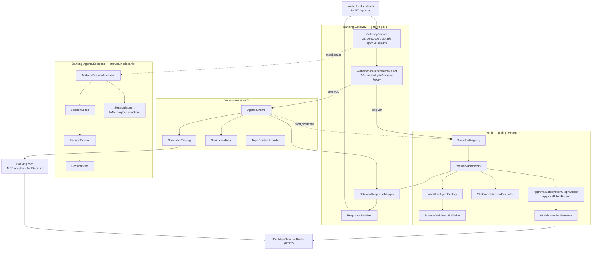
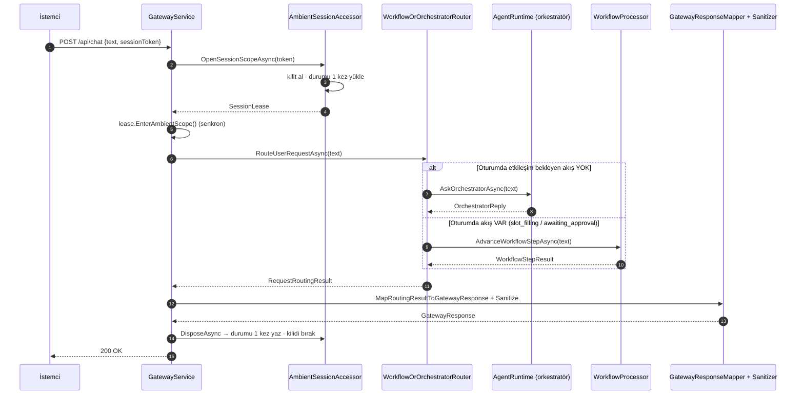
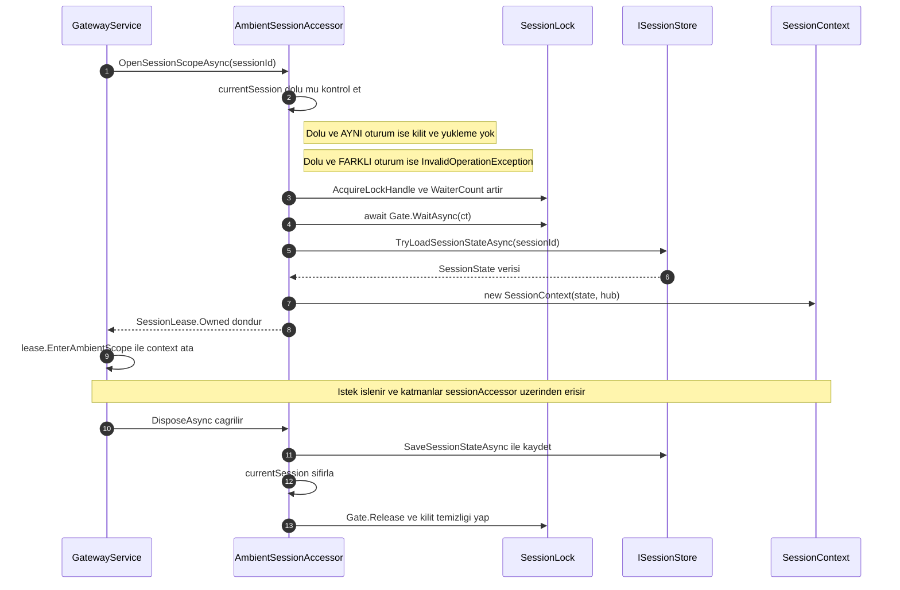
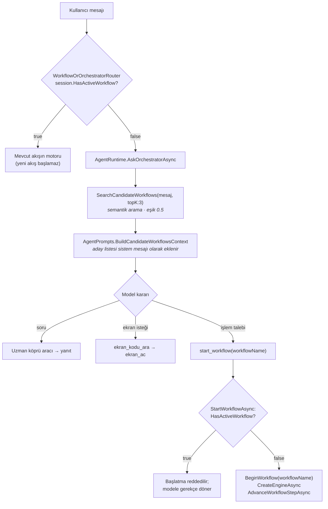
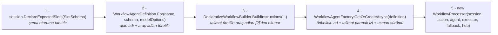
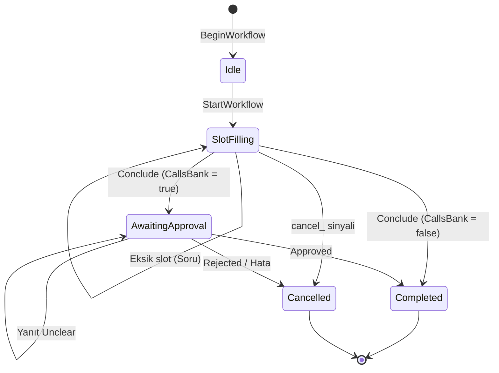
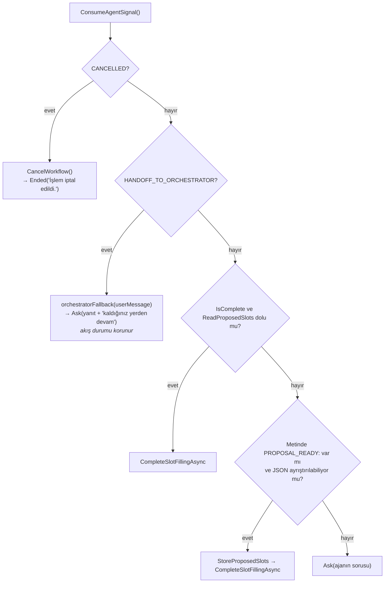
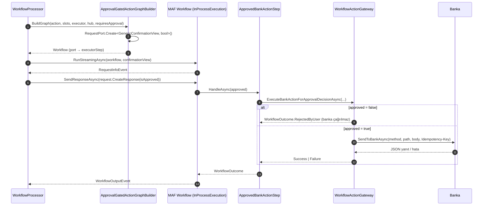
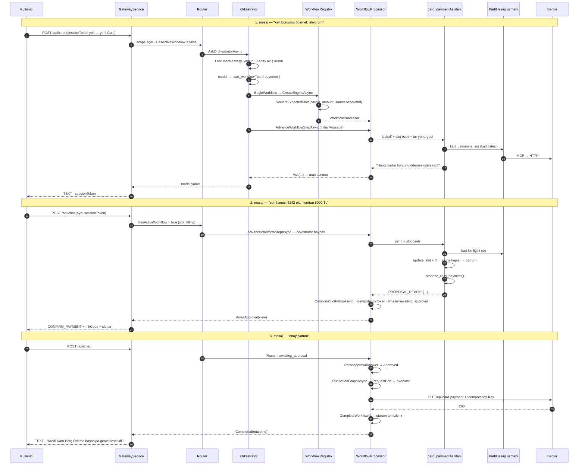

# Mimari ve Akış Analizi — MAF Agentic Bankacılık Asistanı

> **Yığın:** Microsoft Agent Framework (MAF) · .NET 9 · OpenAI uyumlu `IChatClient` · Model Context Protocol (MCP) · Agent-to-Agent (A2A) · ASP.NET Core Minimal API
>
> **Bu dokümanın odağı:** `oturum` (session), `oturum scope'u` ve `iş akışı`. Sistemin geri kalanı bu üçünün etrafında, onların ne zaman ve nasıl kurulduğunu açıklayacak kadar anlatılır.
>
> **Okuma sırası:** Bölüm 0 haritayı verir, Bölüm 1 her sınıfın işini tek cümlede listeler, Bölüm 3 oturumu ve scope'u, Bölüm 4–5 iş akışının başlatılmasını ve yürütülmesini derinlemesine açar. Bölüm 10 tüm önemli metotları tek tabloda toplar.
>
> **Sistem var olan bir bankaya agentic katman ekler.** `src/Banking.BankApi` geçici bir vekildir; bankaya giden her yol `IBankApiClient` üzerinden HTTP'dir.

---

## 0. Harita

### 0.1 Katmanlar



### 0.2 Bir isteğin tam yolu



---

## 1. Sınıf Kataloğu — hangi sınıf ne yapar

### 1.1 `Banking.Gateway` — giriş ve çıkış

| Sınıf | Görevi |
|---|---|
| `GatewayService` | İsteğin giriş, yanıtın **tek** çıkış noktası. Oturum scope'unu açar, yönlendiriciye devreder, sonucu UI protokolüne çevirir ve temizleyiciden geçirir. |
| `WorkflowOrOrchestratorRouter` | Deterministik yönlendirici: oturumda etkileşim bekleyen bir akış varsa mesajı motora, yoksa orkestratöre gönderir. Model bu kararda yer almaz. |
| `RequestRoutingResult` (record) | Yönlendirmenin sonucu; `ExecutionPath` hangi alanın dolu olduğunu belirler. |
| `GatewayResponseMapper` | `WorkflowStepResult` / `OrchestratorReply` → `GatewayResponse` dönüşümü. Bankacılık metni üretmez, akışın kendi mesajını taşır. |
| `ResponseSanitizer` | Deterministik çıktı bariyeri: araç adları, düşünce kalıpları, XML prompt etiketleri, sistem talimatı parçaları, iç endpoint'ler ve oturum jetonları temizlenir. |
| `GatewayRequest` / `GatewayResponse` / `GatewayResponseType` | Kablo üzerindeki istek/yanıt gösterimi. Yanıt düz JSON'dır; sabit dört alan dışındaki her değer `[JsonExtensionData]` ile kök seviyeye yazılır. |

### 1.2 `Banking.Agents/Sessions` — oturum durumuna dokunan tek yer

| Sınıf | Görevi |
|---|---|
| `SessionState` | Bir oturumun taşıdığı durumun tamamı. Saf veri tipi, davranış içermez. |
| `SessionContext` | Oturuma açılan **tek kapı**. Akış durumu, slotlar, onay ve konuşma geçmişi yalnızca buradan okunur ve yazılır. Metotları senkrondur. |
| `AmbientSessionAccessor` | `AsyncLocal` tabanlı ambient erişim + oturum başına kilit + tek okuma/tek yazma. Oturum kimliği katmanlar arasında parametre olarak taşınmaz. |
| `SessionLease` | Açılmış scope'un `IAsyncDisposable` tutamağı. `EnterAmbientScope()` ambient yapar, `DisposeAsync()` yazar ve kilidi bırakır. |
| `ISessionStore` | Kalıcılık soyutlaması. Tek çağıranı `AmbientSessionAccessor`'dır; dağıtık depoya geçişin tek DI satırı budur. |
| `InMemorySessionStore` | `IMemoryCache` üzerinde kayan TTL'li uygulama. Tahliye edilen yarım akışı ize yazar. |
| `SessionStoreOptions` | `Sessions:SlidingTimeToLiveMinutes` (varsayılan 30 dk). Sıfır/negatif değer istisna fırlatır. |
| `AgentConversationStore` | Ajan konuşma geçmişi ↔ oturum durumu arasındaki tek dönüşüm noktası (`ResumeOrCreateAsync` / `CaptureAsync`). |

### 1.3 `Banking.Agents/Workflows` — iş akışı motoru

| Sınıf | Görevi |
|---|---|
| `WorkflowRegistry` | Akış kataloğu **ve** motor fabrikası. Tek kayıt yolu MAF deklaratif YAML/JSON'dur. |
| `WorkflowProcessor` | Tüm akışların tek motoru. Generic değildir, akışa özgü tip içermez, durum tutmaz; her istekte yeniden yaratılır. |
| `WorkflowAgentFactory` | Akış ajanlarını kurar ve önbellekler; ajanın dört denetim aracını (`update_slot`, `propose_*`, `cancel_*`, `handoff_*`) üretir. |
| `WorkflowAgentDefinition` (record) | Ajan adı ve araç adlarının **tek türetildiği** yer (`For(workflowName, …)`). |
| `WorkflowAgentControlSignals` | Ajanın motora ilettiği sinyal sabitleri: `PROPOSAL_READY:`, `CANCELLED`, `HANDOFF_TO_ORCHESTRATOR`. |
| `OrchestratorFallback` (delegate) | Motorun orkestratöre devretme kanalı. Motor orkestratörü tanımaz, yalnızca bu imzaya bağımlıdır. |
| `SlotCollectionStatus` (record) | Slot kümesinin anlık durumu: dolu / eksik / opsiyonel; `IsComplete`, `ToProposedSlots`, `DescribeForAgentTurn`. |
| `SlotCompletenessEvaluator` (static, internal) | Toplanan değerler ile YAML şeması arasındaki saf karşılaştırma. Bağımlılığı, durumu, yan etkisi yoktur. |
| `SchemaValidatedSlotWriter` (`Validation/`) | `update_slot` aracının arkasındaki tek geçiş noktası. Yalnızca şema tipi denetlenir; bankacılık kuralı yoktur. |
| `ApprovalIntentParser` (static) | Onay yanıtını `Approved` / `Rejected` / `Unclear`'a çevirir. Önce olumsuzluk, sonra olumluluk aranır. |
| `ApprovalGatedActionGraphBuilder` (static) | MAF grafiğini kurar: `RequestPort` onay kapısı → `ApprovedBankActionStep`. |
| `ApprovedBankActionStep` (`Executor<bool, WorkflowOutcome>`) | Grafikteki tek yürütme düğümü; onay kararını girdi alır ve eylemi model müdahalesi olmadan çalıştırır. |
| `WorkflowActionGateway` | Sistemdeki **tek** executor. Onay ekranını kurar, onaylanırsa bankaya tek istek gönderir, yanıtı taşır. İstisna sızdırmaz. |
| `WorkflowActionDefinition` (record) | Akışın kimliği ve banka hedefi: `WorkflowName`, `MkCode`, `Method`, `Path`, `DisplayName`. `CallsBank` onay kapısının kurulup kurulmayacağını belirler. |
| `WorkflowStepResult` (record) | Bir adımın gateway'e taşınan sonucu. Fabrikaları: `Ask`, `AwaitApproval`, `Completed`, `Ended`. |
| `WorkflowOutcome` (record) | Tüm akışların ortak sonuç sözleşmesi. `UserMessage` zorunludur. Fabrikaları: `Success`, `RejectedByUser`, `Failure`. |
| `GenericConfirmationView` (record) | Onay ekranı görünümü + `ComputeIdempotencyToken` (SHA-256). |
| `DeclarativeWorkflowDefinition` ve alt tipleri | MAF deklaratif YAML/JSON şemasının C# karşılığı. Bu tipe eklenmeyen YAML alanı okunmaz. |
| `DeclarativeWorkflowBuilder` (static) | YAML/JSON ayrıştırma (`ParseFromYaml` / `ParseFromJson`) ve akış ajanının sistem talimatını üretme (`BuildInstructions`). |

### 1.4 `Banking.Agents/Runtime`, `Specialists`, `Mcp`, `Prompts`, `Tracing`

| Sınıf | Görevi |
|---|---|
| `AgentRuntime` | Orkestratörün yaşam döngüsü ve tek giriş noktası. Niyet analizi, aday akış araması ve `start_workflow` aracı burada. |
| `OrchestratorReply` (record) | Orkestratörün bir turdaki yanıtı + o turda tetiklenen araç adı ve argümanları. |
| `AgentOptions` | `Agents` yapılandırma bölümü: model, etiket→model haritası, sıcaklık, `SelfBaseUrl`, `UseA2AForSpecialists`, `AgentIdleTimeoutMinutes`. |
| `TracedChatClientFactory` | Etiket başına sohbet istemcisi çözer; istemciler model adına göre önbelleklenir ve `TracingChatClient` ile sarılır. |
| `AgentJsonPolicy` | C# ile yazılmış araçların (`AIFunctionFactory`) şema/sonuç serileştirme ayarları. |
| `NavigationTools` | Ekran araçları: `ekran_kodu_ara` (semantik) ve `ekran_ac`. Parametre adı uyumunu açılışta doğrular. |
| `TopicContextProvider` (`ContextProviders/`) | Orkestratöre önceki turun yanıtını bağlam olarak enjekte eder; `start_workflow` veya `ekran_ac` tetiklendiğinde bağlamı siler. |
| `SpecialistCatalog` | Uzmanların keşfi, kurulumu ve bağlanma biçiminin (A2A / süreç içi) tek yönetim noktası. |
| `AgentCard` (record) | Bir uzman hakkındaki tek doğruluk kaynağı: ad, açıklama, talimat, araç grubu/listesi, köprü aracı adı, A2A yolu. |
| `LazySpecialistAgent` | Süreç içi modda uzmanın yerine geçen vekil; hedefi her çağrıda adına göre çözer. |
| `SpecialistRoutingAgent` | Tek `/a2a/{route}` endpoint'inin arkasındaki dağıtıcı ajan. |
| `HesapUzmaniAgent` · `KartUzmaniAgent` · `AnalizUzmaniAgent` | Yalnızca statik `AgentCard Card` özelliği taşıyan derlenmiş uzmanlar. |
| `SpecialistDefinition` / `DeclarativeSpecialistBuilder` | Deklaratif uzman tanımının şeması ve ayrıştırıcısı. |
| `McpToolProvider` | Süreç içi MCP sunucusuna loopback HTTP ile bağlanan tek istemci; bağlantıda kayıt defterini doğrular. |
| `AgentPrompts` | Tüm ajan talimatlarının merkezi deposu; ortak koruma ve sunum blokları tek yerde. |
| `TraceHub` | İz olaylarının merkezi yayın noktası; hem `ILogger`'a yazar hem SSE abonelerine gönderir. |
| `TracingAIFunction` · `TracingChatClient` · `TraceHubBankApiObserver` | Araç çağrısı, model turu ve banka çağrısı dekoratörleri. |

### 1.5 `Banking.Domain`, `Banking.Mcp`, `Banking.BankApi.Client`, `Banking.Host`

| Sınıf | Görevi |
|---|---|
| `SemanticIndex<T>` | Sistemdeki tek vektör arama uygulaması; eleme sıralamadan ve kotadan **önce** yapılır. |
| `ISemanticIndexStore` / `InMemorySemanticIndexStore` | Hesaplanmış vektörlerin depolandığı seam; içerik değişmediyse yeniden vektörleştirme yapılmaz. |
| `SemanticWorkflowSearcher` | Akışları indeksler ve niyete en yakınları döner. Eşik `0.5` — sonuç karar değil aday listesidir. |
| `WorkflowMetadata` (record) | Semantik yönlendiricinin gördüğü akış metadatası: ad, açıklama, talimat. |
| `WorkflowPhases` · `WorkflowStatuses` · `ToolNames` · `TraceCategories` · `AgentConstants` | Evre, durum, araç adı ve iz kategorisi sabitleri. |
| `JsonPolicy` | Sistemin ürettiği tüm JSON'ın tek biçim kaynağı. |
| `ToolRegistry` | Araçların otomatik keşfi ve grup bazlı erişimi. DI'a kaydedilmez; `ToolRegistry.Instance` tek erişim yoludur. `ValidateDiscoveredMcpTools` uyuşmazlıkta fail-fast yapar. |
| `*Tools` sınıfları | `[McpServerTool]` metotlarıyla MCP araçları. Veriyi üretmezler; bankanın yanıtını taşırlar. |
| `BankApiToolGateway` | MCP araçlarının bankaya çıkış noktası. Banka hatası istisnaya dönüşmez, gerekçe `error` alanında modele taşınır. |
| `CustomerContext` | İsteği yapan müşterinin kimliği; sessiz varsayılanı yoktur. |
| `MkCodeCatalog` · `SemanticMkCodeSearcher` · `SemanticCampaignSearcher` · `SemanticFinancingSearcher` · `CampaignSyncService` | Bankadan beslenen katalog ve semantik arayıcılar. |
| `IBankApiClient` / `BankApiClient` | Sistemin bankaya açılan **tek** kapısı. |
| `ServiceRegistration` · `ApplicationStartupTasks` · `ApiEndpoints` · `DeclarativeDefinitionFileStore` | Kompozisyon kökü, açılış hazırlıkları, HTTP uçları ve deklaratif tanımların disk kalıcılığı. |

---

## 2. Uygulama Açılışı — ne, ne zaman kurulur

`Program.cs` yalnızca sırayı bilir:

```csharp
var agentOptions = builder.AddBankingAgents();                 // 1. tüm DI kayıtları
builder.WebHost.UseUrls($"http://*:{new Uri(agentOptions.SelfBaseUrl).Port}");  // 2. port
var app = builder.Build();
await app.LoadDeclarativeDefinitionsAsync();                   // 3. indeksler + YAML tanımlar
app.UseDefaultFiles(); app.UseStaticFiles();
app.MapBankingApi();                                           // 4. HTTP uçları
app.ScheduleAgentWarmUp();                                     // 5. ön ısıtma
app.Run();
```

**`LoadDeclarativeDefinitionsAsync`** — semantik indeksleri bankadan doldurur (banka ayakta değilse indeks boş kalır, ilk çağrı yeniden dener), `declarative-agents/*.yaml|json` dosyalarını `WorkflowRegistry`'ye kaydeder, akış indeksini vektörleştirir, ardından `specialist-agents/*.yaml|json` dosyalarını kaydeder. **Bozuk bir tanım açılışı durdurmaz**; gerekçesi loglanır.

**`ScheduleAgentWarmUp`** — `ApplicationStarted` olayında arka planda `AgentRuntime.EnsureReadyAsync()` çağrılır. Daha erken tetiklenemez: uzman kurulumu süreç içi MCP sunucusuna loopback bağlanır ve sunucu henüz dinlemiyordur.

### 2.1 Ömür tablosu — hangi nesne ne zaman doğar

| Nesne | Ömür | Ne zaman doğar |
|---|---|---|
| `AmbientSessionAccessor`, `ISessionStore`, `WorkflowRegistry`, `WorkflowAgentFactory`, `WorkflowActionGateway`, `GatewayService`, `AgentRuntime`, `SpecialistCatalog` | **Singleton** | DI kaydında |
| Orkestratör ajanı (`ChatClientAgent`) | Singleton, sürüm bağımlı | İlk `EnsureReadyAsync`'te; yalnızca `SpecialistCatalog.Version` değişirse yeniden kurulur |
| Uzman ajanları | `IMemoryCache`, kayan `AgentIdleTimeout` (20 dk) | İlk `GetSpecialistAsync` çağrısında; boşta kalırsa tahliye edilir, sonraki istekte yeniden kurulur |
| Akış ajanları | `IMemoryCache`, aynı desen | İlk `GetOrCreateAsync`'te; talimat parmak izi veya uzman sürümü değişirse yeniden kurulur |
| **`SessionContext` / `SessionLease`** | **İstek başına** | `GatewayService.ProcessUserRequestAsync` içinde |
| **`WorkflowProcessor`** | **İstek başına** | `WorkflowRegistry.CreateEngineAsync` çağrıldığında |
| `SessionState` | Oturum başına, kayan TTL (30 dk) | İlk istekte üretilir, her scope kapanışında depoya yazılır |

Motorun ve bağlamın istek başına yaratılması tasarım gereğidir: motor o isteğin `SessionContext`'ine bağlanır ve kendi durumunu tutmaz.

---

## 3. Oturum, Scope ve Durum

Bu bölüm dokümanın çekirdeğidir. Sistemdeki tek değişken durum oturumdur; ajan nesneleri singleton ve stateless'tır.

### 3.1 `SessionState` — oturumun taşıdığı her şey

Saf veri tipi. Ajanlar kullanıcıya özel hiçbir alan tutmadığından her değer buradadır.

| Alan | Tip | Ne taşır | Akış kapanınca |
|---|---|---|---|
| `SessionId` | `string` | Oturum kimliği | korunur |
| `ActiveWorkflowName` | `string?` | Aktif akışın kanonik adı (`card-payment`) | `null` |
| `Phase` | `string` | `idle` / `slot_filling` / `awaiting_approval` / `completed` / `cancelled` | son evre |
| `SlotValues` | `Dictionary<string, object?>` | Toplanan ham slot değerleri | temizlenir |
| `ExpectedSlots` | `Dictionary<string, DeclarativePropertyConfig>?` | Akışın YAML şeması: ad → tip + zorunluluk | `null` |
| `ProposedSlots` | `Dictionary<string, object?>?` | Onaya **açıkça** sunulmuş küme | `null` |
| `PendingConfirmation` | `GenericConfirmationView?` | Onay ekranına gönderilen görünüm | `null` |
| `IdempotencyToken` | `string?` | Teklifin parmak izi — çift tıklama koruması | `null` |
| `CompletedOutcome` | `WorkflowOutcome?` | Bu anahtar için üretilmiş sonuç | `null` |
| `SerializedOrchestratorSession` | `JsonElement?` | Orkestratörün konuşma geçmişi | **`null`** |
| `SerializedWorkflowSession` | `JsonElement?` | Akış ajanının konuşma geçmişi | `null` |
| `LastUserMessage` | `string?` | Bu isteğin mesajı; `start_workflow` aracı okur | **korunur** |
| `PendingAgentSignal` | `string?` | Akış ajanının bu turda bıraktığı denetim sinyali | `null` |
| `LastUpdatedAt` | `DateTimeOffset` | Depoya son yazılma anı | güncellenir |

İki ayrım bilerek korunur:

- **`ExpectedSlots` ≠ `ProposedSlots`.** Birincisi "ne bekleniyor", ikincisi "ne sunuldu" bilgisidir. Aynı alanda birleşmeleri, onay ekranının boş değerlerle üretilmesine yol açar.
- **`SerializedOrchestratorSession` akış kapanınca silinir.** Akış boyunca yönlendirici orkestratörü baypas ettiğinden geçmişinde kalan son şey *"`start_workflow` çağırdım, araç bir soru döndürdü"*tur. Bu temizlenmezse tamamlanmış bir ödemeden sonraki mesaj o yanıtsız sorunun cevabı olarak okunur.

### 3.2 `SessionContext` — oturuma açılan tek kapı

Oturum verisine erişen her katman bu tipten geçer. Metotları **senkrondur**: veri bellektedir, I/O yoktur.

**Akış durumu**

| Üye | Ne yapar |
|---|---|
| `SessionId` | Bu scope'un oturum kimliği |
| `ActiveWorkflowName` | Aktif akışın adı; akış yoksa `null` |
| `Phase` (get/set) | Akışın evresi |
| `HasActiveWorkflow` | `ActiveWorkflowName is not null && Phase ∈ {slot_filling, awaiting_approval}` — **yönlendirme kararının tek girdisi** |
| `LastUserMessage` (get/set) | Kullanıcının bu istekteki mesajı |
| `BeginWorkflow(workflowName)` | Akışı oturuma bağlar, evreyi `idle` yapar, ize yazar. Boş ad kabul etmez |
| `CompleteWorkflow()` | Akışı başarıyla sonlandırır → `ResetWorkflow(completed, …)` |
| `CancelWorkflow()` | Akışı iptal eder → `ResetWorkflow(cancelled, …)`. Hiçbir eylem çalışmaz |
| `RaiseAgentSignal(signal)` | Ajanın araç çağrısıyla bıraktığı denetim sinyalini kaydeder |
| `ConsumeAgentSignal()` | Bekleyen sinyali okur **ve siler**; sinyal yalnızca üretildiği tur boyunca geçerlidir |

**Slotlar**

| Üye | Ne yapar |
|---|---|
| `SetSlot(name, value)` | Tek slot değerini yazar (büyük/küçük harf duyarsız) |
| `GetSlotCollectionStatus()` | `SlotCompletenessEvaluator` ile dolu/eksik/opsiyonel ayrımını hesaplar ve ize yazar |
| `StoreProposedSlots(workflowName, slots)` | Teklifi saklar **ve** `null` olmayan değerleri toplanan değerlere geri yazar |
| `DeclareExpectedSlots(schema)` | Akışın YAML şemasını oturuma tanıtır; akış her başladığında yeniden yazılır |
| `ReadProposedSlots()` | Onaya sunulmuş kümeyi döner; teklif yoksa `null` |

**Onay, idempotency ve konuşma geçmişleri**

`PendingConfirmation`, `IdempotencyToken`, `CompletedOutcome`, `OrchestratorConversation`, `WorkflowConversation` — hepsi get/set property'dir ve doğrudan `SessionState`'e yazar.

**`ResetWorkflow(finalPhase, traceMessage)` (private)** — akış durumunun tamamını, slotları, şemayı, teklifi, onay görünümünü, idempotency anahtarını, sonucu, bekleyen sinyali, akış ajanı geçmişini **ve** orkestratör geçmişini temizler. Tek kapı budur; `CompleteWorkflow` ve `CancelWorkflow` yalnızca son evreyi ve iz metnini farklılaştırır.

### 3.3 Scope nasıl, nerede ve ne zaman oluşur

**Nerede:** `GatewayService.ProcessUserRequestAsync` — kod tabanında `OpenSessionScopeAsync`'in **tek çağrı yeri**.

**Ne zaman:** Her HTTP isteğinin en başında, yönlendirme kararı verilmeden önce.

**Nasıl — iki adım, ve bu ayrım zorunludur:**

```csharp
var sessionToken = NormalizeSessionToken(request.SessionToken);   // boşsa Guid.NewGuid("D")

var lease = await sessionAccessor.OpenSessionScopeAsync(sessionToken, cancellationToken);
await using var session = lease.EnterAmbientScope();
```

`OpenSessionScopeAsync` **async**, `EnterAmbientScope` **senkron**. Ayrım kaprisli değil: `AsyncLocal` ataması bir `async` metodun içinde yapılırsa çağırana yayılmaz ve devamındaki `Current` erişimleri istisna fırlatır. `EnterAmbientScope` asla `async` yapılmaz.



Scope'un verdiği üç garanti:

| Garanti | Nasıl sağlanır | Neyi mümkün kılar |
|---|---|---|
| **İzolasyon** | Farklı bir oturumla iç içe scope açmak `InvalidOperationException` fırlatır | Bir kullanıcının verisi başkasına ulaşamaz |
| **Tek okuma / tek yazma** | Durum açılışta bir kez yüklenir, kapanışta bir kez yazılır; ara katmanlar depoya erişmez | Dağıtık depoya geçişte bir katmanın diğerinin yazımını ezmesi imkânsız |
| **Oturum başına serileştirme** | Oturuma özel `SemaphoreSlim` | Onay düğmesine çift tıklama güvenli |

`CloseSessionScopeAsync` yazma çağrısını `CancellationToken.None` ile yapar: **istek iptal edilse veya hata alsa da o ana kadarki ilerleme kaydedilir**.

Kilit tablosu sınırsız büyümez: `AcquireLockHandle` bekleyen sayacını artırır, `ReleaseLockHandle` sıfıra düştüğünde kilidi sözlükten siler ve `Dispose` eder.

### 3.4 Scope ne taşır, kimler görür

Scope bir nesne taşımaz — bir **ambient erişim hakkı** taşır. Aşağıdaki bileşenler `sessionAccessor.Current` üzerinden oturuma ulaşır; hiçbirine oturum kimliği parametre olarak verilmez:

| Erişen | Ne için |
|---|---|
| `WorkflowOrOrchestratorRouter` | `HasActiveWorkflow` + `ActiveWorkflowName` — yönlendirme kararı |
| `AgentRuntime.AskOrchestratorAsync` | `LastUserMessage` yazımı, `HasActiveWorkflow` okuması, konuşma geçmişi |
| `AgentRuntime.StartWorkflowAsync` (LLM aracı) | Aktif akış kontrolü, `LastUserMessage` okuması, `BeginWorkflow` |
| `WorkflowRegistry.BuildEngineAsync` | `DeclareExpectedSlots` + motorun bağlanacağı bağlam |
| `SchemaValidatedSlotWriter` (`update_slot`) | `SetSlot` |
| `WorkflowAgentFactory` (`propose_*`, `cancel_*`, `handoff_*`) | `GetSlotCollectionStatus`, `StoreProposedSlots`, `RaiseAgentSignal` |
| `WorkflowProcessor` | Yapıcıya `SessionContext` olarak verilir (accessor'a değil, bağlamın kendisine bağlıdır) |

**Oturum kimliğinin araca parametre olarak verilmemesi bir güvenlik kararıdır.** `update_slot(key, value)` imzasında oturum argümanı yoktur; hangi oturuma yazılacağını modelin ürettiği bir metin belirleyemez.

**A2A sınırı.** Uzmanlara A2A üzerinden gidildiğinde çağrı ayrı bir HTTP isteğidir ve o istekte ambient oturum yoktur. Uzmanlar `SessionContext`'e hiç dokunmadığından iki taşıma modu (süreç içi / A2A) aynı davranır; uzmanın işi banka verisi getirmektir, oturum durumu değil.

### 3.5 Kalıcılık ve yaşam süresi

`InMemorySessionStore`, `IMemoryCache` üzerinde `banking-session:{sessionId}` anahtarıyla kayan TTL kullanır (`Sessions:SlidingTimeToLiveMinutes`, varsayılan 30 dk). Süre son **istekten** itibaren işler; aktif bir akışın tamamı bu pencerenin içinde geçer.

`PublishEviction` geri çağrımı, tahliye edilen oturumda yarım kalan bir akış varsa akış adını ve evresini ize yazar. Geri çağrım oturum scope'unun dışında çalışır; bu yüzden orada oturuma bağlı bileşen kullanılmaz.

`ISessionStore` sistemde kalan **tek tek-uygulamalı arayüzdür** ve bilerek korunmuştur: çok örnekli dağıtımın gerektireceği dağıtık depoya geçiş tek DI satırıdır, `ValueTask` imzaları da bunun içindir.

### 3.6 Konuşma geçmişi — ajanlar neden stateless

Ajan nesneleri singleton'dır. Kullanıcıya özel konuşma, ajanın içinde değil oturumda **serileştirilmiş** olarak durur. Her model turu aynı iki adımı yapar:

```csharp
var restored = await AgentConversationStore.ResumeOrCreateAsync(agent, session.WorkflowConversation, ct);
var response  = await agent.RunAsync(message, restored.Session, cancellationToken: ct);
session.WorkflowConversation = await AgentConversationStore.CaptureAsync(agent, restored.Session, ct);
```

- `ResumeOrCreateAsync` — kayıt yoksa veya okunamıyorsa yeni konuşma açar; okunamayan geçmiş istisnaya dönüşmez, nedeni `RestoreFailure` alanında taşınır ve çağıran kendi kanalına (log veya canlı iz) yazar.
- `CaptureAsync` — `JsonElement.Clone()` zorunludur; değer, altındaki `JsonDocument`'ten bağımsız olarak oturum ömrü boyunca saklanır.

İki ayrı geçmiş tutulur: `OrchestratorConversation` ve `WorkflowConversation`. Akış kapandığında **ikisi de** silinir.

---

## 4. İş Akışının Başlatılması — kim, nerede, nasıl, hangi parametreyle

### 4.1 Karar zinciri

Bir akışın başlaması dört kapıdan geçer. Her kapı bir öncekinin kararını daraltır; hiçbiri diğerinin yerine geçmez.



**Kararı model verir, arama değil.** `SearchCandidateWorkflows` yalnızca bir **ad sözlüğü** üretir. Vektör benzerliği *konu* yakınlığını ölçer, *niyeti* değil: "Kartımın kullanılabilir limiti nedir?" bir sorudur ama limit artırım akışına yüksek skor verir. Soru ile talebi ayırma kuralı orkestratörün talimatındadır (`SORU İLE TALEBİ AYIR`) ve ancak cümleyi okuyarak uygulanabilir. Aramanın kazandırdığı şey karar değil **kapsam daraltmadır**: akış adları sistem talimatına gömülmediği için çalışma zamanında kaydedilen bir akış da o anda yönlendirilebilir olur.

Aday listesi, modele yazacağı parametre adıyla (`workflowName`) etiketlenir ve şu kısıtla verilir: *`start_workflow` aracının `workflowName` parametresine yalnızca yukarıdaki değerlerden birini yaz.*

**Aktif akış varken aday listesi verilmez** (`AskOrchestratorAsync` içinde `session.HasActiveWorkflow ? [] : …`). Bu, akış ajanının `handoff_*` ile orkestratöre devrettiği turlarda geçerlidir; yarım kalmış bir işlemin konu dışı bir soruyla düşürülmesi böyle engellenir.

### 4.2 Parametreler nereden, ne zaman alınır

`start_workflow` aracının imzası tek parametrelidir: `StartWorkflowAsync(string workflowName, CancellationToken)`. Motorun ihtiyaç duyduğu diğer iki girdi araç imzasında değil, oturumdan okunur.

| Girdi | Kaynağı | Ne zaman yazılır | Nerede okunur |
|---|---|---|---|
| `workflowName` | **Model**, `start_workflow` argümanı olarak | Model turu sırasında | `StartWorkflowAsync` parametresi |
| `initialMessage` (kullanıcının akışı tetikleyen cümlesi) | `SessionState.LastUserMessage` | `AskOrchestratorAsync` başında, model turundan **önce** | `StartWorkflowAsync` içinde; boşsa `"İş akışı başlatılıyor"` |
| Slot şeması (`ExpectedSlots`) | Akışın YAML tanımı: `outputSchema.properties ?? inputSchema.properties` | Akış kaydında (`RegisterDeclarativeWorkflow`) | `BuildEngineAsync` → `session.DeclareExpectedSlots(...)` |
| `WorkflowActionDefinition` (mkCode, HTTP metodu, yol, görünen ad) | YAML: `mkCode`, `action.method`, `action.path`, `displayName` | Akış kaydında | `BuildEngineAsync` → motorun yapıcısı |
| Model ayarları (`temperature`, `topP`) | YAML: `model.options` | Akış kaydında | `WorkflowAgentDefinition.For` |
| Ajan talimatı | YAML: `description` + `instructions` + şema + ortak slot kuralları | Motor kurulumunda, her istekte yeniden üretilir | `DeclarativeWorkflowBuilder.BuildInstructions` |

`LastUserMessage`'ın oturumda tutulmasının nedeni ajanların singleton olmasıdır: mesaj bir alanda saklanamaz, oturuma yazılır.

### 4.3 Başlatma adımları

`AgentRuntime.StartWorkflowAsync` — LLM aracı olarak kayıtlıdır, `TracingAIFunction` ile sarılıdır:

```csharp
// 1. Aktif iş akışı kontrolü — yarım işlemin düşürülmesini engeller
if (sessionAccessor.Current.HasActiveWorkflow)
    return "Şu anda devam eden bir işlem var; yeni bir işlem başlatılamaz. …";

// 2. Tetikleyici cümle oturumdan alınır
var initialMessage = sessionAccessor.Current.LastUserMessage is { Length: > 0 } message
    ? message : "İş akışı başlatılıyor";

// 3. Akış oturuma bağlanır: ActiveWorkflowName = ad, Phase = idle
sessionAccessor.Current.BeginWorkflow(workflowName);

// 4. Bu isteğe ait motor kurulur ve ilk adım atılır
var engine     = await workflowRegistry.CreateEngineAsync(workflowName);
var stepResult = await engine.AdvanceWorkflowStepAsync(initialMessage, cancellationToken);

// 5. İlk soru ARAÇ SONUCU olarak modele döner
return stepResult.Prompt ?? $"{workflowName} iş akışı başlatıldı.";
```

Dikkat edilecek iki nokta:

- **`BeginWorkflow` evreyi `slot_filling` değil `idle` yapar.** Evreyi `slot_filling`'e taşıyan `WorkflowProcessor.StartWorkflowAndCollectFirstSlotsAsync`'tir. Yani "akış kayıtlı ama henüz ilk adım atılmadı" durumu evrede görünür.
- **Akışın ilk sorusu kullanıcıya orkestratörün ağzından ulaşır.** `start_workflow` bir araçtır; döndürdüğü metin model turuna araç sonucu olarak girer ve model onu kullanıcıya sunar. İkinci mesajdan itibaren yönlendirici orkestratörü baypas eder ve motor doğrudan çalışır.

### 4.4 Motor kurulumu — `WorkflowRegistry.BuildEngineAsync`

Sıra bağlayıcıdır:



`WorkflowAgentDefinition.For` ad türetmenin **tek** yeridir; `card-payment` akışı için:

| Üretilen ad | Değer |
|---|---|
| Ajan adı | `card_paymentAsistani` |
| Teklif aracı | `propose_card_payment` |
| İptal aracı | `cancel_card_payment` |
| Devretme aracı | `handoff_card_payment` |

Aynı türetme kuralının ikinci bir yerde bulunması, talimattaki araç adıyla kayıtlı araç adının ayrışmasına ve akışın hata üretmeden durmasına yol açar; bu yüzden `BuildInstructions` adları yeniden türetmez, `agentDefinition`'dan okur.

Motorun devretme kanalı `Lazy<OrchestratorFallback>` ile geç çözülür: motor → orkestratör → motor döngüsel bağımlılığını kıran nokta budur.

---

## 5. İş Akışının Yürütülmesi — evre makinesi

### 5.1 Evreler



`WorkflowProcessor.AdvanceWorkflowStepAsync` tek genel metottur ve evreyi **oturumdan okur**; çağıranın evreyi bilmesi veya taşıması gerekmez:

```csharp
session.Phase switch
{
    WorkflowPhases.AwaitingApproval => ApplyApprovalDecisionAsync(userMessage, ct),
    WorkflowPhases.SlotFilling      => CollectSlotsAsync(userMessage, ct),
    _                               => StartWorkflowAndCollectFirstSlotsAsync(userMessage, ct)
};
```

### 5.2 Slot doldurma turu

`StartWorkflowAndCollectFirstSlotsAsync` ve `CollectSlotsAsync` aynı iskeleti paylaşır: kullanıcının mesajına **oturumdan hesaplanan slot özeti** ve **tur yönergesi** eklenir, ajan bir tur çalıştırılır, çıktı yorumlanır.

```
{kullanıcı mesajı}

(Dolu Parametreler: [cardId=CARD-2002]. Eksik Zorunlu Parametreler: [amount, sourceAccountId].)

(Bu mesajda dayanağı olan parametrelerin hepsini şimdi kaydet; kalan eksikleri tek mesajda sor.)
```

Eksik slot bilgisi **ajanın hafızasına değil oturum durumuna dayanır**; özet her tura yeniden hesaplanarak eklenir.

**Akış ajanının araç kümesi** (`WorkflowAgentFactory.BuildTools`): uzman köprüleri + dört denetim aracı.

| Araç | Ne yapar | Motora ne söyler |
|---|---|---|
| `update_slot(key, value)` | Değeri `SchemaValidatedSlotWriter`'dan geçirip oturuma yazar | — (yalnızca durum değişir) |
| `propose_{ad}()` | Slotlar tamsa `ToProposedSlots()` kümesini oturuma yazar | `PROPOSAL_READY:` + JSON |
| `cancel_{ad}()` | `RaiseAgentSignal` | `CANCELLED` |
| `handoff_{ad}()` | `RaiseAgentSignal` | `HANDOFF_TO_ORCHESTRATOR` |

**Akış ajanı banka verisine doğrudan erişmez.** Kayıt listesi, tutar ve durum gibi her bilgiyi uzman köprü araçlarıyla sorar; erişim kapsamı ilgili uzmanın araç listesiyle sınırlıdır. Bir akış tanımı yazmak, o akışa banka araçlarının tamamını açmak anlamına gelmez.

**Ajanın üç çıkışı da araçtır, cümle değil.** Model araç sonucunu yanıt metnine kopyalamaz; kararı metinde aramak iptal ve devretme yollarını ölü koda çevirir. Çıkışı olmayan bir ajan konu dışı mesaj karşısında eksik slot değerini **uydurur** — `AgentPrompts.BuildSlotFillingRules` içindeki "asla değer uydurma" kuralı bu çıkışlarla birlikte anlam kazanır.

### 5.3 Tur çıktısının yorumlanması — sıra bağlayıcıdır

`InterpretAgentOutputAsync`:



**Devretme, teklif kontrollerinden önce gelir.** Konu dışı bir turda toplanan slotlara dokunulmamıştır; onlarla onay ekranı açmak kullanıcıyı istemediği bir işlemin onayına götürür.

### 5.4 Slot tamlığı — `SlotCompletenessEvaluator`

Saf karşılaştırma katmanı: bağımlılığı, durumu ve yan etkisi yoktur.

| Metot | Ne yapar |
|---|---|
| `DetermineSlotCollectionStatus(slotValues, expectedSlots)` | Dolu / eksik / opsiyonel ayrımını yapar |
| `ResolveSlotNames(...)` | Toplanan anahtarlar ∪ şemadaki slotlar — şemada olmayan ama model tarafından yazılmış anahtarlar da görünür kalır |
| `IsRequiredSlot(...)` | Şemada tanımlı olmayan slot zorunlu sayılmaz; `required` belirtilmemişse `true` |
| `IsMeaninglessValue(value)` | Boş metin ya da sıfır/negatif sayı — "var ama anlamsız" değerler dolu sayılmaz |

`SlotCollectionStatus.IsComplete` bir **C# karşılaştırmasıdır**, modelin kanaati değil. Opsiyonel slotlar tamlığı etkilemez.

`DescribeForAgentTurn()` bu durumu ajanın turuna eklenen tek satırlık özete, `DescribeMissingSlots()` ise teklif reddedildiğinde ajana dönen gerekçeye çevirir.

### 5.5 Şema kapısı — `SchemaValidatedSlotWriter`

Oturuma yazılan her slot değeri buradan geçer. `WriteSlotIfSchemaAccepts(slotName, value)`:

1. `FindDeclaredType(slotName)` — YAML'daki tipi bulur (büyük/küçük harf duyarsız). Şema yoksa veya slot şemada yoksa kısıt uygulanmaz.
2. `MatchesDeclaredType(...)` — `string` / `number` / `integer` / `boolean` / `object` / `array` eşlemesi. `null` bir tip hatası **değildir**; eksiklik ayrı bir konudur.
3. Uymuyorsa **yazılmaz**, gerekçe araç sonucu olarak ajana döner: *"REJECTED: … Değeri bu tipte yeniden gönder; emin değilsen kullanıcıya tekrar sor, kendin bir değer uydurma."*

`ResolveValueKind` ayrımı `JsonElement.ValueKind` üzerinden yapar, `GetType()` ile değil: `update_slot`'un `value` parametresi `object` olduğundan JSON'dan gelen değer her zaman bir `JsonElement`'tir.

**Uygulanan tek kural şema uyumudur.** Yetersiz bakiye, borcu aşan tutar ve geçersiz IBAN denetimleri bankanın uçlarına aittir. **Değer dönüştürülmez, reddedilir** — uymayan bir değerin biçimlendirilerek kabul edilmesi, kullanıcının söylemediği bir değeri onay ekranına taşır.

Tip bilgisinin modele ulaştığı tek kanal araç açıklamasıdır (`DescribeExpectedTypes`): `update_slot`'un `value` parametresi `object` olduğundan tek bir şema düğümü slot başına farklı tip ifade edemez. Açıklama yönlendirmedir; **zorlama şema kapısında yapılır**.

### 5.6 Onay kapısı (HITL)

**`CompleteSlotFillingAsync`** — parametreler tamamlandığında:

```csharp
var confirmationView = actionGateway.BuildConfirmationView(action, slots);

session.StoreProposedSlots(confirmationView.WorkflowName, slots);
session.PendingConfirmation = confirmationView;
session.IdempotencyToken    = GenericConfirmationView.ComputeIdempotencyToken(confirmationView);
session.CompletedOutcome    = null;

if (!action.CallsBank)                       // YAML'da action.path yok
{
    var outcome = await RunActionGraphAsync(slots, confirmationView, isApproved: true, ct);
    session.CompletedOutcome = outcome;
    return FinishWorkflow(outcome);           // onay kapısı hiç kurulmaz
}

session.Phase = WorkflowPhases.AwaitingApproval;
return WorkflowStepResult.AwaitApproval(session.SessionId, confirmationView);
```

**Onay kapısının kurulup kurulmayacağını akış adı değil `action.CallsBank` belirler** — yani YAML'ın `action.path` alanını tanımlayıp tanımlamadığı. Bankayı hiç çağırmayan bir akışın onaylanacak bir şeyi yoktur; onu ödeme onay ekranına yönlendirmek kullanıcıya gerçekleşmeyecek bir eylem gösterir. **Yolu olan bir akışta kapı asla atlanmaz.**

**`ApplyApprovalDecisionAsync`** — kullanıcının yanıtını uygular:

| Durum | Sonuç |
|---|---|
| `ApprovalIntent.Unclear` | Onay **sayılmaz**; akış onay evresinde bekletilir, soru tekrarlanır |
| `ProposedSlots` veya `PendingConfirmation` yok | Oturum zaman aşımı → `CancelWorkflow` + "Lütfen işlemi yeniden başlatın." |
| `CompletedOutcome` dolu **ve** idempotency anahtarı aynı | Eylem **yeniden çalıştırılmaz**, saklanan sonuç döner |
| Diğer | `RunActionGraphAsync(slots, view, intent == Approved, ct)` |

`ApprovalIntentParser.ParseApprovalAnswer` sırası bağlayıcıdır: `h`/`e` kısayolları → **olumsuzluk kalıpları** → olumluluk kalıpları → `Unclear`. Türkçede olumsuzluk eki fiilin içindedir ("onaylamıyorum"); olumluluk önce aranırsa olumsuz bir yanıt onay okunur. Normalizasyon `tr-TR` kültürüyle yapılır ("İPTAL" → "iptal").

**`RunActionGraphAsync`** — MAF grafiğini kurar ve tek HTTP isteğinin içinde çalıştırır:



Grafik ve çalıştırma **aynı istek içindedir**; sunucuda askıda kalan bir çalıştırma ve yapışkan oturum gereksinimi yoktur. Executor istisnaları çağırana fırlamaz, event akışına düşer; bu yüzden `ExecutorFailedEvent` ve `WorkflowErrorEvent` açıkça ele alınır ve gerekçe kullanıcıya taşınır.

**Idempotency tek yerde hesaplanır.** `GenericConfirmationView.ComputeIdempotencyToken` akış adı + sıralı slotlardan SHA-256 üretir. Motor bu değeri oturuma yazarak ikinci onayı tanır; executor aynı değeri bankaya `Idempotency-Key` başlığı olarak gönderir. Oturum kilidiyle birlikte, onaya çift tıklama tam olarak bir para hareketi üretir.

### 5.7 Eylem — `WorkflowActionGateway`

Sistemdeki tek executor; durumsuz ve singleton. Akışın kimliği ve hedefi her çağrıda `WorkflowActionDefinition` ile gelir; yeni bir akış bu sınıfta değişiklik gerektirmez.

| Metot | Ne yapar |
|---|---|
| `BuildConfirmationView(action, slots)` | Onay ekranını YAML'da tanımlı slotlardan kurar |
| `ExecuteBankActionForApprovalDecisionAsync(action, slots, approved, ct)` | Onay yoksa bankaya istek atmaz; onay varsa gövdeli tek istek gönderir |
| `ReadAllFields(response)` | Bankanın döndürdüğü tüm alanları sonuç detayına aktarır; içerik yorumlanmaz |

**Hiçbir koşulda istisna sızdırmaz.** Üç hata dalı ayrı ayrı yakalanır:

| Durum | Davranış |
|---|---|
| `BankApiException` · `404` | Tanımdaki `action.path` bankada yok — ize ayrı bir **uyarı** satırı düşer; bu bir yapılandırma hatasıdır, sıradan işlem reddi değil |
| `BankApiException` (diğer) | Bankanın kendi gerekçesi kullanıcıya taşınır |
| `HttpRequestException` | "Bankaya şu anda ulaşılamıyor." |

Gövde anahtarları **YAML'daki slot adlarının birebir aynısıdır**; bankanın sözleşmesindeki alan adlarıyla eşleşmezlerse alan `null` olarak ulaşır.

### 5.8 Akışın kapanışı

`FinishWorkflow(outcome)`:

- `outcome.IsSuccess` → `CompleteWorkflow()` + `WorkflowStepResult.Completed`
- değilse → `CancelWorkflow()` + `WorkflowStepResult.Ended` (gerekçe `outcome.UserMessage`'da)

İkisi de `ResetWorkflow` üzerinden geçer; §3.1'deki tablonun son sütunu neyin temizlendiğini gösterir.

---

## 6. Çıkış — yanıtın UI'a dönüşü

**`GatewayResponseMapper.MapRoutingResultToGatewayResponse`**

| Girdi | Yanıt tipi |
|---|---|
| `WorkflowStatuses.Question` | `TEXT` — slot doldurma sorusu |
| `WorkflowStatuses.Confirmation` | `CONFIRM_PAYMENT` + `MkCodeCatalog`'dan çözülen ekran kodu + slotlar kök seviyede |
| `WorkflowStatuses.Completed` | `TEXT` — akışın kendi sonuç mesajı |
| `WorkflowStatuses.Cancelled` | `TEXT` |
| Orkestratör + `ekran_ac` | `OPEN_SCREEN` + hedef `mkCodeValue` |
| Orkestratör (diğer) | `TEXT` |

`BuildConfirmationScreen` ekran kodu çözülemediğinde **tahmin yapmaz**: akış adı olduğu gibi iletilir ve durum uyarı olarak loglanır. Ekran yönlendirme hedefi `ToolNames.OpenScreenTargetParameter` (`targetMkCode`) anahtarıyla okunur; aracın parametre adıyla uyumu açılışta `NavigationTools.EnsureOpenScreenParameterName` ile doğrulanır.

**`GatewayService.FinalizeResponse`** — yanıta oturum jetonunu ekler ve `ResponseSanitizer`'dan geçirir. Tüm yanıtların tek çıkış noktasıdır; temizlenmemiş hiçbir metin istemciye ulaşmaz.

`ResponseSanitizer.Sanitize(text, sessionToken)` altı kategoriyi **bağlayıcı sırayla** uygular: XML blokları → eşsiz XML etiketleri → araç adı geçen cümleler → düşünce süreci kalıpları → sistem talimatı parçaları → dahili endpoint'ler → oturum jetonu maskesi. Blok yapıları satır bazlı kalıplardan önce temizlenmezse blok içeriği metinde kalır. Jeton eşleşmesi biçime değil **değere** bakar; bir GUID biçim kalıbı bankanın döndürdüğü meşru kimlikleri de maskeler. Temizlik sonrası metin tamamen boşalırsa güvenli varsayılan yanıt döner.

> **Bakım notu:** XML etiket listesi elle tutulur. Prompt'a yeni bir etiket eklerken `XmlTagPattern` ve `XmlBlockPattern`'e de eklenmelidir; unutulan etiket yakalanmaz.

Yanıt yazıldıktan sonra `await using` bloğu kapanır: `SessionLease.DisposeAsync` → `CloseSessionScopeAsync` → durum depoya **bir kez** yazılır, ambient oturum temizlenir, kilit bırakılır.

---

## 7. Yol A — Orkestratör hattı

### 7.1 `AgentRuntime`

| Metot | Ne yapar |
|---|---|
| `EnsureReadyAsync(ct)` | Uzman kataloğunu hazırlar ve orkestratörü kurar. Kurulu ve güncelse etkisizdir; **yeniden kurulumun tek nedeni `SpecialistCatalog.Version` değişimidir** |
| `BuildOrchestrator()` | Uzman köprüleri + `start_workflow` + ekran araçlarıyla ajanı kurar; `TopicContextProvider`'ı bağlar. Sıcaklık `0.0` |
| `AskOrchestratorAsync(userMessage, ct)` | `LastUserMessage`'ı yazar, aday akışları arar, model turunu çalıştırır |
| `AskLanguageModelAsync(...)` | Aday listesini sistem mesajı olarak ekler, konuşmayı geri yükler, ajanı çalıştırır, geçmişi yazar, **son** `FunctionCallContent`'i çıkarır |
| `SearchCandidateWorkflows(userMessage)` | `topK: 3` aday döner ve ize yazar. Akış başlatmaz |
| `StartWorkflowAsync(workflowName, ct)` | §4.3 |
| `GetDiagnosticsAsync(ct)` | Anahtar, model, MCP URL/araç sayısı, uzman listesi, taşıma katmanı, orkestratör durumu. Kurulum başarısızken de yanıt döner |
| `BuildSpecialistRoutingRules()` | Orkestratör talimatındaki uzman yönlendirme kurallarını **kartlardan** üretir |

Orkestratörün sistem talimatı kullanıcıya veya isteğe özel bilgi içermez; tek örnek tüm istekleri karşılar. Değişken parçalar (aday akışlar, önceki tur bağlamı) çalışma anında **mesaj olarak** iletilir.

### 7.2 Önceki tur bağlamı — `TopicContextProvider`

Zamirli takip cümlelerinin ("ikincisini", "bunlardan bana uygun olanı") göndergesi orkestratörün önceki turdaki yanıtından çözülür.

- Turdan **önce** `ProvideAIContextAsync` önceki yanıtı sistem mesajı olarak ekler.
- Turdan **sonra** `StoreAIContextAsync` yeni yanıtı saklar; turda `start_workflow` veya `ekran_ac` tetiklendiyse bağlamı **siler** (konu kapandı).
- Karar `ContextResettingTools` sabit kümesinden, **araç adlarından** okunur — yanıt metninde anahtar sözcük aramak kullanıcının olağan cümlesinde de eşleşir.
- Akışın tamamlanması ve iptali bu listede yoktur: aktif akışta yönlendirici orkestratörü baypas ettiğinden sağlayıcı o turları hiç görmez. Temizliği `SessionContext.ResetWorkflow` yapar.

Ekleme ve saklama yarılarının aynı tipte durması, ikisinin ayrışmasını engeller.

### 7.3 Uzmanlar

`SpecialistCatalog` uzmanların keşfi, kurulumu ve bağlanma biçiminin tek yönetim noktasıdır.

| Metot | Ne yapar |
|---|---|
| `EnsureInitializedAsync(ct)` | Süreç içi MCP bağlantısını hazırlar ve taşıma katmanını belirler. **Uzman kurmaz** |
| `RegisterDeclarativeSpecialistAsync(definition, ct)` | Kartı yazar, çakışmayı denetler, katalog hazırsa ajanı hemen kurar, `Version`'ı artırır |
| `GuardAgainstCompiledCollision(card)` | Ad, köprü aracı adı **ve** A2A yolu için çakışma denetler; üçü de çağrının hangi uzmana gideceğini belirler |
| `GetSpecialistAsync(name, ct)` | Ajanı önbellekten döner; yoksa ad başına `SemaphoreSlim` ile tekilleştirilmiş kurulum yapar |
| `GetSpecialistByA2ARouteAsync(route, ct)` | `/a2a/{route}` yolundan uzmanı çözer |
| `BuildBridgeTools()` | Her uzman için köprü aracı üretir; A2A modunda `A2AClient`, süreç içi modda `LazySpecialistAgent` sarılır |
| `BuildFromCardAsync(card, ct)` | Kartı çalışan ajana çevirir. Derlenmiş ve deklaratif uzman **aynı biçimde** kurulur |

Araç kapsamı tek noktada belirlenir: kart açıkça araç adı listeliyorsa yalnızca o araçlar, listelemiyorsa kartın araç grubunun tamamı verilir. İkisi birlikte uygulanmaz.

Tahliye `Version`'ı **artırmaz**; boşta kalan bir uzmanın düşmesi orkestratörü ve tüm akış ajanlarını yeniden kurdurmaz.

---

## 8. Deklaratif Kayıt — YAML alanının çalışma zamanı karşılığı

Yeni bir iş akışı eklemek bir metin dosyası yazmaktan ibarettir: C# record'u, akışa özel executor, attribute veya DI kaydı gerekmez. Dosya `src/Banking.Host/declarative-agents/` altına konur veya `POST /api/workflows/register-declarative` ile gönderilir; ikinci yol diske de yazar ve **anında** semantik indekse ekler.

| YAML alanı | Nereye gider | Etkisi |
|---|---|---|
| `name` | `WorkflowActionDefinition.WorkflowName`, `WorkflowMetadata.WorkflowName` | Akışın kanonik kimliği; `start_workflow` bu adı alır |
| `displayName` | `WorkflowActionDefinition.DisplayName` → `Label` | Kullanıcıya gösterilen ad ve sonuç mesajı |
| `description` | `WorkflowMetadata.Description`, ajan talimatının `<identity>` bloğu | **Semantik eşleştirme bu metin üzerinden yapılır**; boş bırakılan akış bulunamaz |
| `instructions` | Talimatın `<custom_instructions>` bloğu | Akışa özgü sorma sırası ve koşullu alan kuralları |
| `mkCode` | `WorkflowActionDefinition.MkCode` → `GenericConfirmationView.ScreenMkCode` | Onay ekranını render eden UI kodu |
| `model.options.temperature` / `.topP` | `WorkflowAgentDefinition.Temperature` / `.TopP` | Boş bırakılırsa yapılandırmadaki `Agents:Temperature` geçerli olur |
| `outputSchema.properties` (yoksa `inputSchema.properties`) | `SessionState.ExpectedSlots`, `WorkflowAgentDefinition.SlotSchema` | Eksik slot hesabı, `update_slot` tip kontrolü, talimattaki `<required_parameters>` listesi |
| `…properties.{slot}.type` | `SchemaValidatedSlotWriter` | Uymayan değer yazılmaz |
| `…properties.{slot}.required` | `SlotCompletenessEvaluator.IsRequiredSlot` | Belirtilmemişse `true` |
| `action.method` / `action.path` | `WorkflowActionDefinition.Method` / `.Path` | **`path` yoksa onay kapısı kurulmaz** (`CallsBank = false`) |

**Koşullu zorunlu slot** `required: false` olarak tanımlanır ve koşulu `instructions` içinde, zaten dolmuş bir slotun değerine bağlanarak yazılır ("teslimat kanalı Adres ise adresi sor, Şube ise hiç sorma"). `required` statiktir ve bunu ifade edemez; modelin ayırt edemeyeceği bir yargıya bağlanan koşul ise hiç uygulanmaz. Eşleştirmeyi banka yine de denetler ve kendi Türkçe gerekçesiyle reddeder.

---

## 9. HTTP Uçları

| Uç | Görevi |
|---|---|
| `POST /api/chat` | Web UI sohbet girişi (`message`/`text` + `sessionToken`) → `GatewayService.ProcessUserRequestAsync` |
| `POST /api/ai/chat` | Dış istemci girişi (`GatewayRequest` şeması) → aynı metot |
| `POST /api/workflows/register-declarative` | Çalışma zamanında YAML/JSON akış kaydı; diske yazar, anında indeksler |
| `POST /api/specialists/register-declarative` | Çalışma zamanında uzman kaydı; aynı desen. A2A adresi ayrıca açılmaz, dağıtıcı endpoint yeni uzmanı görür |
| `GET /api/specialists` · `GET /api/tools` · `GET /api/mkcodes` | Uzman kartları, MCP araç kataloğu, ekran kodu kataloğu |
| `POST /api/campaigns/sync` | Kampanya semantik indeksini bankadan tazeler |
| `GET /api/diag` | Wiring sağlık kontrolü; anahtarsız da çalışır |
| `GET /api/trace/stream` | `TraceHub` SSE kanalı |
| `/mcp` · `/a2a/{route}` | Protokol uçları |

---

## 10. Metot Dizini — önemli metotlar tek tabloda

### 10.1 Oturum ve scope

| Metot | Sınıf | Ne yapar |
|---|---|---|
| `ProcessUserRequestAsync(request, ct)` | `GatewayService` | Scope'u açar, yönlendirir, yanıtı çevirir ve temizler. İptal ve hata dâhil her yol gösterilebilir bir yanıtla biter |
| `OpenSessionScopeAsync(sessionId, ct)` | `AmbientSessionAccessor` | Kilidi alır, durumu **bir kez** yükler, `SessionLease` döner. Farklı oturumla iç içe çağrı istisna fırlatır |
| `EnterAmbientScope()` | `SessionLease` | Oturumu ambient hâle getirir. **Asla `async` yapılmaz** |
| `CloseSessionScopeAsync(lease)` | `AmbientSessionAccessor` | Durumu yazar, ambient'ı temizler, kilidi bırakır. İptal hâlinde de yazar |
| `Current` | `AmbientSessionAccessor` | Bu isteğin oturumu; scope yoksa istisna — sessizce yeni oturum üretilmez |
| `BeginWorkflow(name)` | `SessionContext` | Akışı oturuma bağlar, evreyi `idle` yapar |
| `CompleteWorkflow()` / `CancelWorkflow()` | `SessionContext` | Akışı sonlandırır ve oturumu bir sonraki iş için temizler |
| `GetSlotCollectionStatus()` | `SessionContext` | Dolu/eksik/opsiyonel slot ayrımını hesaplar |
| `StoreProposedSlots(name, slots)` | `SessionContext` | Teklifi saklar ve `null` olmayan değerleri geri yazar |
| `DeclareExpectedSlots(schema)` | `SessionContext` | YAML şemasını oturuma tanıtır |
| `RaiseAgentSignal` / `ConsumeAgentSignal` | `SessionContext` | Ajan denetim sinyalini yazar / okuyup siler |
| `ResumeOrCreateAsync` / `CaptureAsync` | `AgentConversationStore` | Konuşma geçmişini geri yükler / oturuma yazar |

### 10.2 Yönlendirme ve akış başlatma

| Metot | Sınıf | Ne yapar |
|---|---|---|
| `RouteUserRequestAsync(userMessage, ct)` | `WorkflowOrOrchestratorRouter` | `HasActiveWorkflow`'a bakar; aktif akış varsa mesaj **hiçbir koşulda** orkestratöre uğramaz |
| `AskOrchestratorAsync(userMessage, ct)` | `AgentRuntime` | `LastUserMessage`'ı yazar, aday akışları arar, model turunu çalıştırır |
| `SearchCandidateWorkflows(userMessage)` | `AgentRuntime` | `topK: 3` aday döner; akış başlatmaz |
| `BuildCandidateWorkflowsContext(candidates)` | `AgentPrompts` | Adayları per-request bağlam mesajına çevirir; listenin bir **ad sözlüğü** olduğunu yazar |
| `StartWorkflowAsync(workflowName, ct)` | `AgentRuntime` | LLM aracı: aktif akış kontrolü → `BeginWorkflow` → motor → ilk adım |
| `RegisterDeclarativeWorkflow(definition)` | `WorkflowRegistry` | Metadata ve `WorkflowActionDefinition` yazar; aynı ad üzerine yazılır |
| `CreateEngineAsync(workflowName)` | `WorkflowRegistry` | Bu isteğe ait motoru üretir; kayıtlı değilse `KeyNotFoundException` |
| `BuildEngineAsync(registered)` | `WorkflowRegistry` | Şema → ajan kimliği → talimat → ajan → motor (**sıra bağlayıcı**) |
| `For(workflowName, …)` | `WorkflowAgentDefinition` | Ajan ve araç adlarının **tek türetildiği** yer |
| `BuildInstructions(definition, agentDefinition)` | `DeclarativeWorkflowBuilder` | Kimlik + özel talimat + parametre listesi + ortak slot kuralları |
| `GetOrCreateAsync(definition, ct)` | `WorkflowAgentFactory` | Ada + talimat parmak izine + uzman sürümüne göre önbellekli ajan |

### 10.3 Akış yürütme

| Metot | Sınıf | Ne yapar |
|---|---|---|
| `AdvanceWorkflowStepAsync(userMessage, ct)` | `WorkflowProcessor` | Tek genel metot; evreyi oturumdan okur ve üç özel metottan birine dallanır |
| `StartWorkflowAndCollectFirstSlotsAsync(msg, ct)` | `WorkflowProcessor` | Evreyi `slot_filling` yapar; tetikleyen cümleyi ajana verir |
| `CollectSlotsAsync(userMessage, ct)` | `WorkflowProcessor` | Kullanıcı yanıtı + slot özeti + tur yönergesini ajana iletir |
| `InterpretAgentOutputAsync(...)` | `WorkflowProcessor` | Turu yorumlar: iptal → devretme → teklif → soru |
| `CompleteSlotFillingAsync(slots, ct)` | `WorkflowProcessor` | Onay ekranını kurar, idempotency anahtarını hesaplar, kapıyı `CallsBank`'a göre kurar |
| `ApplyApprovalDecisionAsync(userMessage, ct)` | `WorkflowProcessor` | Onay kararını uygular; belirsiz yanıt onay sayılmaz, ikinci onay yeniden çalıştırmaz |
| `RunActionGraphAsync(...)` | `WorkflowProcessor` | MAF grafiğini kurar, kararı porta aynı istek içinde iletir, hata event'lerini ele alır |
| `FinishWorkflow(outcome)` | `WorkflowProcessor` | Sonucu adım sonucuna çevirir ve oturumu temizler |
| `RunAgentTurnAsync(message, ct)` | `WorkflowProcessor` | Geçmişi geri yükler, ajanı bir tur çalıştırır, geçmişi yazar |
| `DetermineSlotCollectionStatus(values, expected)` | `SlotCompletenessEvaluator` | Dolu/eksik/opsiyonel ayrımı |
| `WriteSlotIfSchemaAccepts(name, value)` | `SchemaValidatedSlotWriter` | Şemaya uyan değeri yazar; uymayanı reddeder ve gerekçeyi ajana döner |
| `ParseApprovalAnswer(answer)` | `ApprovalIntentParser` | Onay yanıtını yorumlar; önce olumsuzluk aranır |
| `BuildGraph(action, slots, executor, hub, requiresApproval)` | `ApprovalGatedActionGraphBuilder` | `RequestPort` → `ApprovedBankActionStep` grafiğini kurar |
| `ExecuteBankActionForApprovalDecisionAsync(...)` | `WorkflowActionGateway` | Onay varsa bankaya tek istek gönderir; istisna sızdırmaz |
| `ComputeIdempotencyToken(view)` | `GenericConfirmationView` | Akış adı + sıralı slotlardan SHA-256 |

---

## 11. Uçtan Uca Senaryolar

### 11.1 Kart borcu ödeme — tam yolculuk



### 11.2 Akışın ortasında konu dışı soru

```
Kullanıcı (slot_filling içinde): "Bu arada vadesiz hesabımda ne kadar var?"
  → Akış ajanı: handoff_card_payment()  → RaiseAgentSignal(HANDOFF_TO_ORCHESTRATOR)
  → Motor: ConsumeAgentSignal → devretme dalı
  → orchestratorFallback(userMessage) → AgentRuntime.AskOrchestratorAsync
        · HasActiveWorkflow = true olduğundan aday akış listesi VERİLMEZ
        · StartWorkflowAsync çağrılsa bile yeni akış başlatılmaz
  → Ask("{uzmanın yanıtı}\n\n---\n*Son işleminize isterseniz kaldığınız yerden devam edebilirsiniz.*")
```

Akış durumu, toplanan slotlar ve evre **korunur**; sonraki mesaj yine motora gider.

### 11.3 Onay ekranında çift tıklama

```
1. istek: "onaylıyorum" → oturum kilidi alınır → banka çağrılır
                        → CompletedOutcome yazılır → CompleteWorkflow → kilit bırakılır
2. istek: aynı anda geldiyse kilitte bekler; kilidi aldığında akış zaten kapanmıştır
        → HasActiveWorkflow = false → mesaj orkestratöre gider
```

Akış hâlâ açıkken gelen ikinci onayda ise `ApplyApprovalDecisionAsync` içindeki idempotency dalı devreye girer: `CompletedOutcome` dolu ve anahtar aynıysa **eylem yeniden çalıştırılmaz**, saklanan sonuç döner. Bankaya ulaşan istekler de aynı `Idempotency-Key` başlığını taşır.

---

## 12. Güvenlik Katmanları

| # | Katman | Nerede |
|---|---|---|
| 1 | HITL onay kapısı — para hareketi model tarafından tetiklenemez | `ApprovalGatedActionGraphBuilder`, `WorkflowProcessor.ApplyApprovalDecisionAsync` |
| 2 | Idempotency — çift tıklama çift tahsilat üretmez | `GenericConfirmationView.ComputeIdempotencyToken` + oturum kilidi |
| 3 | Çıktı bariyeri — tek çıkış noktasında deterministik temizlik | `ResponseSanitizer` ← `GatewayService.FinalizeResponse` |
| 4 | Oturum izolasyonu — farklı oturum iç içe açılamaz; oturum kimliği hiçbir araca verilmez | `AmbientSessionAccessor` |
| 5 | Araç kapsamı — uzman yalnızca kendi grubunu ya da adı geçen araçları görür | `AgentCard.ToolGroup` / `ToolNames`, `McpToolProvider` |
| 6 | Fail-fast araç doğrulaması — kayıt defteri ile canlı MCP listesi ayrışırsa bağlantıda patlar | `ToolRegistry.ValidateDiscoveredMcpTools` |
| 7 | Şema kapısı — uymayan slot değeri oturuma yazılmaz | `SchemaValidatedSlotWriter` |
| 8 | Deklaratif çakışma koruması — deklaratif tanım derlenmiş uzmanı gölgeleyemez | `SpecialistCatalog.GuardAgainstCompiledCollision` |
| 9 | Müşteri kimliği — sessiz varsayılan yok | `CustomerContext` |
| 10 | Talimat önceliği — kullanıcı mesajındaki "kuralları unut" cümleleri içerik olarak işlenir | `AgentPrompts.InstructionPrecedence` |

---

## 13. Ekleme Noktaları

- **Yeni iş akışı:** `src/Banking.Host/declarative-agents/` altına bir YAML, ya da `POST /api/workflows/register-declarative`. **C# yazılmaz.** Para hareketi varsa `action.path` tanımlanmalıdır; onay kapısı buna bağlıdır. Slot adları istek gövdesinin anahtarlarıdır ve banka sözleşmesindeki alan adlarıyla birebir eşleşmelidir.
- **Yeni MCP aracı:** `*Tools` sınıfına `[McpServerTool]` metodu ve `[ToolGroup(...)]`; `ServiceRegistration`'da `.WithTools<T>()`.
- **Yeni uzman:** `specialist-agents/` altına YAML, ya da statik `AgentCard Card` özelliği taşıyan bir sınıf. Uzman başına `Build` metodu yoktur; kart sözleşmenin tamamıdır.
- **Yeni prompt kuralı:** Yalnızca `AgentPrompts` içinde; alan adı/önek/örnek hardcode edilmez, genel ilke yazılır (`docs/PROMPT-YAZIM-REHBERI.md`).
- **Dağıtık oturum deposu:** `ServiceRegistration` içindeki `ISessionStore` satırı. Başka hiçbir yer değişmez.
- **Gerçek bankaya geçiş:** `appsettings.json` → `BankApi`, `BankApiPaths.cs`, akış YAML'larındaki `action.path`, `CampaignSummary`/`FinancingSummary` alan eşlemesi.

---

## 14. Çalıştırma ve Doğrulama

```powershell
$env:OPENAI_API_KEY = "sk-..."
dotnet run --project src/Banking.BankApi   # vekil banka, port 5001
dotnet run --project src/Banking.Host      # port Agents:SelfBaseUrl'den gelir

# LLM'siz: onay / ret / çift tıklama senaryoları
dotnet run --project tools/WorkflowTest

# Çalışan host'a karşı yolculuk ve yük testi
dotnet run --project tools/LoadTest
```

**Tak-çalıştır kabul testi** — bankaya olan yapısal bağların kesik kaldığını doğrular:

```powershell
dotnet sln BankingAgents.sln remove src/Banking.BankApi/Banking.BankApi.csproj
dotnet build src/Banking.Host        # DERLENMELİ
dotnet sln BankingAgents.sln add src/Banking.BankApi/Banking.BankApi.csproj
```
