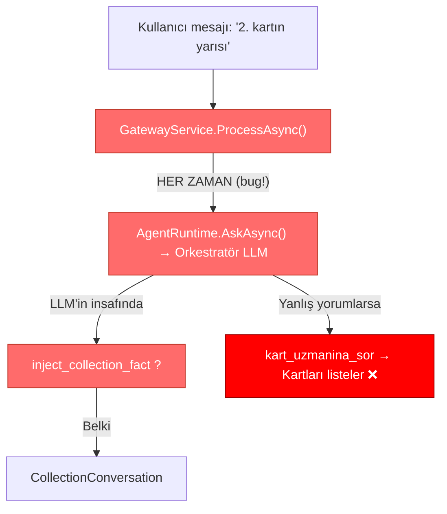
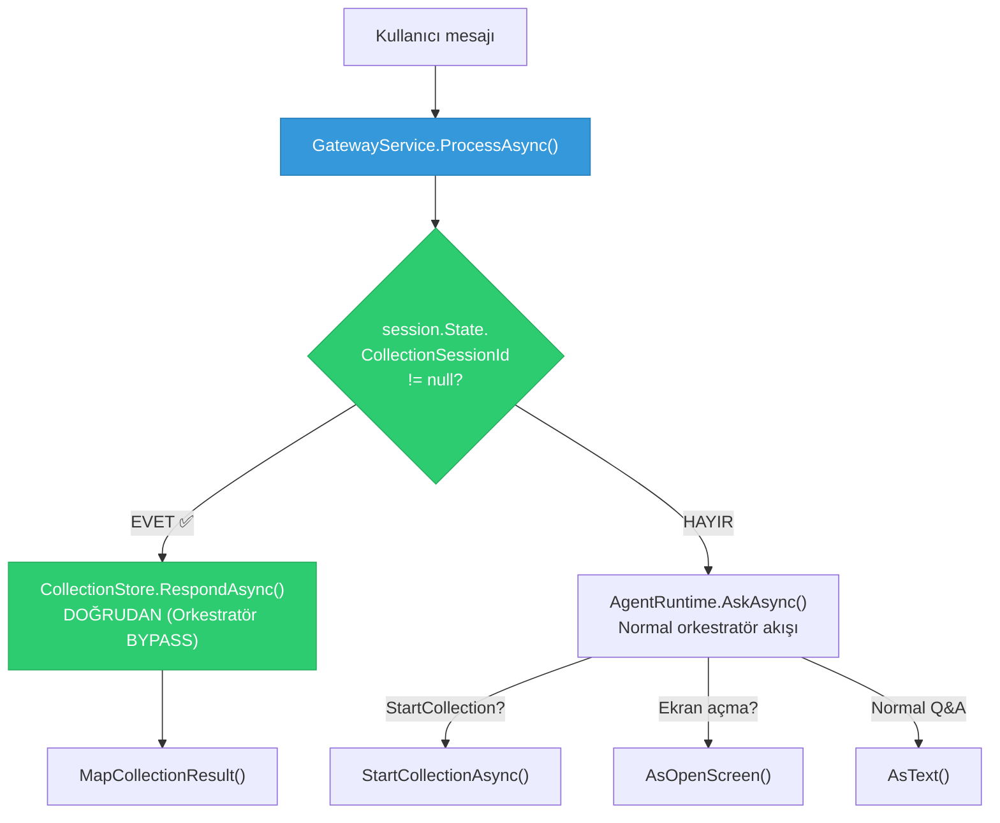

# Deterministik Flow Routing — Tahsilat Akışı Kırılganlık Düzeltmesi

> **Öncelik:** 🔴 KRITIK — Ekran görüntüsünde görülen slot kaybı ve context kopukluğunun kök nedeni

## Sorun Tanımı

Ekran görüntüsünde görülen senaryo:

```
Kullanıcı: "2 kartin yarisini ode"
Bot:       "Hangi kartın borcunu ödemek istersiniz?" + kart listesi ✅
Kullanıcı: "2. Kartin yarisi"
Kullanıcı: "Devam"
Bot:       "Sahip olduğunuz kredi kartları şu şekildedir:" + kart bilgileri ❌ (slot kaybı!)
```

**Beklenen davranış:** Kullanıcı "2. kartın yarısı" dediğinde sistem kartı seçmeli, tutarı yarısı olarak hesaplamalı ve bir sonraki slot olan "kaynak hesap" sorusuna geçmelidir.

**Gerçekleşen davranış:** Sistem kart seçimini algılayamıyor, kartları tekrar listeliyor. Slot-filling tamamen kopuyor.

## Kök Neden Analizi



### Anti-Pattern: LLM-Dependent Flow Routing

[GatewayService.cs](file:///c:/Users/boran/Documents/Projeler/TKFB_Agentic/tfAgentic-main/src/Banking.Gateway/GatewayService.cs) satır 68'de **HER mesaj** (aktif tahsilat oturumu olsa bile) orkestratöre gidiyor:

```csharp
var reply = await _runtime.AskAsync(request.Text, session.History.ToList(), 
    session.State.CollectionSessionId, ct);
```

Orkestratörün `inject_collection_fact` aracını çağırıp çağırmayacağı **tamamen LLM'in kararına** bırakılmış. Bu **fintech standartlarında kabul edilemez** bir anti-pattern:

1. **Slot kaybı:** Orkestratör "2. kartın yarısı" mesajını kart bilgisi sorusu olarak sınıflandırıp `kart_uzmanina_sor`'a yönlendiriyor
2. **Çift LLM gecikmesi:** Her mesaj önce orkestratörden, sonra (belki) tahsilat ajanından geçiyor → 2x latency
3. **Context kopukluğu:** CollectionConversation'ın kendi AgentSession'ı var ama kullanıcı mesajları oraya ulaşamıyor
4. **Fact injection güvenilmezliği:** Orkestratör kullanıcı mesajını "fact" olarak yeniden formüle edip inject ediyor → anlamsal kayıp

> [!CAUTION]
> Anthropic'in agent tasarım ilkeleri: **"Aktif iş akışı sırasında routing kararları LLM'e bırakılmaz, deterministik olmalıdır."** Mevcut mimari bu ilkeyi ihlal ediyor.

## Çözüm: Deterministic Flow Routing with Escape Hatch



## Proposed Changes

### Banking.Gateway (Ana Düzeltme)

---

#### [MODIFY] [GatewayService.cs](file:///c:/Users/boran/Documents/Projeler/TKFB_Agentic/tfAgentic-main/src/Banking.Gateway/GatewayService.cs)

**Kritik değişiklik — Deterministic Flow Router**

`ProcessAsync()` metodu yeniden yapılandırılacak:

1. **Aktif tahsilat oturumu kontrolü** — orkestratöre göndermeden ÖNCE yapılacak
2. **Doğrudan CollectionStore yönlendirmesi** — orkestratör BYPASS edilecek
3. **`inject_collection_fact` referansları kaldırılacak** — artık gereksiz
4. **Tahsilat sonrası history temizliği** — slot-filling mesajları Q&A'yı kirletmesin

```diff
 public async Task<GatewayResponse> ProcessAsync(GatewayRequest request, CancellationToken ct = default)
 {
     // ... session setup aynen kalır ...
     
     try
     {
         session.History.Enqueue(new ChatMessage(ChatRole.User, request.Text));
         while (session.History.Count > 8) { session.History.Dequeue(); }

+        // ══ DETERMINISTIC FLOW ROUTING ══
+        // Aktif tahsilat oturumu varsa, mesajı DOĞRUDAN tahsilat ajanına gönder.
+        // Orkestratör BYPASS edilir. Fintech prensibi: aktif iş akışı sırasında
+        // routing kararları LLM'e bırakılmaz, deterministik olmalıdır.
+        if (session.State.CollectionSessionId is not null)
+        {
+            _hub.Publish("GATEWAY", "Aktif tahsilat oturumu → mesaj doğrudan tahsilat ajanına yönlendiriliyor (deterministic routing)");
+            var result = await _collectionStore.RespondAsync(session.State.CollectionSessionId, request.Text);
+            var response = MapCollectionResult(result, session) with { SessionToken = sessionToken };
+            return SanitizeResponse(response);
+        }
 
-        var reply = await _runtime.AskAsync(request.Text, session.History.ToList(), session.State.CollectionSessionId, ct);
+        // Aktif tahsilat YOK → normal orkestratör akışı
+        var reply = await _runtime.AskAsync(request.Text, session.History.ToList(), ct: ct);
 
-        // 1. DURUM: Fact Injection
-        if (!string.IsNullOrEmpty(reply.InjectedFact) && session.State.CollectionSessionId != null)
-        {
-            // ... (KALDIRILDI - artık gerek yok)
-        }
-
-        // 2. DURUM: Tahsilat başlatma
+        // DURUM: Tahsilat başlatma
         if (reply.StartCollection)
         {
             // ... (aynen kalır)
         }
```

---

#### [MODIFY] [GatewaySession.cs](file:///c:/Users/boran/Documents/Projeler/TKFB_Agentic/tfAgentic-main/src/Banking.Gateway/GatewaySession.cs)

**Küçük iyileştirme — Tahsilat sonrası history temizliği**

Tahsilat akışı bittiğinde (completed/cancelled), slot-filling mesajlarının Q&A history'sini kirletmemesi için `ClearHistory()` metodu eklenecek.

---

### Banking.Agents (Temizlik)

---

#### [MODIFY] [AgentRuntime.cs](file:///c:/Users/boran/Documents/Projeler/TKFB_Agentic/tfAgentic-main/src/Banking.Agents/AgentRuntime.cs)

**Gereksiz inject_collection_fact altyapısının kaldırılması:**

1. `InjectCollectionFact` metodu ve `FactInjectionIntent` AsyncLocal'i kaldırılacak
2. Orkestratör tool listesinden `inject_collection_fact` kaldırılacak
3. `BuildNativeContext()`'ten CollectionSessionId system message enjeksiyonu kaldırılacak
4. `AskAsync()` ve `AskStreamingAsync()` parametrelerinden `collectionSessionId` kaldırılacak
5. `OrchestratorReply` record'undan `InjectedFact` kaldırılacak
6. Orkestratör instructions'dan `inject_collection_fact` referansları ve "AKTİF İŞ AKIŞI" kuralları kaldırılacak

> [!IMPORTANT]
> Bu değişiklik `OrchestratorReply` record'unun signature'ını değiştirir. Host'taki `/api/chat` endpoint'i de güncellenecek.

---

#### [MODIFY] [CollectionConversation.cs](file:///c:/Users/boran/Documents/Projeler/TKFB_Agentic/tfAgentic-main/src/Banking.Agents/Collection/CollectionConversation.cs)

**Instructions güçlendirme — Dolayli seçimleri anlama**

CollectionConversation'ın LLM talimatlarına ek kurallar eklenecek:

```diff
 <interaction_rules>
+- DOLAYLI SEÇİMLER: Kullanıcı "2. kart", "ikinci kart", "yarısını öde", "tamamını öde" gibi
+  dolaylı ifadeler kullanabilir. Bunları anlamlandır:
+  - "2. kart" veya "ikinci kart" → Listeden 2. sıradaki kartı seç
+  - "yarısını öde" veya "yarısı" → Seçili kartın güncel borcunun %50'sini tutar olarak belirle
+  - "tamamını öde" veya "tamamı" → Seçili kartın güncel borcunun tamamını tutar olarak belirle
+  - "asgari" veya "minimum" → Seçili kartın asgari ödeme tutarını kullan
+- DEVAM: Kullanıcı "devam", "evet", "tamam" derse, bir önceki mesajdaki seçimi onayla ve
+  sonraki eksik slot'u sor. ÖNCEKİ BİLGİLERİ ASLA UNUTMA.
 - Her mesajda yalnızca TEK eksik soruyu sor; kısa, nazik ve Türkçe kullan.
```

Ayrıca `[SİSTEM BİLGİSİ]` referansları kaldırılacak (artık orkestratörden fact injection gelmiyor).

---

#### [MODIFY] [CollectionSessionStore](file:///c:/Users/boran/Documents/Projeler/TKFB_Agentic/tfAgentic-main/src/Banking.Agents/Collection/CollectionConversation.cs#L222-L268) (Aynı dosya)

**`RespondWithFactAsync()` metodu kaldırılacak** — artık kullanılmıyor.

---

### Banking.Host (Uyum)

---

#### [MODIFY] [Program.cs](file:///c:/Users/boran/Documents/Projeler/TKFB_Agentic/tfAgentic-main/src/Banking.Host/Program.cs)

`/api/chat` endpoint'inde `OrchestratorReply` değişikliğine uyum:

```diff
-    return Results.Ok(new { reply = r.Reply, startCollection = r.StartCollection });
+    return Results.Ok(new { reply = r.Reply, startCollection = r.StartCollection, openScreen = r.OpenScreenMkCode });
```

---

## Yapılmayan Değişiklikler (Kasıtlı)

| Bileşen | Neden Dokunulmadı |
|---------|-------------------|
| `CollectionToolset.cs` | Tool'lar doğru çalışıyor, değişiklik gerekmiyor |
| `PaymentApprovalWorkflow.cs` | MAF Workflow + RequestPort onay gate'i doğru çalışıyor |
| `ResponseSanitizer.cs` | Output guard katmanı bağımsız, değişiklik gerekmiyor |
| `GatewayResponse.cs / GatewayResponseType.cs` | Response modeli doğru, routing'le ilgisi yok |
| `Banking.Mcp/*` | MCP araçları doğru çalışıyor |
| `DeferredSpecialistAgent.cs` | Uzman ajan lazy-init yapısı doğru |
| `SpecialistAgents.cs` | Uzman ajan tanımları doğru |

> [!TIP]
> **Tekerliği sıfırdan inşa etmeme kuralı:** MAF framework'ünün AgentSession, AIAgent.RunAsync(), Workflow+RequestPort ve TracingAIFunction özelliklerini kullanıyoruz. Kendi state management, approval pipeline veya observability layer yazmıyoruz.

## Verification Plan

### Automated Tests

```bash
# Projenin derlenmesi
cd c:\Users\boran\Documents\Projeler\TKFB_Agentic\tfAgentic-main
dotnet build BankingAgents.sln
```

### Manuel Doğrulama (cURL)

```bash
# 1. Tahsilat başlat
curl -s -X POST http://localhost:5080/api/ai/chat \
  -H "Content-Type: application/json" \
  -d '{"text": "2 kart borcumun yarisini ödemek istiyorum"}' | jq .
# Beklenen: type=TEXT, text="Hangi kartın..." + sessionToken

# 2. Kart seçimi (aktif collection → doğrudan tahsilat ajanına gitmeli)
curl -s -X POST http://localhost:5080/api/ai/chat \
  -H "Content-Type: application/json" \
  -d '{"text": "2. kartın yarısı", "sessionToken": "<önceki_token>"}' | jq .
# Beklenen: type=TEXT, "Ne kadar ödeyeceksiniz?" VEYA otomatik yarısını hesaplayıp
#           "Hangi hesaptan çekilecek?" sorusu

# 3. Hesap seçimi
curl -s -X POST http://localhost:5080/api/ai/chat \
  -H "Content-Type: application/json" \
  -d '{"text": "vadesiz hesabımdan", "sessionToken": "<önceki_token>"}' | jq .
# Beklenen: type=CONFIRM_PAYMENT, kart/tutar/hesap bilgileri ile onay ekranı
```

### Doğrulama Kriterleri

- [ ] Aktif tahsilat sırasında mesajlar doğrudan CollectionConversation'a gidiyor (trace log'da "deterministic routing" görülmeli)
- [ ] Orkestratör tahsilat mesajlarını GÖRMÜyor (trace'de orkestratör çağrısı olmamalı)
- [ ] Slot-filling çalışıyor: kart → tutar → hesap sırasıyla ilerliyor
- [ ] "2. kart", "yarısını öde" gibi dolaylı ifadeler doğru yorumlanıyor
- [ ] Tahsilat tamamlandıktan sonra normal Q&A devam ediyor
- [ ] `dotnet build` hatasız geçiyor
