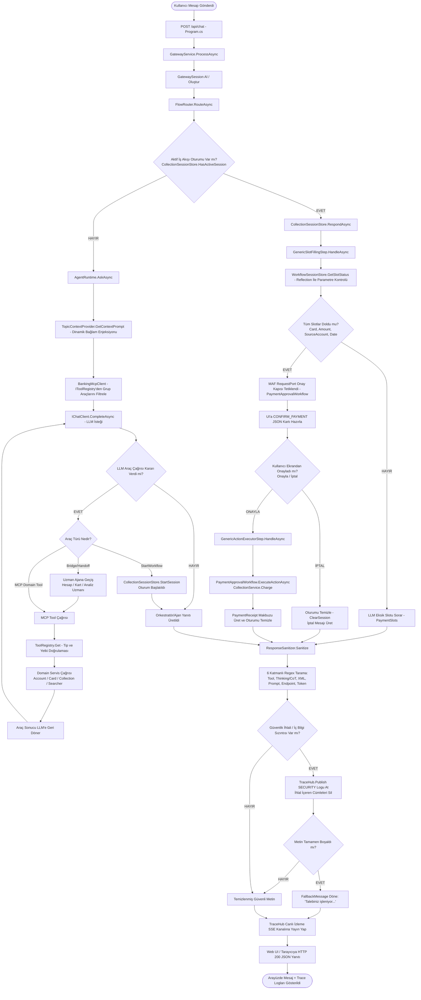

# Detaylı Mimari, Analiz ve Tasarım Dokümanı — MAF Agentic Bankacılık Asistanı

> **Teknoloji Yığını:** Microsoft Agent Framework (MAF) · .NET 9 · OpenAI / C# IChatClient · Model Context Protocol (MCP) · Agent-to-Agent (A2A) · ASP.NET Core Web API · Vanilla JS / CSS Web UI

---

## 1. Mimarinin Genel Amacı ve Temel Prensipleri

Bu proje, bankacılık sektörüne özel geliştirilmiş **tam yetkili (agentic)**, **deterministik iş akışı destekli (workflow-driven)** ve **fintech düzeyinde güvenli (defense-in-depth)** bir yapay zeka asistan mimarisidir.

### Temel Mimari Prensipler
1. **Deterministik Flow Routing (Orkestratör Bypass):** Müşteri aktif bir borç ödeme/tahsilat akışındayken, LLM serbestliğinden kaynaklanan hataları engellemek amacıyla Orkestratör (LLM) bypass edilir ve mesaj doğrudan deterministik MAF Workflow adımına iletilir.
2. **Dynamic Tool Registry & Grouping (İzole Araç Yönetimi):** MCP araçları tüm ajanlara ortak sunulmaz. `IToolRegistry` mimarisi ile araçlar gruplara (`Account`, `Card`, `Analyze`, `Collection`, `Orchestrator`) ayrılır. Uzman ajanlar sadece kendi gruplarındaki araçlara erişebilir. MCP server uyumsuzlukları runtime başlarken fail-fast (`InvalidOperationException`) fırlatır.
3. **6 Katmanlı Output Guardrail (ResponseSanitizer):** LLM çıktısı kullanıcıya sunulmadan önce 6 ayrı güvenlik süzgecinden (Araç adları, Düşünce kalıpları/CoT, XML etiketleri, Prompt parçaları, Localhost/URL'ler, Session tokenlar) geçirilir.
4. **Modüler Yönergeler ve Dinamik Bağlam (TopicContextProvider):** Sistem prompt'ları C# sınıflarından ayıklanarak `AgentPrompts.cs` altında modülerleştirilmiştir. Diyaloğun anlık konusuna göre prompt'a dynamic context injection yapılır.
5. **Human-in-the-Loop (HITL) Approval Gate:** Geri alınamaz finansal işlemler (borç ödeme) asla LLM'in tek taraflı kararıyla çalıştırılmaz. MAF `RequestPort` ile kullanıcının ekrandan açık onayı alınır.

---

## 2. Uçtan Uca Detaylı İş Akış Şeması (End-to-End Decision Flowchart)

Aşağıdaki şemada, kullanıcının bir mesaj göndermesinden yanıtın web arayüzünde gösterilmesine kadar tüm süreçteki kararlar (Evet/Hayır kutuları), uğranan sınıflar, çağrılan metotlar ve güvenlik katmanları gösterilmiştir.



---

## 3. Katmanlı Mimari ve Sınıf Sorumluluk Rehberi

Sistemde yer alan tüm katmanlar, sınıflar ve fonksiyonlar aşağıda detaylandırılmıştır.

```
tfAgentic-main/src/
├── Banking.Gateway/       # API Gateway, Session, Security Guard, Flow Router
├── Banking.Agents/        # MAF Orchestrator, Specialist Agents, Prompts, Workflows
├── Banking.Mcp/           # MCP Server Tools, Dynamic Registry & Grouping
├── Banking.Domain/        # Domain Models, In-Memory Stores, Services, Vector Searchers
└── Banking.Host/          # Composition Root, ASP.NET Core Web API, Web UI
```

---

### 3.1. `Banking.Gateway` Katmanı

Uygulamanın dış dünya (Web UI) ile ilk temas noktasıdır. İstek yönlendirme, oturum saklama ve çıktı güvenliğinden sorumludur.

#### 1. `GatewayService.cs`
* **Sorumluluk:** API katmanındaki tüm isteklerin giriş ve çıkış koordinatörüdür.
* **Ana Fonksiyonlar:**
  * `ProcessAsync(string message, string? sessionToken)`: Kullanıcı mesajını alır, `GatewaySession` erişimini sağlar, `FlowRouter`'ı çalıştırır, çıkan yanıtı `ResponseSanitizer` ile temizler ve `TraceHub` üzerinden UI'a yayınlar.

#### 2. `FlowRouter.cs`
* **Sorumluluk:** Saf Nesne Yönelimli Yönlendirici (Pure OOP Router). İsteklerin aktif bir workflow oturumuna mı yoksa LLM Orkestratörü'ne mi yönlendirileceğine karar verir.
* **Ana Fonksiyonlar:**
  * `RouteAsync(string sessionToken, string text, GatewaySession session)`: `_collectionStore.HasActiveSession(sessionToken)` kontrolü yapar. Aktif oturum varsa LLM'e sormadan doğrudan workflow'a iletir (`workflow_step`). Oturum yoksa `AgentRuntime.AskAsync` çağırır (`orchestrator_reply`).

#### 3. `GatewaySession.cs`
* **Sorumluluk:** Müşterinin aktif oturum durumunu saklayan veri yapısı. (MAF `AgentSession` ve Workflows sohbet geçmişini yerleşik yönettiği için manuel kuyruk / sliding window **tutulmaz**).
* **Ana Özellikler:**
  * `State`: Akış durumunu tutan `AppState` nesnesi (`CollectionSessionId`, `ContextData`).
  * `ClearForNewFlow()`: İş akışı sonlandığında oturum durumunu sıfırlar.

#### 4. `ResponseSanitizer.cs`
* **Sorumluluk:** Fintech düzeyinde 6 katmanlı Output Guard (Defense-in-Depth - Katman 3). LLM yanıtlarını güvenlik süzgecinden geçirir.
* **Ana Fonksiyonlar:**
  * `Sanitize(string? text)`: Metni sırasıyla 6 güvenlik kategorisinde tarar:
    1. **Tool Names:** Dahili araç isimlerini (`GetCreditCardStatement` vb.) içeren cümleleri siler (`StripToolNames`).
    2. **Thinking / CoT:** Düşünce süreci ifadelerini (`"uzmana yönlendiriyorum"`, `"araç çağırıyorum"`) siler (`StripThinkingPatterns`).
    3. **XML Tags & Blocks:** Promptlarda kullanılan dahili XML etiketlerini temizler (`StripXmlBlocks`, `StripXmlTags`).
    4. **System Prompt Leaks:** Sistem talimat cümlelerini siler (`StripSystemPromptLeaks`).
    5. **Endpoints:** `localhost`, `127.0.0.1`, `/mcp` gibi URL adreslerini temizler (`StripEndpoints`).
    6. **Session Tokens:** `gw-xxx` veya `cs-xxx` tokenlarını `[GİZLİ]` olarak maskeler (`MaskSessionTokens`).
  * İhlal durumunda `TraceHub.Publish("SECURITY", ...)` yayınlar. Metin tamamen silinirse `FallbackMessage` döner.

#### 5. `GatewayResponseType.cs`
* **Sorumluluk:** Gateway ile Web UI arasındaki iletişim için kullanılan yanıt modelleri ve `GatewayResponseType` enum değerlerini (`MESSAGE`, `CONFIRM_PAYMENT`, `RECEIPT`, `OPEN_SCREEN`) tanımlar.

---

### 3.2. `Banking.Agents` Katmanı

Microsoft Agent Framework (MAF) entegrasyonu, orkestrasyon, uzman ajanlar ve deterministik workflow'ların bulunduğu katmandır.

#### 1. `AgentRuntime.cs`
* **Sorumluluk:** Orkestratör ajanın runtime yöneticisidir. LLM ile diyalog kurar, dinamik bağlamı yükler ve araç çağrılarını yönetir.
* **Ana Fonksiyonlar:**
  * `AskAsync(string userMessage, string sessionToken)`: `TopicContextProvider` üzerinden bağlam metnini alır, `BankingMcpClient` ile araç listesini çeker, `IChatClient.CompleteAsync` ile LLM'i çalıştırır ve araç çağrılarını/handoff'ları yönetir.

#### 2. `SpecialistAgents.cs`
* **Sorumluluk:** MAF uzman ajanlarının (`HesapUzmani`, `KrediKartiUzmani`, `FinansalAnalizUzmani`) fabrika metodlarını barındırır.
* **Ana Fonksiyonlar:**
  * `BuildHesapAgent()`, `BuildKartAgent()`, `BuildAnalyzeAgent()`: Ajanları `IChatClient`, izole MCP araçları (`ToolGroup`) ve `AgentPrompts` talimatları ile hazırlar.

#### 3. `AgentPrompts.cs` (`Banking.Agents/Prompts/`)
* **Sorumluluk:** Tüm sistem ve uzman ajan yönergelerinin toplandığı modüler prompt deposudur. C# kodlarında hardcode metin kalmasını engeller.

#### 4. `TopicContextProvider.cs` (`Banking.Agents/ContextProviders/`)
* **Sorumluluk:** Diyaloğun aktif konusuna (`Account`, `Card`, `Analyze`, `Collection`) göre sistem prompt'una dinamik durum metinleri ve kısıtlar enjekte eder.

#### 5. `BankingMcpClient.cs`
* **Sorumluluk:** Ajanların MCP Sunucusuna istemci olarak bağlanmasını sağlar. `IToolRegistry` ile entegre çalışarak ajanlara sadece yetkili oldukları grup araçlarını (`GetToolsForGroupAsync`) döner.

#### 6. `TraceHub.cs` (`Banking.Agents/Tracing/`)
* **Sorumluluk:** Uygulamanın iç çalışma adımlarını (`LLM`, `A2A`, `MCP`, `SERVICE`, `WORKFLOW`, `FLOWROUTER`, `GATEWAY`, `SECURITY`) Server-Sent Events (SSE) ile canlı olarak Web UI'a yayınlar.

#### 7. `CollectionWorkflow.cs` (`Banking.Agents/Collection/`)
* **Sorumluluk:** Jenerik MAF Workflow Boru Hattı oluşturucu. Aktif slot nesnesine (`PaymentSlots`) otomatik adapte olur.
* **Ana Yapılar:**
  * `Build<TSlots, TConfirmation, TOutcome>()`: Slot filling adımı, onay kapısı (RequestPort) ve eylem çalıştırıcı düğümü birleştirerek MAF `Workflow` nesnesi üretir.

#### 8. `GenericSlotFillingStep.cs` & `GenericActionExecutorStep.cs`
* **Sorumluluk:** MAF Workflow adımlarıdır. Reflection ile slotların doluluğunu denetler; onay sonrası deterministik servis çağrısını yürütür.

#### 9. `CollectionSessionStore.cs` & `WorkflowSessionStore.cs`
* **Sorumluluk:** İş akışının adım durumlarını, toplanan slot değerlerini (`SaveSlots`) ve onay durumlarını saklayan oturum depolarıdır.

#### 10. `PaymentApprovalWorkflow.cs`
* **Sorumluluk:** Kart ödeme onay adımının somut uygulamasıdır. Onay alındığında `ICollectionService.Charge` metodunu tetikler.

---

### 3.3. `Banking.Mcp` Katmanı

Model Context Protocol (MCP) server araçlarının ve dinamik araç registry sisteminin bulunduğu katmandır.

#### 1. `IToolRegistry.cs`, `ToolRegistry.cs` & `ToolGroupAttribute.cs`
* **Sorumluluk:** Araçların yetki gruplarına (`ToolGroup`) ayrılmasını, otomatik olarak Reflection ile taranmasını ve runtime başlarken MCP server araçları ile doğrulama (Fail-Fast) yapılmasını sağlar.
* **Ana Fonksiyonlar:**
  * `ScanAssembly(Assembly assembly)`: `[McpServerTool]` ve `[ToolGroup]` ile işaretlenmiş araçları otomatik tespit edip kaydeder.
  * `ValidateDiscoveredMcpTools(IEnumerable<string> discovered)`: Server'daki araçlar ile registry'i kıyaslar. Eksik varsa `InvalidOperationException` fırlatır.
  * `GetToolsByGroup(ToolGroup group)`: Belirli bir ajanın kullanabileceği araç listesini döner.

#### 2. `AccountsTools.cs`
* **Sorumluluk:** `[ToolGroup(ToolGroup.Account)]`. `get_account_balance`, `list_accounts`, `get_transactions` MCP araçlarını sunar.

#### 3. `CardsTools.cs`
* **Sorumluluk:** `[ToolGroup(ToolGroup.Card)]`. `list_cards`, `get_card_debt`, `get_statement`, `get_available_limit` MCP araçlarını sunar.

#### 4. `AnalyzeTools.cs`
* **Sorumluluk:** `[ToolGroup(ToolGroup.Analyze)]`. `AnalyzeStatementSummary`, `AnalyzeCategoryBreakdown`, `KampanyaVektorelAra`, `search_financing` ve ödeme planı simülasyon araçlarını sunar.

#### 5. `Constants/` (`AccountToolNames`, `CardToolNames`, `AnalyzeToolNames`)
* **Sorumluluk:** Tip güvenliği sağlamak amacıyla tüm araç isimlerini `public const string` olarak tutar.

---

### 3.4. `Banking.Domain` Katmanı

Bankacılık iş mantığı, domain modelleri, in-memory veri deposu ve vektör arama motorlarının yer aldığı çekirdek katmandır.

#### 1. `InMemoryBankStore.cs`
* **Sorumluluk:** Bankacılık simülasyon verilerini (Müşteri hesapları, kredi kartları, ekstreler, son harcamalar, finansman paketleri) bellekte tutar.

#### 2. `SemanticCampaignSearcher.cs`
* **Sorumluluk:** Müşterinin harcama profiline göre en uygun kampanyaları Cosine Similarity (Kosinüs Benzerliği) vektör araması ile bulur.

#### 3. `SemanticFinancingSearcher.cs`
* **Sorumluluk:** Kullanıcının konut, taşıt veya ihtiyaç kredisi gibi finansman taleplerini anlamsal vektör aramasıyla uygun finansman paketleriyle eşleştirir.

#### 4. `AccountService.cs`, `CardService.cs`, `CollectionService.cs`
* **Sorumluluk:** Hesap bakiyesi sorma, ekstre getirme ve borç tahsilatı (`Charge`) gibi çekirdek bankacılık fonksiyonlarını gerçekleştirir.

#### 5. `PaymentSlots.cs` (`Banking.Domain/Records/`)
* **Sorumluluk:** Kredi kartı ödeme akışında toplanması gereken slot alanlarını (`CardNumber`, `Amount`, `SourceAccountId`, `PaymentDate`) içeren immutable C# `record` nesnesidir.

---

### 3.5. `Banking.Host` Katmanı

Uygulamanın çalışma zamanı (Composition Root), ASP.NET Core konfigürasyonları ve Kullanıcı Arayüzü (Web UI) katmanıdır.

#### 1. `Program.cs`
* **Sorumluluk:** Dependency Injection (DI) konteynerini yapılandırır, MCP (`/mcp`) ve A2A (`/a2a`) HTTP endpoint'lerini açar, REST API rotalarını tanımlar ve `ToolRegistry` fail-fast doğrulamasını çalıştırır.

#### 2. `index.html` (`wwwroot/`)
* **Sorumluluk:** Müşterinin asistanla konuştuğu web arayüzüdür.
* **Özellikler:**
  * **Markdown Render:** `marked.js` ile zengin metin desteği.
  * **Canlı Trace Log Paneli:** Ajanların çalışma adımlarını (`LLM`, `A2A`, `MCP`, `SERVICE`, `WORKFLOW`, `FLOWROUTER`, `GATEWAY`, `SECURITY`) renkli kartlarla anlık izleme.
  * **Interactive Confirm Card:** Ödeme onayı geldiğinde dinamik Onayla/İptal butonlu kart render etme.
  * **Session Synchronization:** Browser `sessionStorage` üzerinden `gw-` session token yönetimi.

---

## 4. Kullanılan Güvenlik Mekanizmaları ve Guardrails

Uygulamada 3 ayrı katmanda güvenlik önlemi uygulanır:

1. **Katman 1 — Dynamic Tool Isolation:** Ajanlar sadece kendi yetki alanındaki araçları görebilir (`ToolGroup`). Bir hesap ajanının borç ödeme veya ekstre analiz aracı çağırması sistemsel olarak engellenmiştir.
2. **Katman 2 — System Prompt Guardrails:** System prompt'lar içerisine uydurma veri üretmeme, dosya istememe ve sadece araç verilerine dayanma kısıtları (`AgentPrompts.cs`) konulmuştur.
3. **Katman 3 — Output Guard (ResponseSanitizer):** LLM yanıt verdikten sonra deterministik olarak çalışan 6 katmanlı regex süzgecidir. LLM kuralları ihlal etse bile iç araç adları, düşünde kalıpları veya tokenlar son kullanıcıya ulaşmadan temizlenir.

---

## 5. Örnek Kullanım Senaryoları ve İzler (Traces)

### Senaryo A: Soru-Cevap (Hesap Bakiyesi Sorma)
```
[Kullanıcı] "Vadesiz hesabımda ne kadar para var?"
 1. GatewayService -> FlowRouter (Aktif workflow yok -> Orkestratör)
 2. AgentRuntime -> TopicContextProvider ("Account" bağlamı eklendi)
 3. AgentRuntime -> IChatClient -> LLM "hesap_uzmanina_sor" aracını seçti
 4. BankingMcpClient -> HesapUzmani -> MCP "get_account_balance"
 5. AccountService -> InMemoryBankStore -> 45.250,00 TL
 6. ResponseSanitizer -> Temiz yanıt doğrulandı
 7. [Asistan] "Vadesiz hesabınızda 45.250,00 TL bakiye bulunmaktadır."
```

### Senaryo B: Tahsilat / Kart Borcu Ödeme Akışı
```
[Kullanıcı] "Kredi kartı borcumu ödemek istiyorum"
 1. GatewayService -> FlowRouter -> AgentRuntime -> "start_workflow" tetiklendi
 2. CollectionSessionStore -> Workflow oturumu başlatıldı (SessionToken: cs-89f1a2)
 3. CollectionWorkflow -> GenericSlotFillingStep (Eksik slotlar: Kart, Tutar, Hesap)
 4. [Asistan] "Hangi kredi kartınızın borcunu ödemek istersiniz?"
[Kullanıcı] "Mastercard kartımdan vadesiz hesabımla 2500 TL öde"
 5. GatewayService -> FlowRouter (Aktif oturum VAR -> Orkestratör BYPASS edildi!)
 6. GenericSlotFillingStep -> Reflection kontrolü: Tüm slotlar DOLDU!
 7. MAF RequestPort onay kapısı açıldı -> UI'a CONFIRM_PAYMENT gönderildi
 8. [UI Ekranı] ÖDEME ONAYI Kart: **** 4521 | Tutar: 2.500,00 TL [✓ Onayla] [✗ İptal]
[Kullanıcı] (Onayla Butonuna Bastı)
 9. GenericActionExecutorStep -> PaymentApprovalWorkflow -> CollectionService.Charge()
10. Makbuz üretildi, workflow oturumu sonlandırıldı.
```

---

## 6. Kurulum ve Çalıştırma Rehberi

### Gereksinimler
* **.NET 9 SDK**
* OpenAI API Key (`OPENAI_API_KEY`)

### Çalıştırma Adımları
1. Ortam değişkenini ayarlayın:
   ```bash
   $env:OPENAI_API_KEY="sk-..."  # PowerShell
   ```
2. Uygulamayı başlatın:
   ```bash
   cd tfAgentic-main
   dotnet run --project src/Banking.Host
   ```
3. Tarayıcıdan açın:
   `http://localhost:5080` (veya console'da belirtilen port).
