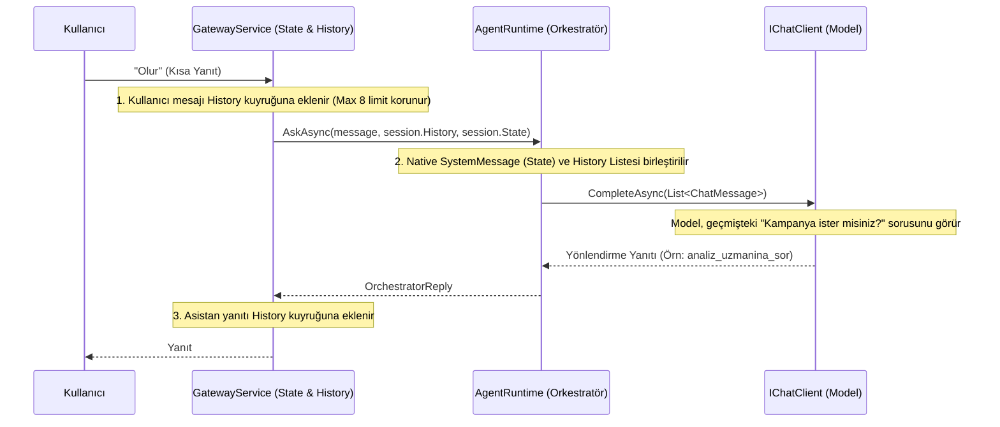

# Mimari Değişiklik Günlüğü (Changelog)

## Sürüm: [Memory-Refactor] - 2026-07-30

### Neden Bu Değişiklik Yapıldı? (Problem Tanımı)
Sistem, kullanıcının doğrudan bağlam (context) gerektiren kısa ifadelerini anlayamıyordu. Örneğin, sistem "Eğer kampanya önerisi almak isterseniz, lütfen belirtin." dedikten hemen sonra kullanıcı "Olur" yanıtını verdiğinde, LLM bu yanıtın öncesini hatırlayamadığı için "Bu konuda yardımcı olamam (Alan Dışı)" diyerek diyaloğu kırıyordu.

Eski mimaride (Prompt Injection), `AgentRuntime` her isteği `0-shot` (geçmişsiz) olarak değerlendiriyor ve sadece Tahsilat akışındayken `<context_state>` adı altında yapay bir durum enjekte ediyordu. Ancak genel sohbet hafızası (kampanyalar vb.) tutulmuyordu ve XML formatı ile string manipulation yapılıyordu.

### Çözüm ve Yeni Mimari

Uygulamanın mimarisi **Native Message Array (Sliding Window)** ve **Host-Managed State Store** prensiplerine (Microsoft Agent Framework standartları) geçirildi.

#### 1. State Store (Uygulama Durumu)
Uygulamanın mantıksal durumu (Flow, Step, ActiveTopic vb.) artık `GatewaySession.cs` içerisindeki `AppState` sınıfı (POCO) tarafından yönetiliyor. Bu sayede uygulamanın state'i ile sohbet geçmişi birbirinden net bir şekilde ayrıştırıldı.
- Sadece ihtiyaç duyulduğunda bu State, LLM'e bir `SystemMessage` olarak aktarılır (Örn: "Mevcut Durum: Kullanıcı kredi kartı tahsilat akışında.").

#### 2. Kayan Pencere (Sliding Window) ve Native ChatMessage
Eski Prompt Injection (`PrepareMessageWithContext` ve `<chat_history>` XML etiketleri) tamamen koddan silindi. 
Kullanıcının ve asistanın son yazışmaları `GatewayService` üzerinde bir Kuyrukta (`Queue<ChatMessage>`) tutuluyor (maksimum 8 adet) ve LLM'e direkt `Microsoft.Extensions.AI.ChatMessage` dizisi olarak veriliyor. 
- XML parse ve token sızıntısı riskleri önlendi.
- Model, geçmişi tamamen native (kendi doğasına uygun role yapısıyla) analiz edebiliyor.

---

### Mimari Şema

### Dışa Kapalı (Internal) C# Değişiklikleri
- **[Eklendi]** `GatewaySession.cs`: `AppState` sınıfı ve `History` property'si.
- **[Kaldırıldı]** `AgentRuntime.cs`: `PrepareMessageWithContext` metodu tamamen silindi.
- **[Güncellendi]** `AgentRuntime.cs`: `AskAsync` ve `AskStreamingAsync` metot imzaları, `history` ve `collectionSessionId` alacak şekilde refactor edildi.
- **[Güncellendi]** `GatewayService.cs`: Kullanıcı ve asistan mesajlarını History kuyruğuna (limit 8) Enqueue/Dequeue yapan mantık uygulandı. `AskAsync` çağrıları yeni imzaya uyarlandı.

*(Not: Bu köklü refactoring, Java Middleware veya Web UI REST API kontratlarını bozmayacak şekilde, sadece C# backend içi nesne paslaşmaları seviyesinde tutulmuştur.)*

## Sürüm: [Agentic-Workflow-Refactor] - 2026-07-31

### Neden Bu Değişiklik Yapıldı? (Problem Tanımı)
1. **Deterministik Akış Kaybı:** Aktif bir tahsilat oturumu varken, kullanıcının sıradaki cevabı (örn. "2. kart") önce orkestratöre gidiyordu. Orkestratör bağlamı anlamayıp başka servislere (analiz vb.) yönlendirme yapabiliyor ve akışı bozuyordu.
2. **Zero-Shot Fast-Track Eksikliği:** Kullanıcı ödeme bilgilerini tek seferde ("Vadesiz hesabından mastercardın yüzde 42.75'ini öde") verdiğinde, ajan eksik bilgi olmamasına rağmen "Hangi kart?" gibi onay soruları soruyordu çünkü araçlarda marka (`Brand`) bilgisi yoktu ve prompt "sırayla sor" şeklinde katı bir kurala sahipti.
3. **Magic String ve Teknik Borç:** Araç (Tool) isimleri proje geneline sabit metin (magic string) olarak dağılmıştı, bu da tip güvenliğini bozuyordu.

### Çözüm ve Yeni Mimari

Uygulamanın karar mekanizmaları (Routing), veri tipleri ve sistem promptları yeniden düzenlendi.

#### 1. Deterministik Flow Routing (Orkestratör Bypass)
`GatewayService.cs` içerisindeki istek yönlendirme mantığı değiştirildi. Eğer müşterinin o an aktif bir tahsilat oturumu (`CollectionSessionId`) varsa, kullanıcının mesajı **Orkestratör modeline (LLM) HİÇ GÖNDERİLMEDEN** doğrudan ilgili alt ajana (CollectionAgent) iletilir.
- İşlem tamamlandığında veya iptal edildiğinde session ID temizlenir (`ClearForNewFlow`) ve orkestratör tekrar devreye girer.

#### 2. Zero-Shot Fast-Track ve Veri Zenginleştirme
- `CollectionToolset`'in `GetMyCards` aracı `Brand` (Visa, Mastercard vb.) bilgisini dönecek şekilde zenginleştirildi, böylece LLM artık hangi kartın seçildiğini şaşmaz bir şekilde görebiliyor.
- `CollectionConversation` yönergelerine (prompt) **FAST-TRACK (Hızlı Çıkış)** kuralı eklendi. Müşteri tüm slotları (kart, tutar, hesap) aynı anda verdiyse, ajan hiçbir soru sormadan doğrudan `propose_payment` aracını çağıracak şekilde esnetildi.

#### 3. Clean Code: Tool İsimlerinin Merkezi Yönetimi
Araç (Tool) isimleri `Banking.Mcp.Constants` klasörü altında `AccountToolNames.cs` ve `CardToolNames.cs` statik sınıflarına taşındı. Framework'ün `[McpServerTool]` etiketleri doğrudan bu sabitleri referans alır hale getirildi.

---

### Dışa Kapalı (Internal) C# Değişiklikleri
- **[Eklendi]** `Banking.Mcp/Constants/AccountToolNames.cs` ve `CardToolNames.cs` statik sabit sınıfları oluşturuldu.
- **[Güncellendi]** `GatewayService.cs`: `CollectionSessionId` kontrolü yapılarak orkestratörü bypass eden deterministik routing eklendi.
- **[Güncellendi]** `GatewaySession.cs`: Oturum bitiminde state'i sıfırlamak için `ClearForNewFlow()` metodu eklendi.
- **[Güncellendi]** `AgentRuntime.cs`: İptal edilen/gereksiz `inject_collection_fact` akışı ve `RespondWithFactAsync` kaldırıldı.
- **[Güncellendi]** `CollectionToolset.cs`: `GetMyCards` dönüş objesine `c.Brand` eklendi.
- **[Güncellendi]** `CollectionConversation.cs`: System prompt güncellenerek katı sıralı soru sorma kuralı FAST-TRACK kuralı ile esnetildi.
- **[Güncellendi]** `AccountsTools.cs`, `CardsTools.cs`, `BankingMcpClient.cs`: Magic stringler kaldırılarak yeni `Constants` sınıflarına bağlandı.
