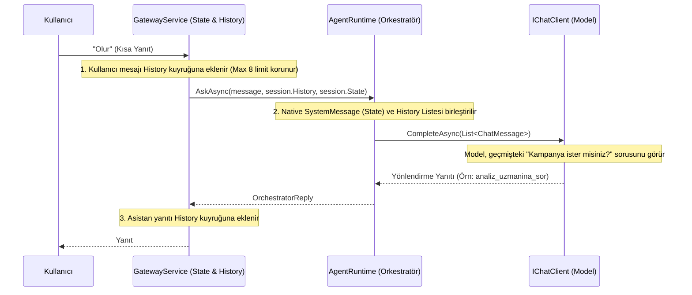

# Mimari Değişiklik Günlüğü (Changelog)

## Sürüm: [Clean-Code-Session-Constants-Refactor] - 2026-08-03

### Neden Bu Değişiklik Yapıldı? (Problem Tanımı)
1. **Oturum İsimlendirmeleri ve Kafa Karışıklığı:** Eski yapıda `GatewaySession` ve `CollectionSessionId` isimlendirmeleri hem isim karmaşasına hem de genel kullanıcı chat oturumu ile workflow oturumunun karıştırılmasına yol açıyordu.
2. **Magic String Kullanımı:** Kod genelinde hardcode dize sabitleri (`"question"`, `"confirmation"`, `"completed"`, `"GATEWAY"`, `"ekran_ac"` vb.) serpiştirilmiş durumdaydı ve takip edilebilir tip güvenli yapıda değildi.
3. **Muğlak Metod İsimleri:** `ProcessAsync`, `RouteAsync`, `RespondAsync`, `AskAsync` gibi metod isimleri ne iş yaptığını veya hangi bileşenle konuştuğunu açıkça ifade etmiyordu.

### Çözüm ve Yeni Mimari

#### 1. Oturum Mimarisi İyileştirmeleri (`UserSession` & `WorkflowSessionId`)
- `GatewaySession` ismi **`UserSession`** olarak güncellendi.
- `AppState` içerisindeki `CollectionSessionId` alanı **`WorkflowSessionId`** adını aldı.
- `CollectionSessionStore` sınıfı **`WorkflowConversationStore`** olarak yeniden adlandırıldı.

#### 2. Merkezi Tip Güvenli Sabitler (`Banking.Domain.Constants`)
- **`WorkflowStatuses`**: `Question`, `Confirmation`, `Completed`, `Cancelled`
- **`WorkflowPhases`**: `Slot`, `Confirm`, `Done`, `Idle`, `SlotFilling`, `AwaitingApproval`, `Completed`, `Cancelled`
- **`TraceCategories`**: `Gateway`, `FlowRouter`, `System`, `Workflow`, `Security`, `Service`
- **`ToolNames`**: `StartWorkflow`, `OpenScreen`, `SearchScreenCode`, `AskAccountSpecialist`, `AskCardSpecialist`, `AskAnalyzeSpecialist`

#### 3. Niyet Belirten (Self-Describing) Metod İsimleri (Clean Code)
- `GatewayService.ProcessAsync` ➡️ `ProcessUserRequestAsync`
- `GatewayService.MapCollectionResult` ➡️ `MapWorkflowResultToResponse`
- `FlowRouter.RouteAsync` ➡️ `RouteUserRequestAsync`
- `WorkflowConversationStore.HasActiveSession` ➡️ `HasActiveWorkflowSession`
- `WorkflowConversationStore.StartAsync` ➡️ `StartWorkflowConversationAsync`
- `WorkflowConversationStore.RespondAsync` ➡️ `ProcessWorkflowStepMessageAsync`
- `CollectionConversation.RespondAsync` ➡️ `ProcessUserMessageAsync`
- `AgentRuntime.AskAsync` ➡️ `AskOrchestratorAsync`

---

## Sürüm: [Generic-StateBag-Refactor] - 2026-08-02

### Neden Bu Değişiklik Yapıldı? (Problem Tanımı)
Eski mimaride onay ve ödeme akışları (`ConfirmationView`, `PaymentActionExecutor`, `GatewayResponse.AsConfirmPayment`) sert kodlanmış (hardcoded) C# sınıflarına ve sadece Kredi Kartı alanlarına (`CardMasked`, `TotalDebt`, `Amount`, `SourceAccountMasked` vb.) bağımlıydı. Bu durum, sisteme EFT (`EftTransferSlots`), Fatura Ödeme veya Kredi Başvurusu gibi yeni iş akışları eklenmek istendiğinde her defasında yeni onay DTO'ları ve hardcoded serileştirme kodları yazılmasını gerektiriyordu.

### Çözüm ve Yeni Mimari

Uygulamanın onay ve serileştirme mimarisi **StateBag Tabanlı Dinamik / Jenerik Onay (Generic Confirmation)** prensibine dönüştürüldü.

#### 1. Jenerik Onay Ekranı (`GenericConfirmationView` & Reflection)
- Sert kodlanmış `ConfirmationView` sınıfı kaldırıldı.
- `GenericConfirmationView` record'u eklendi. `GenericConfirmationView.FromSlots<TSlots>(slots)` metodu ile herhangi bir C# `record` türü (ör: `PaymentSlots`, `EftTransferSlots`) Reflection ile otomatik taranarak sıfır hardcoded bağımlılıkla dinamik bir `Parameters` sözlüğüne (`IReadOnlyDictionary<string, object?>`) dönüştürüldü.

#### 2. Dinamik StateBag Entegrasyonu (`WorkflowSessionStore`)
- `WorkflowSessionStore` sınıfına `BuildGenericConfirmationView<TSlots>(sessionId)` metodu eklendi.
- Onay aşamasına gelindiğinde `StateBag` içindeki toplanan parametreler otomatik olarak jenerik onay görünümüne dönüştürülüyor.

#### 3. Düz (Flat) Root JSON Serileştirme (`GatewayResponse` & `[JsonExtensionData]`)
- `GatewayResponse` üzerindeki temel 4 sabit alan (`type`, `text`, `mkCodeValue`, `sessionToken`) **kesinlikle korunarak** sabit tutuldu.
- Geri kalan tüm dinamik Record parametreleri `[JsonExtensionData]` özniteliği ile JSON'ın KÖK (root) seviyesine düz (flat) property'ler olarak serileştirildi (`amount`, `cardNumber`, `accountNo`, `receiverIban` vb.).
- Eski ve hardcoded `GatewayResponse.AsConfirmPayment` metodu tamamen kaldırıldı; yerini `GatewayResponse.AsGenericConfirmation` aldı.

#### 4. Koda Açıklayıcı Yorumlar (Code Commenting)
- `AgentRuntime.cs`, `FlowRouter.cs`, `GatewayService.cs`, `TopicContextProvider.cs`, `CollectionConversation.cs`, `CollectionWorkflow.cs` dosyalarındaki kritik metot ve adımların yanına 2-3 kelimelik kısa açıklayıcı C# inline yorumları eklendi.

---

### Dışa Kapalı (Internal) C# Değişiklikleri
- **[Yeni Dosya]** `src/Banking.Agents/Collection/GenericConfirmationView.cs`: Reflection destekli jenerik onay DTO'su.
- **[Güncellendi]** `src/Banking.Agents/Collection/WorkflowSessionStore.cs`: `BuildGenericConfirmationView` metodu ve `GenericConfirmationView` entegrasyonu.
- **[Güncellendi]** `src/Banking.Agents/Collection/PaymentApprovalWorkflow.cs`: `PaymentActionExecutor` jenerik tipe uyarlandı, `FromSlots` ile reflection tabanlı dinamik parametre türetme uygulandı.
- **[Güncellendi]** `src/Banking.Agents/Collection/CollectionConversation.cs`: `CollectStepResult` DTO'su `GenericConfirmationView` nesnesini taşıyacak şekilde güncellendi.
- **[Güncellendi]** `src/Banking.Gateway/Models/GatewayResponse.cs`: `[JsonExtensionData]` ile flat serileştirme sağlandı, hardcoded `AsConfirmPayment` temizlendi.
- **[Güncellendi]** `src/Banking.Gateway/GatewayService.cs`: `BuildConfirmationScreen` metodu jenerik onay parametrelerini flat serileştirecek şekilde güncellendi.

---

## Sürüm: [Memory-Refactor] - 2026-07-30

### Neden Bu Değişiklik Yapıldı? (Problem Tanımı)
Sistem, kullanıcının doğrudan bağlam (context) gerektiren kısa ifadelerini anlayamıyordu. Örneğin, sistem "Eğer kampanya önerisi almak isterseniz, lütfen belirtin." dedikten hemen sonra kullanıcı "Olur" yanıtını verdiğinde, LLM bu yanıtın öncesini hatırlayamadığı için "Bu konuda yardımcı olamam (Alan Dışı)" diyerek diyaloğu kırıyordu.

Eski mimaride (Prompt Injection), `AgentRuntime` her isteği `0-shot` (geçmişsiz) olarak değerlendiriyor ve sadece Tahsilat akışındayken `<context_state>` adı altında yapay bir durum enjekte ediyordu. Ancak genel sohbet hafızası (kampanyalar vb.) tutulmuyordu ve XML formatı ile string manipulation yapılıyordu.

### Çözüm ve Yeni Mimari

Uygulamanın mimarisi **Native Message Array (Sliding Window)** ve **Host-Managed State Store** prensiplerine (Microsoft Agent Framework standartları) geçirildi.

#### 1. State Store (Uygulama Durumu)
Uygulamanın mantıksal durumu (Flow, Step, ActiveTopic vb.) artık `GatewaySession.cs` içerisindeki `AppState` sınıfı (POCO) tarafından yönetiliyor. Bu sayede uygulamanın state'i ile sohbet geçmişi birbirinden net bir şekilde ayrıştırıldı.
- Sadece ihtiyaç duyulduğunda bu State, LLM'e bir `SystemMessage` olarak aktarılır (Örn: "Mevcut Durum: Kullanıcı kredi kartı tahsilat akışında.").

#### 2. Kayan Pencere (Sliding Window) ve Native ChatMessage
Eski Prompt Injection (`PrepareMessageWithContext` ve `<chat_history>` XML etiketleri) tamamen koddan silindi. 
Kullanıcının ve asistanın son yazışmaları `GatewayService` üzerinde bir Kuyrukta (`Queue<ChatMessage>`) tutuluyor (maksimum 8 adet) ve LLM'e direkt `Microsoft.Extensions.AI.ChatMessage` dizisi olarak veriliyor. 
- XML parse ve token sızıntısı riskleri önlendi.
- Model, geçmişi tamamen native (kendi doğasına uygun role yapısıyla) analiz edebiliyor.

---

### Mimari Şema

### Dışa Kapalı (Internal) C# Değişiklikleri
- **[Eklendi]** `GatewaySession.cs`: `AppState` sınıfı ve `History` property'si.
- **[Kaldırıldı]** `AgentRuntime.cs`: `PrepareMessageWithContext` metodu tamamen silindi.
- **[Güncellendi]** `AgentRuntime.cs`: `AskAsync` ve `AskStreamingAsync` metot imzaları, `history` ve `collectionSessionId` alacak şekilde refactor edildi.
- **[Güncellendi]** `GatewayService.cs`: Kullanıcı ve asistan mesajlarını History kuyruğuna (limit 8) Enqueue/Dequeue yapan mantık uygulandı. `AskAsync` çağrıları yeni imzaya uyarlandı.

*(Not: Bu köklü refactoring, Java Middleware veya Web UI REST API kontratlarını bozmayacak şekilde, sadece C# backend içi nesne paslaşmaları seviyesinde tutulmuştur.)*

## Sürüm: [Agentic-Workflow-Refactor] - 2026-07-31

### Neden Bu Değişiklik Yapıldı? (Problem Tanımı)
1. **Deterministik Akış Kaybı:** Aktif bir tahsilat oturumu varken, kullanıcının sıradaki cevabı (örn. "2. kart") önce orkestratöre gidiyordu. Orkestratör bağlamı anlamayıp başka servislere (analiz vb.) yönlendirme yapabiliyor ve akışı bozuyordu.
2. **Zero-Shot Fast-Track Eksikliği:** Kullanıcı ödeme bilgilerini tek seferde ("Vadesiz hesabından mastercardın yüzde 42.75'ini öde") verdiğinde, ajan eksik bilgi olmamasına rağmen "Hangi kart?" gibi onay soruları soruyordu çünkü araçlarda marka (`Brand`) bilgisi yoktu ve prompt "sırayla sor" şeklinde katı bir kurala sahipti.
3. **Magic String ve Teknik Borç:** Araç (Tool) isimleri proje geneline sabit metin (magic string) olarak dağılmıştı, bu da tip güvenliğini bozuyordu.

### Çözüm ve Yeni Mimari

Uygulamanın karar mekanizmaları (Routing), veri tipleri ve sistem promptları yeniden düzenlendi.

#### 1. Deterministik Flow Routing (Orkestratör Bypass)
`GatewayService.cs` içerisindeki istek yönlendirme mantığı değiştirildi. Eğer müşterinin o an aktif bir tahsilat oturumu (`CollectionSessionId`) varsa, kullanıcının mesajı **Orkestratör modeline (LLM) HİÇ GÖNDERİLMEDEN** doğrudan ilgili alt ajana (CollectionAgent) iletilir.
- İşlem tamamlandığında veya iptal edildiğinde session ID temizlenir (`ClearForNewFlow`) ve orkestratör tekrar devreye girer.

#### 2. Zero-Shot Fast-Track ve Veri Zenginleştirme
- `CollectionToolset`'in `GetMyCards` aracı `Brand` (Visa, Mastercard vb.) bilgisini dönecek şekilde zenginleştirildi, böylece LLM artık hangi kartın seçildiğini şaşmaz bir şekilde görebiliyor.
- `CollectionConversation` yönergelerine (prompt) **FAST-TRACK (Hızlı Çıkış)** kuralı eklendi. Müşteri tüm slotları (kart, tutar, hesap) aynı anda verdiyse, ajan hiçbir soru sormadan doğrudan `propose_payment` aracını çağıracak şekilde esnetildi.

#### 3. Clean Code: Tool İsimlerinin Merkezi Yönetimi
Araç (Tool) isimleri `Banking.Mcp.Constants` klasörü altında `AccountToolNames.cs` ve `CardToolNames.cs` statik sınıflarına taşındı. Framework'ün `[McpServerTool]` etiketleri doğrudan bu sabitleri referans alır hale getirildi.

---

### Dışa Kapalı (Internal) C# Değişiklikleri
- **[Eklendi]** `Banking.Mcp/Constants/AccountToolNames.cs` ve `CardToolNames.cs` statik sabit sınıfları oluşturuldu.
- **[Güncellendi]** `GatewayService.cs`: `CollectionSessionId` kontrolü yapılarak orkestratörü bypass eden deterministik routing eklendi.
- **[Güncellendi]** `GatewaySession.cs`: Oturum bitiminde state'i sıfırlamak için `ClearForNewFlow()` metodu eklendi.
- **[Güncellendi]** `AgentRuntime.cs`: İptal edilen/gereksiz `inject_collection_fact` akışı ve `RespondWithFactAsync` kaldırıldı.
- **[Güncellendi]** `CollectionToolset.cs`: `GetMyCards` dönüş objesine `c.Brand` eklendi.
- **[Güncellendi]** `CollectionConversation.cs`: System prompt güncellenerek katı sıralı soru sorma kuralı FAST-TRACK kuralı ile esnetildi.
- **[Güncellendi]** `AccountsTools.cs`, `CardsTools.cs`, `BankingMcpClient.cs`: Magic stringler kaldırılarak yeni `Constants` sınıflarına bağlandı.

## Sürüm: [Financing-Vector-Guardrails] - 2026-07-31

### Neden Bu Değişiklik Yapıldı? (Problem Tanımı)
1. **Finansman Ürünü Eksikliği:** Kullanıcıların konut, taşıt, ihtiyaç ve ticari finansman paketlerini inceleme, oran hesabı yapma ve ödeme planı simülasyonu alma imkanı yoktu.
2. **Uydurma Veri ve Kötü Kullanıcı Deneyimi:** LLM'in finansal veriler bulunamadığında kendi kafasından harcama/faiz verisi uydurması ya da müşteriden ekstre dosyası istemesi gibi hatalı tutumları vardı.

### Çözüm ve Yeni Mimari

#### 1. Semantic Financing Searcher & Veri Tabanı Zenginleştirme
- `SemanticFinancingSearcher.cs` motoru kuruldu. Müşterinin ihtiyaçlarına uygun konut, taşıt ve tüketici finansman paketlerini semantik (anlamsal) vektör araması ile eşleştirme altyapısı sağlandı.
- `InMemoryBankStore.cs` içerisine finansman paketleri, kar/faiz oranları ve ödeme türleri eklendi.

#### 2. Finansman MCP Araçları ve Guardrails
- `AnalyzeTools.cs` zenginleştirilerek `search_financing` ve ödeme planı hesaplama araçları eklendi. Araç isimleri `AnalyzeToolNames.cs` sınıfında toplandı.
- Analiz ajanına katı (strict) guardrail'lar tanımlandı: Kullanıcıdan ekstre dosyası veya dosya yolu istemesi yasaklandı, parametresiz çalışma kuralı getirildi.

---

### Dışa Kapalı (Internal) C# Değişiklikleri
- **[Eklendi]** `SemanticFinancingSearcher.cs`: Finansman paketleri için anlamsal vektör benzerlik motoru.
- **[Eklendi]** `Banking.Mcp/Constants/AnalyzeToolNames.cs`: Analiz ve finansman araç sabitleri.
- **[Güncellendi]** `AnalyzeTools.cs`: `search_financing` ve ödeme simülasyon araçları eklendi.
- **[Güncellendi]** `InMemoryBankStore.cs`: Finansman ürünleri veri modelleri ve kar oranları eklendi.

## Sürüm: [Tool-Registry-Refactor] - 2026-08-01

### Neden Bu Değişiklik Yapıldı? (Problem Tanımı)
1. **Araç Yetkilendirme ve İzolasyon Eksikliği:** MCP araçları (Tools) tüm ajanlara ortak sunuluyordu. Uzman ajanların kendi sorumluluk alanı dışındaki araçları görmesi token israfına ve ajanın yanlış aracı tetiklemesine yol açıyordu.
2. **Fail-Fast Doğrulama Yokluğu:** MCP Server tarafında tanımlı araçlar ile kod içerisindeki kayıtlar uyuşmadığında uygulama sessizce çalışmaya devam ediyor ve runtime anında hata verıyordu.

### Çözüm ve Yeni Mimari

#### 1. Dynamic Tool Registry ve Grouping
- `IToolRegistry`, `ToolRegistry` ve `ToolGroupAttribute` mimarisi kuruldu. Araçlar gruplara (`Account`, `Card`, `Analyze`, `Collection`, `Orchestrator`) ayrıldı.
- `AccountsTools`, `CardsTools`, `AnalyzeTools` sınıfları `[ToolGroup(...)]` özniteliği ile işaretlendi.

#### 2. Reflection Scanner ve Fail-Fast Validation
- `ToolRegistry.Instance` ile assembly üzerindeki araçlar runtime başlatılırken reflection ile otomatik taranır.
- `ValidateDiscoveredMcpTools` metodu ile MCP Sunucusunda açılan araçlar kontrol edilir; uyuşmayan bir araç varsa uygulama başlarken anında `InvalidOperationException` fırlatır (Fail-Fast).
- `BankingMcpClient` üzerinden uzman ajanlara sadece kendi grubuna ait araçlar (`GetToolsForGroupAsync`) filtrelenerek sunulur.

---

### Dışa Kapalı (Internal) C# Değişiklikleri
- **[Eklendi]** `Banking.Mcp/Registry/IToolRegistry.cs`: `ToolGroup` ve `ToolDefinition` türlerini ve `IToolRegistry` kontratını içerir.
- **[Eklendi]** `Banking.Mcp/Registry/ToolGroupAttribute.cs`: Sınıf seviyesinde araç grubu tanımlayan öznitelik.
- **[Eklendi]** `Banking.Mcp/Registry/ToolRegistry.cs`: Otomatik reflection tarayıcı, singleton registry ve fail-fast MCP doğrulayıcı.
- **[Güncellendi]** `BankingMcpClient.cs`: Araçları grup bazlı filtreleyip ajanlara izole şekilde sunan yapıya geçildi.

## Sürüm: [Modular-Prompts-ContextProviders] - 2026-08-01

### Neden Bu Değişiklik Yapıldı? (Problem Tanımı)
1. **Bakım Zorluğu ve Hardcoded Prompts:** Sistem ve uzman ajan promptları `SpecialistAgents.cs` gibi C# sınıfları içinde yüzlerce satırlık hardcode string/XML blokları halindeydi. Bu durum kod okunabilirliğini düşürüyor, değiştirmeyi zorlaştırıyordu.
2. **Dinamik Bağlam Yönetimi Eksikliği:** Kullanıcının o anki sohbet konusuna (Topic) göre prompt'a dinamik durum bilgisi enjekte edilemiyordu.

### Çözüm ve Yeni Mimari

#### 1. Modüler AgentPrompts Yapısı
- Tüm sistem ve uzman ajan yönergeleri C# sınıflarından ayırarak `Banking.Agents/Prompts/AgentPrompts.cs` altında merkezi ve modüler bir yapıda toplandı.

#### 2. Dynamic Context Providers
- `TopicContextProvider.cs` eklendi. Müşterinin aktif sohbet konusuna (Hesap, Kart, Analiz, Tahsilat vb.) göre bağlam ve kısıt bilgileri sistem prompt'una dinamik olarak enjekte edilir.

---

### Dışa Kapalı (Internal) C# Değişiklikleri
- **[Eklendi]** `Banking.Agents/Prompts/AgentPrompts.cs`: Tüm sistem ve uzman ajan yönergelerinin toplandığı modül.
- **[Eklendi]** `Banking.Agents/ContextProviders/TopicContextProvider.cs`: Konu bazlı dinamik bağlam sağlayıcı.
- **[Güncellendi]** `SpecialistAgents.cs`: Gömülü prompt string'leri temizlendi, `AgentPrompts` sabitlerine bağlandı.
- **[Güncellendi]** `AgentRuntime.cs`: Dinamik prompt ve bağlam birleştirme mantığı uygulandı.

## Sürüm: [Deterministic-FlowRouter-Workflows] - 2026-08-01

### Neden Bu Değişiklik Yapıldı? (Problem Tanımı)
1. **LLM Belirsizliği ve Adım Atlama:** Kredi kartı borç ödemesi gibi kritik finansal işlemlerde LLM'in serbest hareket etmesi, slotları atlaması veya hatalı onay üretmesi riski vardı.
2. **Eski Tool Tabanlı Tahsilat:** `CollectionToolset` esnek ancak determinizimden uzak bir yapı sunuyordu.

### Çözüm ve Yeni Mimari

#### 1. Pure OOP FlowRouter (Deterministik Routing)
- `FlowRouter.cs` eklendi. Gelen mesajlar değerlendirilirken aktif bir iş akışı (Workflow Session) varsa LLM Orkestratörü tamamen bypass edilerek mesaj doğrudan workflow adımına iletilir.

#### 2. Jenerik MAF Workflows & Slot Filling
- Microsoft Agent Framework (MAF) Workflows standardına geçildi.
- `CollectionWorkflow.cs` ve `GenericSlotFillingStep<TSlots>` sınıfları yazıldı. Reflection ile `PaymentSlots` nesnesindeki alanların doluluğu kontrol edilir. Eksik slot kaldıkça adım adım bilgi toplamaya devam eder.
- `WorkflowSessionStore.cs` ve `CollectionSessionStore.cs` ile oturum bağımsız workflow hafızası yönetimi sağlandı.

#### 3. RequestPort (HITL Gate) Onay Mekanizması
- Onay gerektiren adımlar için MAF `RequestPort` (Human-in-the-Loop) gate'i kuruldu. Kullanıcı ekrandan veya sohbetten onay verdiğinde `GenericActionExecutorStep` tetiklenerek borç ödeme işlemi deterministik biçimde tamamlanır.

---

### Dışa Kapalı (Internal) C# Değişiklikleri
- **[Eklendi]** `Banking.Gateway/FlowRouter.cs`: Deterministik Flow ve Orkestratör Yönlendiricisi.
- **[Eklendi]** `Banking.Agents/Collection/CollectionWorkflow.cs`: Jenerik MAF Workflow boru hattı ve slot filling adımı.
- **[Eklendi]** `Banking.Agents/Collection/CollectionSessionStore.cs` ve `WorkflowSessionStore.cs`: Workflow oturum saklayıcıları.
- **[Eklendi]** `Banking.Domain/Records/PaymentSlots.cs`: Ödeme akışı slot veri record kontratı.
- **[Kaldırıldı]** `CollectionToolset.cs`: Eski esnek tool tabanlı tahsilat sınıfı silindi.
- **[Güncellendi]** `GatewayService.cs`: Yönlendirme mantığı `FlowRouter`'a devredildi.
- **[Güncellendi]** `PaymentApprovalWorkflow.cs`: MAF Workflow onay adımlarına uyarlandı.

## Sürüm: [Fintech-Output-Guardrails-WebUI] - 2026-08-01

### Neden Bu Değişiklik Yapıldı? (Problem Tanımı)
1. **İç Bilgi Sızıntısı (Security Leaks):** AI modelinin yanıt üretirken iç araç adlarını (tool names), CoT (Chain of Thought) düşünce süreçlerini, XML etiketlerini veya session token'larını kullanıcı yanıtlarına sızdırma riski vardı.
2. **Web UI Şeffaflığı ve İzlenebilirlik:** Arayüz düz metin yanıtlar veriyor, arka planda hangi katmanların (`LLM`, `A2A`, `MCP`, `SERVICE`, `WORKFLOW`, `SECURITY`) çalıştığı, araçların ne zaman tetiklendiği izlenemiyordu.

### Çözüm ve Yeni Mimari

#### 1. 6 Katmanlı Output Guard (ResponseSanitizer)
- `ResponseSanitizer.cs` sınıfı 6 katmanlı deterministik savunma hattı (Defense-in-Depth - Katman 3) olarak güncellendi:
  1. Dahili araç adı sızıntıları
  2. Düşünce süreci ve CoT kalıpları
  3. XML tag ve sistem prompt parçaları
  4. Sistem talimat metinleri
  5. Localhost ve endpoint URL sızıntıları
  6. Session token sızıntıları (`gw-xxx`, `cs-xxx`)
- Sızıntı tespit edildiğinde `TraceHub`'a `SECURITY` uyarısı atılır ve zararlı içerik temizlenir. Metin tamamen temizlenirse `FallbackMessage` döner.

#### 2. Web UI Canlı İzleme ve UX Geliştirmeleri
- `wwwroot/index.html` güncellendi. Sağ panele canlı katman akışları (`LLM`, `A2A`, `MCP`, `SERVICE`, `WORKFLOW`, `FLOWROUTER`, `GATEWAY`, `SECURITY`) renk kodlu badge'lerle eklendi.
- `marked.js` ile Markdown zengin metin render desteği eklendi.
- Session token yönetimi browser `sessionStorage` ile senkronize edildi. Ödeme onay kartları yenilendi.

---

### Dışa Kapalı (Internal) C# & Web Değişiklikleri
- **[Güncellendi]** `ResponseSanitizer.cs`: 6 katmanlı regex süzgeci ve `TraceHub` güvenlik yayın sistemi.
- **[Güncellendi]** `TraceHub.cs`: `FLOWROUTER`, `GATEWAY` ve `SECURITY` katman tanımları eklendi.
- **[Güncellendi]** `wwwroot/index.html`: Yenilenen UI layout, canlı trace log paneli, markdown desteği, session token takibi.
- **[Güncellendi]** `GatewayResponseType.cs`: API yanıt tipleri uyarlandı.

## Sürüm: [Deterministic-LLM-Temperature] - 2026-08-02

### Neden Bu Değişiklik Yapıldı? (Problem Tanımı)
1. **Model Kararsızlığı ve Gevezelik (CoT Drift):** Model sıcaklık (Temperature) parametresi açıkça tanımlanmadığı için OpenAI varsayılan değeri (`1.0`) ile çalışıyordu. Bu durum modelin kararsız kalmasına, yaratıcı/geveze yanıtlar vererek araç çağırmak yerine *"Bekleyin analiz yapıyorum"* gibi gereksiz cümleler kurmasına yol açıyordu.

### Çözüm ve Yeni Mimari

#### 1. Merkezi LLM Sıcaklık Yapılandırması (Temperature = 0.1)
- Bankacılık ve fintech standartlarına uygun olarak LLM sıcaklık değeri **`0.1`** seviyesine sabitlendi.
- Yapılandırma `appsettings.json` ve `AgentOptions.cs` üzerinden yönetilebilir ve değiştirilebilir hale getirildi.
- `TracingChatClient.cs` delegasyon istemcisine köprü mantığı eklendi; tüm orkestratör, uzman ajan ve workflow model isteklerine `Temperature = 0.1` otomatik enjekte edilir.

---

### Dışa Kapalı (Internal) C# Değişiklikleri
- **[Eklendi]** `AgentOptions.cs`: `Temperature` konfigürasyon özelliği (varsayılan: `0.1f`).
- **[Güncellendi]** `appsettings.json`: `"Agents"` bölümüne `"Temperature": 0.1` alanı eklendi.
- **[Güncellendi]** `TracingChatClient.cs`: Tüm `GetResponseAsync` ve `GetStreamingResponseAsync` çağrılarına sıcaklık değeri enjeksiyonu sağlandı.
- **[Güncellendi]** `AgentRuntime.cs`: `TracedClient` oluşturulurken `_options.Temperature` değerinin aktarılması sağlandı.
