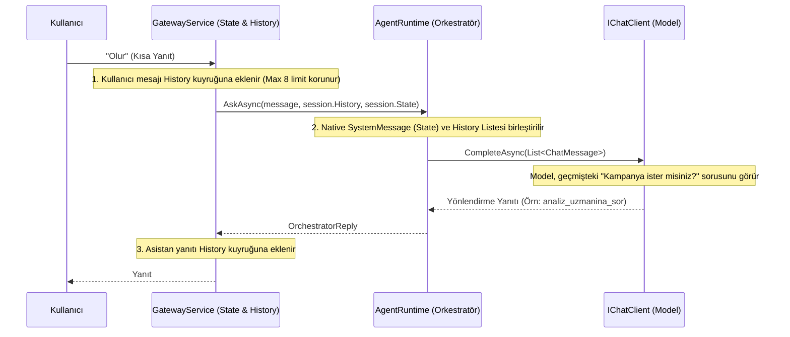

# Mimari Değişiklik Günlüğü (Changelog)

## Sürüm: [Prompt-Deseni-Standardizasyonu] - 2026-08-06

> Kapsam: `Banking.Agents/Prompts/AgentPrompts.cs` ile prompt üreten iki deklaratif kurucu. Motor sözleşmesi (sinyal araçları, HITL kapısı, oturum yolu) değişmedi; değişen yalnızca LLM'e giden metin ve o metnin tek kaynaktan üretilme biçimi.

### Neden Bu Değişiklik Yapıldı? (Problem Tanımı)
1. **Ortak kural bloğu ajanların bir kısmına hiç ulaşmıyordu:** `BuildSpecialistRules()` yalnızca YAML'dan doğan uzmanlara ekleniyordu; derlenmiş `HesapUzmani`/`KrediKartiUzmani`/`AnalizUzmani` kendi güvenlik bloklarının inline kopyasını taşıyordu. Ortak bloğa eklenen bir kural bu üç uzmana girmiyordu — sapma teoride değil, fiilen mevcuttu: "veri uydurma" kuralı Analiz uzmanında hiç yoktu, para formatı kuralı iki uzmanda vardı birinde yoktu.
2. **Prompt'a gömülü araç adları:** `BuildSlotFillingRules` araç adlarını bilinçli olarak parametre alırken (prompt'taki ad ile kayıtlı ad ayrışırsa ajan var olmayan bir aracı çağırır), uzman promptları `list_accounts`, `get_card_debt`, `AnalyzeStatementSummary` gibi adları literal yazıyordu. Öngörülen hata gerçekleşmişti: Analiz uzmanının prompt'u kayıtlı olmayan `kampanya_vektorel_ara` adını söylüyor, aynı prompt iki satır aşağıda doğru adı (`KampanyaVektorelAra`) kullanıyordu.
3. **İfade kara listeleri:** "Bekleyin", "Bir dakika lütfen", "X aracını çağırıyorum" gibi yasak cümleler altı ayrı blokta, her kopyada biraz farklı yazılmıştı. Dile bağımlı, eksik ve token yakan bir yöntemdi; sızıntının deterministik kapısı zaten `ResponseSanitizer`'dır.
4. **Dört ayrı prompt şeması yan yanaydı:** düz madde listesi (Hesap/Kart), tam XML ağacı (`<system_prompt><identity><purpose><workflow_guidelines>`, Analiz), `<identity>/<custom_instructions>/<strict_rules>` kompozisyonu (deklaratif kurucular). Aynı işi gören dört etiket dolaşıyordu: `<response_guidelines>`, `<strict_rules>`, `<guardrails>`, `<security_guardrails>`.
5. **Guardrail bazen iki kez, bazen hiç basılıyordu:** `DeclarativeWorkflowBuilder` dahili kimlik kuralını `<custom_instructions>` içine ekliyor, `BuildSlotFillingRules` aynı metni koruma bloğunda tekrar veriyordu. YAML'da `instructions` alanı yoksa ilk kopya hiç eklenmiyordu.
6. **Orkestratör prompt'u akış adı sayıyordu:** akışlar çalışma zamanında YAML ile eklenip kaldırılabilirken prompt "borç ödeme / EFT / Havale" örneklerini sabit taşıyordu; diskteki `limit-artirim` ve `otomatik-odeme-talimati` prompt'ta hiç yoktu. Araç adları da `ToolNames` sabitleri yerine literal yazılmıştı.
7. **Aday akış listesi parametre adını söylemiyordu:** `BuildCandidateWorkflowsContext` listeyi `- Workflow: 'x' (Tanım: y)` diye basıp ardından "'workflowName' değerlerini kullan" diyordu; modelin araca yazacağı anahtar adı listede hiç geçmiyordu.
8. **Prompt injection savunması yoktu:** hiçbir ajan talimatında talimat hiyerarşisi kuralı bulunmuyordu.

### Çözüm ve Yeni Yapı

#### 1. Tek yazım deseni (`AgentPrompts.cs` dosya başındaki yorumda tarif edilir)
Her ajan talimatı aynı blok sırası ve aynı etiket sözlüğüyle yazılır: `<identity>` → `<scope>` → `<operating_rules>` → `<output_contract>` → `<guardrails>`. Deseni dayatan bir sınıf/şablon motoru **bilerek eklenmedi**: yeni bir ajan gerektiğinde iskelet elle kopyalanır. Şablon üreten bir tip, prompt yazmayı kolaylaştırmadan bir soyutlama katmanı daha getirirdi.

#### 2. Ortak kural sabitleri
Tekrarlanan kurallar tek tek sabite indi: `NoStatusChatter`, `NoInternalDisclosure`, `NoFabrication`, `InstructionPrecedence` (yeni — injection savunması), `InternalGuardrail`, `InternalIdAgentChannel`, `PresentationContract`. Koruma bloğu iki hazır sabitten okunur: `SpecialistGuardrails` (kimlik kuralının kanal istisnasını içerir) ve akış ajanları için kullanılan varyantı. Sabitler derleme zamanında çözülür; çalışma anında string birleştirme maliyeti yoktur.

#### 3. Uzman promptları
Üç uzman talimatı da aynı desene göre yeniden yazıldı; ortak sözleşme ve koruma blokları artık interpolasyonla gelir, inline kopya kalmadı. Analiz uzmanının 45 satırlık XML ağacı düzleştirildi ve metindeki bozuk Türkçe karakterler onarıldı. Her uzmana `<scope>` bloğu eklendi: neyi yapmadığı ve alan dışı soruyla ne yapacağı artık açıkça yazılı.

#### 4. Araç adları prompt metninden çıktı
Uzman promptlarındaki tüm literal araç adları kaldırıldı; kurallar ilke bazlı yazıldı ("ilgili listeleme aracını çağır"). Kayıtlı olmayan `kampanya_vektorel_ara` adı böylece ortadan kalktı. Adı zorunlu olan tek yer motorun sinyal araçlarıdır (`propose_*`/`cancel_*`/`handoff_*`); onlar tek kaynaktan (`WorkflowAgentDefinition.For`) parametreyle gelmeye devam ediyor. Orkestratörde araç adları `ToolNames` sabitlerinden interpolasyonla giriyor.

#### 5. Orkestratör ve aday akış bağlamı
Sistem prompt'u artık hiçbir akış adı saymıyor; akış listesi zaten her istekte `<candidate_workflows>` mesajıyla geliyor. Sistem prompt'unun istek-bağımsız kalması korundu — orkestratörün uygulama ömrü boyunca bir kez kurulması buna bağlı. Aday listesi `- workflowName: 'x' — açıklama` biçimine geçti; modelin araca yazacağı anahtar adı listede görünüyor.

#### 6. Akış (slot doldurma) bloğu
Dokuz kuralın tamamı korundu — "asla değer uydurma", uzmandan gelen cevabı aynı turda kaydetme, konu dışı mesajda `handoff_*` çağırma dahil. Bloğa `<output_contract>` ve koruma bloğu eklendi (akış ajanlarında ikisi de hiç yoktu) ve "işlemi ilerleten tek yol bu araçlardır" kuralı yazıya döküldü.

#### 7. Maliyet etkisi (bilinçli kabul)
Render edilen prompt boyutu uzman başına ~%15-35 arttı (ortak sunum sözleşmesi, `<scope>` ve injection kuralı artık her ajanda var); akış ajanı bloğu ~1.600 → ~3.400 karaktere çıktı, çünkü daha önce sunum sözleşmesi ve koruma bloğu hiç almıyordu. Karşılığında dört şema yerine tek şema ve sıfır kural tekrarı elde edildi.

### Doğrulama
- `dotnet build BankingAgents.sln` → 0 uyarı, 0 hata.
- Render edilmiş prompt dökümü alındı: iç içe raw-string interpolasyonunda girinti kayması yok, araç adları doğru yerleşiyor, yönlendirme kuralları doğru iç içe geçiyor.
- `tools/WorkflowTest` → onay / ret / çift tıklama senaryolarının üçü de geçti; idempotency ve tek makbuz garantisi korunuyor.
- LLM'li davranış testi yapılmadı (depoda otomatik eval yok); önerilen manuel vakalar `docs/PROMPT-YAZIM-REHBERI.md` içindedir.

### Dışa Kapalı (Internal) C# Değişiklikleri
- **[Güncellendi]** `src/Banking.Agents/Prompts/AgentPrompts.cs`: Tek desene göre yeniden yazıldı; ortak kural sabitleri eklendi, `BuildSpecialistRules()` metodu yerini `SpecialistGuardrails` sabitine bıraktı, sınıf `static class` oldu, kullanılmayan `using`'ler (`System.ComponentModel`, `System.Reflection`, `System.Text`) kaldırıldı.
- **[Güncellendi]** `src/Banking.Agents/Specialists/Declarative/DeclarativeSpecialistBuilder.cs`: `SpecialistGuardrails` kullanımına geçti; deklaratif uzmanlarda hiç bulunmayan `<output_contract>` bloğu eklendi.
- **[Güncellendi]** `src/Banking.Agents/Workflows/Declarative/DeclarativeWorkflowBuilder.cs`: İkinci kez basılan dahili kimlik guardrail'i, çift `using` ve gereksiz alan kaldırıldı.
- **[Güncellendi]** `src/Banking.Agents/Runtime/AgentRuntime.cs`: `BuildSpecialistRoutingRules` artık prompt girintisini (11 boşluk) runtime'a sızdırmıyor; biçim prompt tarafında.
- **[Güncellendi]** `src/Banking.Host/Program.cs`: Hiçbir yerden enjekte edilmeyen ölü `AddSingleton<AgentPrompts>()` kaydı kaldırıldı (sınıf artık statik).
- **[Yeni Dosya]** `docs/PROMPT-YAZIM-REHBERI.md`: Desenin tarifi, yeni ajan promptu ekleme adımları, kuralların gerekçeleri ve manuel test vakaları.

## Sürüm: [Modüler-Stateless-Fintech-Mimarisi-Refactor] - 2026-08-04

> Kapsamlı kod incelemesi ve `REFACTOR-PLAN.md` planına dayanır; bkz. o belgedeki K/Y/O bulgu kodları.

### Neden Bu Değişiklik Yapıldı? (Problem Tanımı)
1. **İki paralel motor ve yanlış sonuç raporlama:** `CollectionConversation` (elle yazılmış LLM döngüsü) ile ölü `CollectionWorkflow`/`GenericSlotFillingStep` aynı işi iddia ediyordu. Başarı kontrolü `PaymentOutcome`'a sabitlenmişti; başarılı bir para transferi bile kullanıcıya "işlem sonlandırıldı" diye raporlanıyor, banka tarafında fırlatılan exception'lar (yetersiz bakiye) yakalanmadan "işlem tamamlandı" mesajına dönüşüyordu.
2. **Ajanlar stateless değildi:** `sessionId` tool closure'larına gömülüydü, orkestratör tüm kullanıcılar için tek bir `AgentSession` paylaşıyordu — çok kullanıcılı ortamda oturum/veri karışması ve sınırsız bellek büyümesi riski.
3. **Onay metin eşleştirmesiyle yapılıyordu:** `"onaylamıyorum"` gibi ifadeler `Contains("onayl")` ile yanlışlıkla onay sayılabiliyordu; çift tıklamaya karşı eşzamanlılık koruması yoktu.
4. **Doğrulama yanlış zamanda ve yanlış katmandaydı:** Bakiye/limit/IBAN kontrolleri yalnızca onay anında, veri katmanının (`InMemoryBankStore`) içinde yapılıyordu; kullanıcı hatayı ancak "Onayla"ya bastıktan sonra öğreniyordu. `AnalyzeTools` gibi MCP araçları servis katmanını atlayıp doğrudan store'a erişiyordu.
5. **Sessiz bozulmalar:** Slot tip dönüşümü başarısız olduğunda sessizce `0`/`null`'a düşüyordu; deklaratif YAML akışları slotlara bakmadan sahte makbuz üretiyordu; ekran yönlendirme (`mkCode`/`targetMkCode` uyuşmazlığı) hiç çalışmıyordu.
6. **Ölü kod ve tutarsız isimlendirme:** `CollectionWorkflow`, `CampaignsRegistry`/`CampaignsDefinition`, `ScreenCommand`, `CustomerSupportAgent`, kullanılmayan sabitler ve fazla constructor'lar; `tools/WorkflowTest` derlenmiyordu.

### Çözüm ve Yeni Mimari

#### 1. Tek İş Akışı Motoru (`Workflows/Engine`, `Workflows/Slots`, `Workflows/Approval`, `Workflows/Actions`, `Workflows/Contracts`, `Workflows/Declarative`)
- `WorkflowEngine<TSlots>` tek jenerik motor olarak eklendi; `Phase`'e göre `StartAsync` → `CollectSlotsAsync` → `ApplyApprovalDecisionAsync` sıralamasıyla çalışıyor. Eski `Collection/` dizini (`CollectionConversation`, ölü `CollectionWorkflow`) ve dağınık `Workflows/*.cs` dosyaları (`WorkflowSessionStore`, `WorkflowConversationStore`, `WorkflowScopes`, `PaymentApprovalWorkflow`) tamamen kaldırıldı.
- `WorkflowOutcome` jenerik sonuç modeli (`IsSuccess`, `FailureReason`, `ReceiptId`, `Details`) eklendi; `PaymentOutcome`/`TransferOutcome` özel durumları ortadan kalktı — başarılı transfer artık doğru raporlanıyor, başarısız işlemin gerçek sebebi kullanıcıya ulaşıyor.
- `ApprovalIntentParser` ile açık olumsuzluk önceliğine dayalı onay çözümlemesi eklendi; belirsiz ifadelerde onay sayılmıyor.
- `SlotBinder`/`SlotValueConverter` ile dictionary ↔ record dönüşümü ayrıştırıldı; başarısız tip dönüşümü artık sessizce null'a düşmüyor, slot "eksik" olarak işaretleniyor.
- `DeclarativeActionExecutor` gerçek MCP aracını çağırıp doğru sonucu döndürecek, `PaymentActionExecutor`/`TransferActionExecutor` domain exception'larını yakalayıp `WorkflowOutcome.Failure` üretecek şekilde yeniden yazıldı.

#### 2. Oturum İzolasyonu ve Stateless Ajanlar (`Sessions/`, `Runtime/`)
- `SessionContext` tek kapı olarak eklendi; `ISessionStore`/`InMemorySessionStore` yalnızca `AmbientSessionAccessor` üzerinden çağrılıyor. `AsyncLocalWorkflowSessionAccessor`, `ISessionStateStore`, `IWorkflowSessionAccessor` gibi ara soyutlamalar kaldırılıp tek `ISessionAccessor` sözleşmesine indirgendi.
- `AgentRuntime` (eski god class) `Runtime/` altında `AgentOptions`, `ChatClientFactory`, `DeferredSpecialistAgent`, `NavigationTools` olarak ayrıştırıldı; uzman keşfi `SpecialistCatalog`'a taşındı.
- `sessionId` artık tool closure'larına gömülmek yerine ambient scope'tan okunuyor; ajan nesneleri singleton, kullanıcıya özel veri taşımıyor.

#### 3. Erken Doğrulama ve Katman Disiplini (`Banking.Domain/Validation`, `Banking.Agents/Validation`)
- `BankValidationResult` ve dry-run doğrulama akışı `CollectionService`/`TransferService` içine eklendi; bakiye/limit/tutar/IBAN kontrolleri artık slot doldukça `update_slot` anında çalışıyor, onay ekranına gelmeden önce kullanıcıya yansıyor.
- `TurkishIbanValidator` ile IBAN format/checksum doğrulaması eklendi.
- `BankValidatedSlotWriter` (choke point) ve `PartiallyFilledSlotReader` ("değer yok" ile "değer sıfır" ayrımını koruyan okuyucu) eklendi.
- `ICampaignService`/`ICampaignCatalogService`/`IFinancingCatalogService`/`CampaignSyncService` eklenerek `AnalyzeTools`'un `InMemoryBankStore`'a doğrudan erişimi kesildi; MCP araçları artık yalnızca servis katmanı üzerinden gidiyor.

#### 4. Gateway ve Yanıt Eşleme Düzeltmeleri
- `GatewayResponseMapper` eklendi; protokol eşleme `GatewayService`'ten ayrıştırıldı. `UserSession.cs` kaldırıldı.
- `ekran_ac`/`mkCode` parametre adı uyuşmazlığı giderildi (ekran yönlendirme artık çalışıyor); onay ekranı `mkCode` çözümü `[Workflow]` adı üzerinden yapılıyor, hardcoded `"CreditCardPayment"` fallback'i kaldırıldı.

#### 5. Ölü Kod Temizliği ve Sabit Standardizasyonu
- `CampaignsRegistry`/`CampaignsDefinition`, `ScreenCommand`, `CustomerSupportAgent`, kullanılmayan `IToolRegistry` alanları ve `ResponseSanitizer`'ın fazla constructor'ı silindi.
- `WorkflowPhases`/`WorkflowStatuses`/`ToolNames`/`AgentConstants`/MCP araç sabitleri tekilleştirildi.
- `tools/WorkflowTest` doğru namespace'lere (`Banking.Domain.Records`) uyarlanarak tekrar derlenir hale getirildi.

#### 6. Deklaratif Ajan Şablonları
- `declarative-agents/card-payment.yaml` kaldırıldı, yerine `otomatik-odeme-talimati.yaml` eklendi; UI'daki (`index.html`) canlı YAML/Form senkronizasyonu genişletildi.

---

### Dışa Kapalı (Internal) C# Değişiklikleri
- **[Yeni Klasör]** `src/Banking.Agents/Workflows/{Engine,Slots,Approval,Actions,Contracts,Declarative}`: Tek jenerik iş akışı motoru ve destek sınıfları.
- **[Yeni Klasör]** `src/Banking.Agents/Runtime/`: `AgentRuntime` parçalanmasından doğan `AgentOptions`, `ChatClientFactory`, `DeferredSpecialistAgent`, `NavigationTools`.
- **[Yeni Dosya]** `src/Banking.Agents/Specialists/SpecialistCatalog.cs`, `src/Banking.Agents/Mcp/McpToolProvider.cs`.
- **[Yeni Dosya]** `src/Banking.Agents/Sessions/{SessionContext,SessionState,ISessionAccessor,AmbientSessionAccessor,ISessionStore}.cs`.
- **[Yeni Dosya]** `src/Banking.Agents/Validation/{BankValidatedSlotWriter,PartiallyFilledSlotReader}.cs`, `src/Banking.Domain/Validation/{BankValidationResult,TurkishIbanValidator}.cs`.
- **[Yeni Dosya]** `src/Banking.Domain/Services/{CampaignCatalogService,FinancingCatalogService}.cs`, `src/Banking.Domain/Campaigns/CampaignSyncService.cs`.
- **[Yeni Dosya]** `src/Banking.Gateway/GatewayResponseMapper.cs`.
- **[Silindi]** `src/Banking.Agents/Collection/`, eski `src/Banking.Agents/Workflows/*.cs` (WorkflowSessionStore, WorkflowConversationStore, WorkflowScopes, PaymentApprovalWorkflow, DeclarativeWorkflowBuilder, DeterministicActionWorkflow, TransferActionExecutor), `src/Banking.Agents/AgentRuntime.cs`, `AgentOptions.cs`, `ChatClientFactory.cs`, `DeferredSpecialistAgent.cs`, `src/Banking.Agents/Sessions/{AsyncLocalWorkflowSessionAccessor,ISessionStateStore,IWorkflowSessionAccessor}.cs`, `src/Banking.Agents/Specialists/CustomerSupportAgent.cs`, `src/Banking.Domain/Campaigns/{CampaignsDefinition,CampaignsRegistry}.cs`, `src/Banking.Domain/MkCodes/ScreenCommand.cs`, `src/Banking.Gateway/UserSession.cs`.
- **[Güncellendi]** `src/Banking.Host/Program.cs`: Yeni DI kayıtları (session/runtime/validation/workflow motoru), `WorkflowRegistry.AutoDiscoverWorkflows` iki assembly taraması.
- **[Güncellendi]** `src/Banking.Domain/Services/{AccountService,CardService,CollectionService,TransferService}.cs`, `src/Banking.Domain/Data/InMemoryBankStore.cs`: Dry-run doğrulama ve kural taşıma.
- **[Güncellendi]** `src/Banking.Mcp/{AccountsTools,AnalyzeTools,CardsTools}.cs`, `Registry/{IToolRegistry,ToolRegistry}.cs`: Katman disiplini ve sabit temizliği.
- **[Güncellendi]** `src/Banking.Gateway/{FlowRouter,GatewayService,ResponseSanitizer}.cs`, `Models/{GatewayRequest,GatewayResponse,GatewayResponseType}.cs`.
- **[Güncellendi]** `tools/WorkflowTest/Program.cs`, `src/Banking.Host/wwwroot/index.html`, `ANALIZ.md`.
- **[Yeni Belge]** `CLAUDE.md` (proje rehberi), `REFACTOR-PLAN.md` (bu refactor'ın plan belgesi — bulgu kodları K1-K10, Y1-Y16, O1-O16).

---

### Neden Bu Değişiklik Yapıldı? (Problem Tanımı)
1. **Statik C# İş Akışı Bağımlılığı:** Yeni bir iş akışı veya ajan tanımlamak C# sınıfı yazmayı, derlemeyi ve servisi yeniden başlatmayı gerektiriyordu. Dinamik ve çalışma zamanında (runtime) tanımlanabilen deklaratif ajan yapısı bulunmuyordu.
2. **Microsoft Agent Framework (MAF) Declarative Şema Desteği Eksikliği:** Resmi MAF standartlarında sunulan YAML/JSON deklaratif ajanı tanımlarının ayrıştırılıp sistemdeki RAG vektörel yönlendiricisine ve slot-filling motoruna entegre edilmesi gerekiyordu.
3. **Sert Kodlanmış Dize ve Ajan İsimleri (Magic Strings):** Kod tabanında ajan isimleri (`"HesapUzmani"`, `"KrediKartiUzmani"`, `"FinansalAnalizUzmani"`) ve trace kategorileri (`"LLM"`, `"SECURITY"`, `"WORKFLOW"`) dağınık ve hardcoded string ifadeler halinde bulunuyordu.
4. **Görsel Deklaratif Ajan Tasarım Arayüzü Eksikliği:** Kullanıcıların ve geliştiricilerin kod yazmadan UI üzerinden form doldurarak veya YAML düzenleyerek anında ajan oluşturabileceği bir stüdyo paneli eksikti.

### Çözüm ve Yeni Mimari

#### 1. Microsoft Agent Framework (MAF) Deklaratif Ajan Motoru (`DeclarativeWorkflowBuilder` & `DeclarativeActionExecutor`)
- **`DeclarativeWorkflowBuilder`**: MAF resmi YAML ve JSON deklaratif şemalarını (`MicrosoftAgentDeclarativeDefinition`) çalışma zamanında ayrıştırarak dinamik sistem talimatları, parametre şemaları ve `update_slot`/`propose_*` kurallarını otomatik üreten builder yapısı kuruldu.
- **`DeclarativeActionExecutor`**: Sıfır C# kodu gerektiren, deklaratif ajanların onay ve yürütme aşamalarını yöneten jenerik eylem yürütücüsü eklendi.

#### 2. Çalışma Zamanı Dinamik Kayıt, Disk Kalıcılığı ve Anlık RAG Vektör İndeksleme
- **`WorkflowRegistry.RegisterDeclarativeWorkflow`**: C# derlemesi olmadan dinamik ajanları belleğe kaydeder.
- **Disk Kalıcılığı (`declarative-agents/`)**: Oluşturulan deklaratif ajanlar `declarative-agents/*.yaml` olarak diske kaydedilir ve uygulama açılışında otomatik yüklenir.
- **`/api/workflows/register-declarative` Endpoint**: HTTP POST ile yeni YAML/JSON deklaratif ajan kaydı alır ve anında `SemanticWorkflowSearcher` (ONNX RAG) vektör indeksine ekler (Sıfır Cold Start).

#### 3. Merkezi Ajan ve Trace Sabitleri Standartlaştırması (`AgentConstants` & `TraceCategories`)
- **`Banking.Domain.Constants.AgentConstants`**: Uzman ajan isimleri (`SpecialistNames.Account`, `Card`, `Analyze`, `CustomerSupport`) ve araç grupları tek noktada toplandı.
- **`TraceCategories`**: `Llm`, `Context`, `Mcp`, `A2a` kategorileri merkezi sabit olarak eklendi ve `TracingChatClient`, `ResponseSanitizer`, `WorkflowSessionStore` sınıflarındaki magic dize kullanımı temizlendi.
- **`SpecialistAgents.cs` Temizliği**: Eski monolitik cephe sınıfı kaldırılarak modüler uzman sınıflarına geçiş tamamlandı.

#### 4. UI Declarative Agent Studio & Canlı YAML Tasarım Paneli (`index.html`)
- Görsel Form vs. YAML Stüdyo modu eklendi.
- Parametre ekleme/silme, dinamik şema üretimi ve hazır şablonlar (`Kredi Kartı Limit Artırımı`, `Otomatik Ödeme Talimatı`, `Kayıp/Çalıntı Kart İptal`) entegre edildi.

---

### Dışa Kapalı (Internal) C# Değişiklikleri
- **[Yeni Dosya]** `src/Banking.Agents/Workflows/DeclarativeWorkflowBuilder.cs`: MAF Declarative YAML/JSON ayrıştırıcısı ve jenerik executor.
- **[Yeni Dosya]** `src/Banking.Domain/Constants/AgentConstants.cs`: Merkezi ajan ve araç grubu sabitleri.
- **[Yeni Klasör & Dosyalar]** `src/Banking.Host/declarative-agents/`: Disk kalıcılığı için örnek deklaratif ajan şablonları (`card-payment.yaml`, `limit-artirim.yaml`).
- **[Silindi]** `src/Banking.Agents/Specialists/SpecialistAgents.cs`: Eski monolitik uzman ajan cephe sınıfı.
- **[Güncellendi]** `src/Banking.Agents/Workflows/WorkflowRegistry.cs`: Dinamik MAF deklaratif ajan kaydı ve DI bağımlılık enjeksiyonu.
- **[Güncellendi]** `src/Banking.Host/Program.cs`: Diski tarama, kalıcı yükleme ve `/api/workflows/register-declarative` REST endpoint entegrasyonu.
- **[Güncellendi]** `src/Banking.Domain/Workflows/SemanticWorkflowSearcher.cs`: Dinamik ekleme (`AddOrUpdate`) desteği.
- **[Güncellendi]** `src/Banking.Agents/Workflows/WorkflowSessionStore.cs`: Dynamic `Dictionary<string, object?>` slot haritalama desteği.
- **[Güncellendi]** `src/Banking.Host/wwwroot/index.html`: Visual Form & Live YAML sync destekli Declarative Agent Studio.

---

### Neden Bu Değişiklik Yapıldı? (Problem Tanımı)
1. **İş Akışlarının Sert Kodlanmış (Hardcoded) Yapısı:** Eski mimaride iş akışları (`Collection/`) altında sadece Kredi Kartı Ödemesi (`PaymentApprovalWorkflow`) gibi spesifik akışlara özel sert kodlanmış sınıflardan oluşuyordu. Sisteme Para Transferi (Havale/EFT) veya Kredi Başvurusu gibi yeni iş akışları eklemek esnek değildi.
2. **Statik LLM Yönlendirme Gecikmesi:** Kullanıcının "1000 TL transfer et" veya "Kart borcumu öde" gibi açık eylem istekleri dahi her defasında LLM orkestratörüne gidiyor, bu durum yanıt süresini uzatıyor ve token maliyetini artırıyordu.
3. **Monolitik Uzman Ajan Yapısı:** `SpecialistAgents.cs` dosyasında tüm uzman ajanlar (`HesapUzmani`, `KartUzmani`, `FinansalAnalizUzmani`) statik metotlar halinde tanımlanmıştı. Modülerlik ve genişletilebilirlik zayıftı.
4. **Sabit UI Onay/Makbuz Ekranları:** Arayüz (`index.html`) yalnızca Kredi Kartı ödeme kartını gösterecek şekilde statik HTML şablonuna sahipti; Para Transferi gibi farklı parametrelere sahip akışlar gösterilemiyordu.

### Çözüm ve Yeni Mimari

#### 1. Otomatik Keşif ve Semantik Vektör Yönlendirme (`WorkflowRegistry` & `SemanticWorkflowSearcher`)
- **`WorkflowAttribute`**: İş akışları öznitelikler (`[Workflow("money-transfer", "Hesaba veya IBAN'a para transferi...")]`) ile işaretlendi.
- **`WorkflowRegistry`**: Assembly bazlı tarama yaparak sistemdeki tüm iş akışlarını otomatik keşfeden jenerik sicil yapısı kuruldu.
- **`SemanticWorkflowSearcher`**: Keşfedilen iş akışları `SmartComponents.LocalEmbeddings` (ONNX) ile vektörel indekslendi. Kullanıcı isteği %80 üzeri semantik benzerlik sağladığında LLM'e sormadan doğrudan otomatik workflow başlatılması sağlandı.

#### 2. Para Transferi İş Akışı Entegrasyonu (`TransferService` & `TransferActionExecutor`)
- **`TransferSlots`**: Kaynak hesap, hedef IBAN, tutar, tarih ve açıklama alanlarını içeren yeni slot yapısı tanımlandı.
- **`ITransferService` / `TransferService`**: Hesaptan IBAN'a para transferi işlemlerini (bakiye kontrolü, hesaptan düşme, transfer kaydı) yürüten domain servisi eklendi.
- **`TransferActionExecutor`**: Transfer onaylandığında servisi çalıştıran ve makbuz üreten eylem yürütücüsü yazıldı.
- **`WorkflowSessionStore.ConstructSlotsFromBag<TSlots>`**: `StateBag` içerisindeki ham parametrelerden Reflection ile dinamik olarak strongly-typed `Slots` record'u türetme yeteneği eklendi.

#### 3. Uzman Ajanların ve İş Akışlarının Modülerleşmesi
- `Banking.Agents/Collection/` dizini altındaki iş akışı deposu ve onay akışları jenerik hale getirilerek `Banking.Agents/Workflows/` klasörüne taşındı.
- Uzman ajanlar (`HesapUzmaniAgent`, `KartUzmaniAgent`, `AnalizUzmaniAgent`, `CustomerSupportAgent`) kendi modüler sınıflarına ayrıştırıldı.
- `ToolRegistry` içerisindeki köprü araçlarının (bridge tools) açıklamaları netleştirildi ve orkestratör talimatlarına dinamik kural enjeksiyonu sağlandı.

#### 4. Frontend Dinamik Onay ve Makbuz Render Mimarisi (`index.html`)
- `renderConfirm` ve `renderReceipt` fonksiyonları jenerik parametre haritalama (`keyLabels`) ile yeniden yazıldı.
- İş akış türüne göre ("🔐 ÖDEME ONAYI", "💸 TRANSFER ONAYI") dinamik başlıklar, tutar biçimlendirmeleri ve bakiye/borç etiketleri dinamik olarak render ediliyor.

---

### Dışa Kapalı (Internal) C# Değişiklikleri
- **[Yeni Dosya]** `src/Banking.Domain/Attributes/WorkflowAttribute.cs`: İş akışlarını niyet ve tanımları ile işaretleyen öznitelik.
- **[Yeni Dosya]** `src/Banking.Domain/Workflows/WorkflowMetadata.cs`: İş akışı meta veri modeli.
- **[Yeni Dosya]** `src/Banking.Domain/Workflows/SemanticWorkflowSearcher.cs`: ONNX tabanlı vektörel iş akışı arayıcısı.
- **[Yeni Dosya]** `src/Banking.Domain/Services/TransferService.cs`: Para transferi domain servisi.
- **[Yeni Dosya]** `src/Banking.Agents/Workflows/WorkflowRegistry.cs`: Otomatik iş akışı keşif sicili.
- **[Yeni Dosya]** `src/Banking.Agents/Workflows/TransferActionExecutor.cs`: Para transferi onay eylem yürütücüsü.
- **[Yeni Dosya]** `src/Banking.Agents/Specialists/AgentCard.cs`, `AnalizUzmaniAgent.cs`, `CustomerSupportAgent.cs`, `HesapUzmaniAgent.cs`, `KartUzmaniAgent.cs`: Modüler uzman ajan sınıfları.
- **[Taşındı & Güncellendi]** `src/Banking.Agents/Workflows/WorkflowSessionStore.cs`: `ConstructSlotsFromBag<TSlots>` ile dinamik slot üretimi.
- **[Güncellendi]** `src/Banking.Agents/AgentRuntime.cs`: Otomatik vektörel yönlendirme ve dinamik bridge tool kuralları.
- **[Güncellendi]** `src/Banking.Host/Program.cs`: `WorkflowRegistry`, `TransferService` ve `SemanticWorkflowSearcher` DI entegrasyonu.
- **[Güncellendi]** `src/Banking.Host/wwwroot/index.html`: Dinamik onay ve makbuz arayüzü.

---

### Neden Bu Değişiklik Yapıldı? (Problem Tanımı)
1. **Oturum İsimlendirmeleri ve Kafa Karışıklığı:** Eski yapıda `GatewaySession` ve `CollectionSessionId` isimlendirmeleri hem isim karmaşasına hem de genel kullanıcı chat oturumu ile workflow oturumunun karıştırılmasına yol açıyordu.
2. **Magic String Kullanımı:** Kod genelinde hardcode dize sabitleri (`"question"`, `"confirmation"`, `"completed"`, `"GATEWAY"`, `"ekran_ac"` vb.) serpiştirilmiş durumdaydı ve takip edilebilir tip güvenli yapıda değildi.
3. **Muğlak Metod İsimleri:** `ProcessAsync`, `RouteAsync`, `RespondAsync`, `AskAsync` gibi metod isimleri ne iş yaptığını veya hangi bileşenle konuştuğunu açıkça ifade etmiyordu.

### Çözüm ve Yeni Mimari

#### 1. Oturum Mimarisi İyileştirmeleri (`UserSession` & `WorkflowSessionId`)
- `GatewaySession` ismi **`UserSession`** olarak güncellendi.
- `AppState` içerisindeki `CollectionSessionId` alanı **`WorkflowSessionId`** adını aldı.
- `CollectionSessionStore` sınıfı **`WorkflowConversationStore`** olarak yeniden adlandırıldı.

#### 2. Merkezi Tip Güvenli Sabitler (`Banking.Domain.Constants`)
- **`WorkflowStatuses`**: `Question`, `Confirmation`, `Completed`, `Cancelled`
- **`WorkflowPhases`**: `Slot`, `Confirm`, `Done`, `Idle`, `SlotFilling`, `AwaitingApproval`, `Completed`, `Cancelled`
- **`TraceCategories`**: `Gateway`, `FlowRouter`, `System`, `Workflow`, `Security`, `Service`
- **`ToolNames`**: `StartWorkflow`, `OpenScreen`, `SearchScreenCode`, `AskAccountSpecialist`, `AskCardSpecialist`, `AskAnalyzeSpecialist`

#### 3. Niyet Belirten (Self-Describing) Metod İsimleri (Clean Code)
- `GatewayService.ProcessAsync` ➡️ `ProcessUserRequestAsync`
- `GatewayService.MapCollectionResult` ➡️ `MapWorkflowResultToResponse`
- `FlowRouter.RouteAsync` ➡️ `RouteUserRequestAsync`
- `WorkflowConversationStore.HasActiveSession` ➡️ `HasActiveWorkflowSession`
- `WorkflowConversationStore.StartAsync` ➡️ `StartWorkflowConversationAsync`
- `WorkflowConversationStore.RespondAsync` ➡️ `ProcessWorkflowStepMessageAsync`
- `CollectionConversation.RespondAsync` ➡️ `ProcessUserMessageAsync`
- `AgentRuntime.AskAsync` ➡️ `AskOrchestratorAsync`

---

## Sürüm: [Generic-StateBag-Refactor] - 2026-08-02

### Neden Bu Değişiklik Yapıldı? (Problem Tanımı)
Eski mimaride onay ve ödeme akışları (`ConfirmationView`, `PaymentActionExecutor`, `GatewayResponse.AsConfirmPayment`) sert kodlanmış (hardcoded) C# sınıflarına ve sadece Kredi Kartı alanlarına (`CardMasked`, `TotalDebt`, `Amount`, `SourceAccountMasked` vb.) bağımlıydı. Bu durum, sisteme EFT (`EftTransferSlots`), Fatura Ödeme veya Kredi Başvurusu gibi yeni iş akışları eklenmek istendiğinde her defasında yeni onay DTO'ları ve hardcoded serileştirme kodları yazılmasını gerektiriyordu.

### Çözüm ve Yeni Mimari

Uygulamanın onay ve serileştirme mimarisi **StateBag Tabanlı Dinamik / Jenerik Onay (Generic Confirmation)** prensibine dönüştürüldü.

#### 1. Jenerik Onay Ekranı (`GenericConfirmationView` & Reflection)
- Sert kodlanmış `ConfirmationView` sınıfı kaldırıldı.
- `GenericConfirmationView` record'u eklendi. `GenericConfirmationView.FromSlots<TSlots>(slots)` metodu ile herhangi bir C# `record` türü (ör: `PaymentSlots`, `EftTransferSlots`) Reflection ile otomatik taranarak sıfır hardcoded bağımlılıkla dinamik bir `Parameters` sözlüğüne (`IReadOnlyDictionary<string, object?>`) dönüştürüldü.

#### 2. Dinamik StateBag Entegrasyonu (`WorkflowSessionStore`)
- `WorkflowSessionStore` sınıfına `BuildGenericConfirmationView<TSlots>(sessionId)` metodu eklendi.
- Onay aşamasına gelindiğinde `StateBag` içindeki toplanan parametreler otomatik olarak jenerik onay görünümüne dönüştürülüyor.

#### 3. Düz (Flat) Root JSON Serileştirme (`GatewayResponse` & `[JsonExtensionData]`)
- `GatewayResponse` üzerindeki temel 4 sabit alan (`type`, `text`, `mkCodeValue`, `sessionToken`) **kesinlikle korunarak** sabit tutuldu.
- Geri kalan tüm dinamik Record parametreleri `[JsonExtensionData]` özniteliği ile JSON'ın KÖK (root) seviyesine düz (flat) property'ler olarak serileştirildi (`amount`, `cardNumber`, `accountNo`, `receiverIban` vb.).
- Eski ve hardcoded `GatewayResponse.AsConfirmPayment` metodu tamamen kaldırıldı; yerini `GatewayResponse.AsGenericConfirmation` aldı.

#### 4. Koda Açıklayıcı Yorumlar (Code Commenting)
- `AgentRuntime.cs`, `FlowRouter.cs`, `GatewayService.cs`, `TopicContextProvider.cs`, `CollectionConversation.cs`, `CollectionWorkflow.cs` dosyalarındaki kritik metot ve adımların yanına 2-3 kelimelik kısa açıklayıcı C# inline yorumları eklendi.

---

### Dışa Kapalı (Internal) C# Değişiklikleri
- **[Yeni Dosya]** `src/Banking.Agents/Collection/GenericConfirmationView.cs`: Reflection destekli jenerik onay DTO'su.
- **[Güncellendi]** `src/Banking.Agents/Collection/WorkflowSessionStore.cs`: `BuildGenericConfirmationView` metodu ve `GenericConfirmationView` entegrasyonu.
- **[Güncellendi]** `src/Banking.Agents/Collection/PaymentApprovalWorkflow.cs`: `PaymentActionExecutor` jenerik tipe uyarlandı, `FromSlots` ile reflection tabanlı dinamik parametre türetme uygulandı.
- **[Güncellendi]** `src/Banking.Agents/Collection/CollectionConversation.cs`: `CollectStepResult` DTO'su `GenericConfirmationView` nesnesini taşıyacak şekilde güncellendi.
- **[Güncellendi]** `src/Banking.Gateway/Models/GatewayResponse.cs`: `[JsonExtensionData]` ile flat serileştirme sağlandı, hardcoded `AsConfirmPayment` temizlendi.
- **[Güncellendi]** `src/Banking.Gateway/GatewayService.cs`: `BuildConfirmationScreen` metodu jenerik onay parametrelerini flat serileştirecek şekilde güncellendi.

---

## Sürüm: [Memory-Refactor] - 2026-07-30

### Neden Bu Değişiklik Yapıldı? (Problem Tanımı)
Sistem, kullanıcının doğrudan bağlam (context) gerektiren kısa ifadelerini anlayamıyordu. Örneğin, sistem "Eğer kampanya önerisi almak isterseniz, lütfen belirtin." dedikten hemen sonra kullanıcı "Olur" yanıtını verdiğinde, LLM bu yanıtın öncesini hatırlayamadığı için "Bu konuda yardımcı olamam (Alan Dışı)" diyerek diyaloğu kırıyordu.

Eski mimaride (Prompt Injection), `AgentRuntime` her isteği `0-shot` (geçmişsiz) olarak değerlendiriyor ve sadece Tahsilat akışındayken `<context_state>` adı altında yapay bir durum enjekte ediyordu. Ancak genel sohbet hafızası (kampanyalar vb.) tutulmuyordu ve XML formatı ile string manipulation yapılıyordu.

### Çözüm ve Yeni Mimari

Uygulamanın mimarisi **Native Message Array (Sliding Window)** ve **Host-Managed State Store** prensiplerine (Microsoft Agent Framework standartları) geçirildi.

#### 1. State Store (Uygulama Durumu)
Uygulamanın mantıksal durumu (Flow, Step, ActiveTopic vb.) artık `GatewaySession.cs` içerisindeki `AppState` sınıfı (POCO) tarafından yönetiliyor. Bu sayede uygulamanın state'i ile sohbet geçmişi birbirinden net bir şekilde ayrıştırıldı.
- Sadece ihtiyaç duyulduğunda bu State, LLM'e bir `SystemMessage` olarak aktarılır (Örn: "Mevcut Durum: Kullanıcı kredi kartı tahsilat akışında.").

#### 2. Kayan Pencere (Sliding Window) ve Native ChatMessage
Eski Prompt Injection (`PrepareMessageWithContext` ve `<chat_history>` XML etiketleri) tamamen koddan silindi. 
Kullanıcının ve asistanın son yazışmaları `GatewayService` üzerinde bir Kuyrukta (`Queue<ChatMessage>`) tutuluyor (maksimum 8 adet) ve LLM'e direkt `Microsoft.Extensions.AI.ChatMessage` dizisi olarak veriliyor. 
- XML parse ve token sızıntısı riskleri önlendi.
- Model, geçmişi tamamen native (kendi doğasına uygun role yapısıyla) analiz edebiliyor.

---

### Mimari Şema

### Dışa Kapalı (Internal) C# Değişiklikleri
- **[Eklendi]** `GatewaySession.cs`: `AppState` sınıfı ve `History` property'si.
- **[Kaldırıldı]** `AgentRuntime.cs`: `PrepareMessageWithContext` metodu tamamen silindi.
- **[Güncellendi]** `AgentRuntime.cs`: `AskAsync` ve `AskStreamingAsync` metot imzaları, `history` ve `collectionSessionId` alacak şekilde refactor edildi.
- **[Güncellendi]** `GatewayService.cs`: Kullanıcı ve asistan mesajlarını History kuyruğuna (limit 8) Enqueue/Dequeue yapan mantık uygulandı. `AskAsync` çağrıları yeni imzaya uyarlandı.

*(Not: Bu köklü refactoring, Java Middleware veya Web UI REST API kontratlarını bozmayacak şekilde, sadece C# backend içi nesne paslaşmaları seviyesinde tutulmuştur.)*

## Sürüm: [Agentic-Workflow-Refactor] - 2026-07-31

### Neden Bu Değişiklik Yapıldı? (Problem Tanımı)
1. **Deterministik Akış Kaybı:** Aktif bir tahsilat oturumu varken, kullanıcının sıradaki cevabı (örn. "2. kart") önce orkestratöre gidiyordu. Orkestratör bağlamı anlamayıp başka servislere (analiz vb.) yönlendirme yapabiliyor ve akışı bozuyordu.
2. **Zero-Shot Fast-Track Eksikliği:** Kullanıcı ödeme bilgilerini tek seferde ("Vadesiz hesabından mastercardın yüzde 42.75'ini öde") verdiğinde, ajan eksik bilgi olmamasına rağmen "Hangi kart?" gibi onay soruları soruyordu çünkü araçlarda marka (`Brand`) bilgisi yoktu ve prompt "sırayla sor" şeklinde katı bir kurala sahipti.
3. **Magic String ve Teknik Borç:** Araç (Tool) isimleri proje geneline sabit metin (magic string) olarak dağılmıştı, bu da tip güvenliğini bozuyordu.

### Çözüm ve Yeni Mimari

Uygulamanın karar mekanizmaları (Routing), veri tipleri ve sistem promptları yeniden düzenlendi.

#### 1. Deterministik Flow Routing (Orkestratör Bypass)
`GatewayService.cs` içerisindeki istek yönlendirme mantığı değiştirildi. Eğer müşterinin o an aktif bir tahsilat oturumu (`CollectionSessionId`) varsa, kullanıcının mesajı **Orkestratör modeline (LLM) HİÇ GÖNDERİLMEDEN** doğrudan ilgili alt ajana (CollectionAgent) iletilir.
- İşlem tamamlandığında veya iptal edildiğinde session ID temizlenir (`ClearForNewFlow`) ve orkestratör tekrar devreye girer.

#### 2. Zero-Shot Fast-Track ve Veri Zenginleştirme
- `CollectionToolset`'in `GetMyCards` aracı `Brand` (Visa, Mastercard vb.) bilgisini dönecek şekilde zenginleştirildi, böylece LLM artık hangi kartın seçildiğini şaşmaz bir şekilde görebiliyor.
- `CollectionConversation` yönergelerine (prompt) **FAST-TRACK (Hızlı Çıkış)** kuralı eklendi. Müşteri tüm slotları (kart, tutar, hesap) aynı anda verdiyse, ajan hiçbir soru sormadan doğrudan `propose_payment` aracını çağıracak şekilde esnetildi.

#### 3. Clean Code: Tool İsimlerinin Merkezi Yönetimi
Araç (Tool) isimleri `Banking.Mcp.Constants` klasörü altında `AccountToolNames.cs` ve `CardToolNames.cs` statik sınıflarına taşındı. Framework'ün `[McpServerTool]` etiketleri doğrudan bu sabitleri referans alır hale getirildi.

---

### Dışa Kapalı (Internal) C# Değişiklikleri
- **[Eklendi]** `Banking.Mcp/Constants/AccountToolNames.cs` ve `CardToolNames.cs` statik sabit sınıfları oluşturuldu.
- **[Güncellendi]** `GatewayService.cs`: `CollectionSessionId` kontrolü yapılarak orkestratörü bypass eden deterministik routing eklendi.
- **[Güncellendi]** `GatewaySession.cs`: Oturum bitiminde state'i sıfırlamak için `ClearForNewFlow()` metodu eklendi.
- **[Güncellendi]** `AgentRuntime.cs`: İptal edilen/gereksiz `inject_collection_fact` akışı ve `RespondWithFactAsync` kaldırıldı.
- **[Güncellendi]** `CollectionToolset.cs`: `GetMyCards` dönüş objesine `c.Brand` eklendi.
- **[Güncellendi]** `CollectionConversation.cs`: System prompt güncellenerek katı sıralı soru sorma kuralı FAST-TRACK kuralı ile esnetildi.
- **[Güncellendi]** `AccountsTools.cs`, `CardsTools.cs`, `BankingMcpClient.cs`: Magic stringler kaldırılarak yeni `Constants` sınıflarına bağlandı.

## Sürüm: [Financing-Vector-Guardrails] - 2026-07-31

### Neden Bu Değişiklik Yapıldı? (Problem Tanımı)
1. **Finansman Ürünü Eksikliği:** Kullanıcıların konut, taşıt, ihtiyaç ve ticari finansman paketlerini inceleme, oran hesabı yapma ve ödeme planı simülasyonu alma imkanı yoktu.
2. **Uydurma Veri ve Kötü Kullanıcı Deneyimi:** LLM'in finansal veriler bulunamadığında kendi kafasından harcama/faiz verisi uydurması ya da müşteriden ekstre dosyası istemesi gibi hatalı tutumları vardı.

### Çözüm ve Yeni Mimari

#### 1. Semantic Financing Searcher & Veri Tabanı Zenginleştirme
- `SemanticFinancingSearcher.cs` motoru kuruldu. Müşterinin ihtiyaçlarına uygun konut, taşıt ve tüketici finansman paketlerini semantik (anlamsal) vektör araması ile eşleştirme altyapısı sağlandı.
- `InMemoryBankStore.cs` içerisine finansman paketleri, kar/faiz oranları ve ödeme türleri eklendi.

#### 2. Finansman MCP Araçları ve Guardrails
- `AnalyzeTools.cs` zenginleştirilerek `search_financing` ve ödeme planı hesaplama araçları eklendi. Araç isimleri `AnalyzeToolNames.cs` sınıfında toplandı.
- Analiz ajanına katı (strict) guardrail'lar tanımlandı: Kullanıcıdan ekstre dosyası veya dosya yolu istemesi yasaklandı, parametresiz çalışma kuralı getirildi.

---

### Dışa Kapalı (Internal) C# Değişiklikleri
- **[Eklendi]** `SemanticFinancingSearcher.cs`: Finansman paketleri için anlamsal vektör benzerlik motoru.
- **[Eklendi]** `Banking.Mcp/Constants/AnalyzeToolNames.cs`: Analiz ve finansman araç sabitleri.
- **[Güncellendi]** `AnalyzeTools.cs`: `search_financing` ve ödeme simülasyon araçları eklendi.
- **[Güncellendi]** `InMemoryBankStore.cs`: Finansman ürünleri veri modelleri ve kar oranları eklendi.

## Sürüm: [Tool-Registry-Refactor] - 2026-08-01

### Neden Bu Değişiklik Yapıldı? (Problem Tanımı)
1. **Araç Yetkilendirme ve İzolasyon Eksikliği:** MCP araçları (Tools) tüm ajanlara ortak sunuluyordu. Uzman ajanların kendi sorumluluk alanı dışındaki araçları görmesi token israfına ve ajanın yanlış aracı tetiklemesine yol açıyordu.
2. **Fail-Fast Doğrulama Yokluğu:** MCP Server tarafında tanımlı araçlar ile kod içerisindeki kayıtlar uyuşmadığında uygulama sessizce çalışmaya devam ediyor ve runtime anında hata verıyordu.

### Çözüm ve Yeni Mimari

#### 1. Dynamic Tool Registry ve Grouping
- `IToolRegistry`, `ToolRegistry` ve `ToolGroupAttribute` mimarisi kuruldu. Araçlar gruplara (`Account`, `Card`, `Analyze`, `Collection`, `Orchestrator`) ayrıldı.
- `AccountsTools`, `CardsTools`, `AnalyzeTools` sınıfları `[ToolGroup(...)]` özniteliği ile işaretlendi.

#### 2. Reflection Scanner ve Fail-Fast Validation
- `ToolRegistry.Instance` ile assembly üzerindeki araçlar runtime başlatılırken reflection ile otomatik taranır.
- `ValidateDiscoveredMcpTools` metodu ile MCP Sunucusunda açılan araçlar kontrol edilir; uyuşmayan bir araç varsa uygulama başlarken anında `InvalidOperationException` fırlatır (Fail-Fast).
- `BankingMcpClient` üzerinden uzman ajanlara sadece kendi grubuna ait araçlar (`GetToolsForGroupAsync`) filtrelenerek sunulur.

---

### Dışa Kapalı (Internal) C# Değişiklikleri
- **[Eklendi]** `Banking.Mcp/Registry/IToolRegistry.cs`: `ToolGroup` ve `ToolDefinition` türlerini ve `IToolRegistry` kontratını içerir.
- **[Eklendi]** `Banking.Mcp/Registry/ToolGroupAttribute.cs`: Sınıf seviyesinde araç grubu tanımlayan öznitelik.
- **[Eklendi]** `Banking.Mcp/Registry/ToolRegistry.cs`: Otomatik reflection tarayıcı, singleton registry ve fail-fast MCP doğrulayıcı.
- **[Güncellendi]** `BankingMcpClient.cs`: Araçları grup bazlı filtreleyip ajanlara izole şekilde sunan yapıya geçildi.

## Sürüm: [Modular-Prompts-ContextProviders] - 2026-08-01

### Neden Bu Değişiklik Yapıldı? (Problem Tanımı)
1. **Bakım Zorluğu ve Hardcoded Prompts:** Sistem ve uzman ajan promptları `SpecialistAgents.cs` gibi C# sınıfları içinde yüzlerce satırlık hardcode string/XML blokları halindeydi. Bu durum kod okunabilirliğini düşürüyor, değiştirmeyi zorlaştırıyordu.
2. **Dinamik Bağlam Yönetimi Eksikliği:** Kullanıcının o anki sohbet konusuna (Topic) göre prompt'a dinamik durum bilgisi enjekte edilemiyordu.

### Çözüm ve Yeni Mimari

#### 1. Modüler AgentPrompts Yapısı
- Tüm sistem ve uzman ajan yönergeleri C# sınıflarından ayırarak `Banking.Agents/Prompts/AgentPrompts.cs` altında merkezi ve modüler bir yapıda toplandı.

#### 2. Dynamic Context Providers
- `TopicContextProvider.cs` eklendi. Müşterinin aktif sohbet konusuna (Hesap, Kart, Analiz, Tahsilat vb.) göre bağlam ve kısıt bilgileri sistem prompt'una dinamik olarak enjekte edilir.

---

### Dışa Kapalı (Internal) C# Değişiklikleri
- **[Eklendi]** `Banking.Agents/Prompts/AgentPrompts.cs`: Tüm sistem ve uzman ajan yönergelerinin toplandığı modül.
- **[Eklendi]** `Banking.Agents/ContextProviders/TopicContextProvider.cs`: Konu bazlı dinamik bağlam sağlayıcı.
- **[Güncellendi]** `SpecialistAgents.cs`: Gömülü prompt string'leri temizlendi, `AgentPrompts` sabitlerine bağlandı.
- **[Güncellendi]** `AgentRuntime.cs`: Dinamik prompt ve bağlam birleştirme mantığı uygulandı.

## Sürüm: [Deterministic-FlowRouter-Workflows] - 2026-08-01

### Neden Bu Değişiklik Yapıldı? (Problem Tanımı)
1. **LLM Belirsizliği ve Adım Atlama:** Kredi kartı borç ödemesi gibi kritik finansal işlemlerde LLM'in serbest hareket etmesi, slotları atlaması veya hatalı onay üretmesi riski vardı.
2. **Eski Tool Tabanlı Tahsilat:** `CollectionToolset` esnek ancak determinizimden uzak bir yapı sunuyordu.

### Çözüm ve Yeni Mimari

#### 1. Pure OOP FlowRouter (Deterministik Routing)
- `FlowRouter.cs` eklendi. Gelen mesajlar değerlendirilirken aktif bir iş akışı (Workflow Session) varsa LLM Orkestratörü tamamen bypass edilerek mesaj doğrudan workflow adımına iletilir.

#### 2. Jenerik MAF Workflows & Slot Filling
- Microsoft Agent Framework (MAF) Workflows standardına geçildi.
- `CollectionWorkflow.cs` ve `GenericSlotFillingStep<TSlots>` sınıfları yazıldı. Reflection ile `PaymentSlots` nesnesindeki alanların doluluğu kontrol edilir. Eksik slot kaldıkça adım adım bilgi toplamaya devam eder.
- `WorkflowSessionStore.cs` ve `CollectionSessionStore.cs` ile oturum bağımsız workflow hafızası yönetimi sağlandı.

#### 3. RequestPort (HITL Gate) Onay Mekanizması
- Onay gerektiren adımlar için MAF `RequestPort` (Human-in-the-Loop) gate'i kuruldu. Kullanıcı ekrandan veya sohbetten onay verdiğinde `GenericActionExecutorStep` tetiklenerek borç ödeme işlemi deterministik biçimde tamamlanır.

---

### Dışa Kapalı (Internal) C# Değişiklikleri
- **[Eklendi]** `Banking.Gateway/FlowRouter.cs`: Deterministik Flow ve Orkestratör Yönlendiricisi.
- **[Eklendi]** `Banking.Agents/Collection/CollectionWorkflow.cs`: Jenerik MAF Workflow boru hattı ve slot filling adımı.
- **[Eklendi]** `Banking.Agents/Collection/CollectionSessionStore.cs` ve `WorkflowSessionStore.cs`: Workflow oturum saklayıcıları.
- **[Eklendi]** `Banking.Domain/Records/PaymentSlots.cs`: Ödeme akışı slot veri record kontratı.
- **[Kaldırıldı]** `CollectionToolset.cs`: Eski esnek tool tabanlı tahsilat sınıfı silindi.
- **[Güncellendi]** `GatewayService.cs`: Yönlendirme mantığı `FlowRouter`'a devredildi.
- **[Güncellendi]** `PaymentApprovalWorkflow.cs`: MAF Workflow onay adımlarına uyarlandı.

## Sürüm: [Fintech-Output-Guardrails-WebUI] - 2026-08-01

### Neden Bu Değişiklik Yapıldı? (Problem Tanımı)
1. **İç Bilgi Sızıntısı (Security Leaks):** AI modelinin yanıt üretirken iç araç adlarını (tool names), CoT (Chain of Thought) düşünce süreçlerini, XML etiketlerini veya session token'larını kullanıcı yanıtlarına sızdırma riski vardı.
2. **Web UI Şeffaflığı ve İzlenebilirlik:** Arayüz düz metin yanıtlar veriyor, arka planda hangi katmanların (`LLM`, `A2A`, `MCP`, `SERVICE`, `WORKFLOW`, `SECURITY`) çalıştığı, araçların ne zaman tetiklendiği izlenemiyordu.

### Çözüm ve Yeni Mimari

#### 1. 6 Katmanlı Output Guard (ResponseSanitizer)
- `ResponseSanitizer.cs` sınıfı 6 katmanlı deterministik savunma hattı (Defense-in-Depth - Katman 3) olarak güncellendi:
  1. Dahili araç adı sızıntıları
  2. Düşünce süreci ve CoT kalıpları
  3. XML tag ve sistem prompt parçaları
  4. Sistem talimat metinleri
  5. Localhost ve endpoint URL sızıntıları
  6. Session token sızıntıları (`gw-xxx`, `cs-xxx`)
- Sızıntı tespit edildiğinde `TraceHub`'a `SECURITY` uyarısı atılır ve zararlı içerik temizlenir. Metin tamamen temizlenirse `FallbackMessage` döner.

#### 2. Web UI Canlı İzleme ve UX Geliştirmeleri
- `wwwroot/index.html` güncellendi. Sağ panele canlı katman akışları (`LLM`, `A2A`, `MCP`, `SERVICE`, `WORKFLOW`, `FLOWROUTER`, `GATEWAY`, `SECURITY`) renk kodlu badge'lerle eklendi.
- `marked.js` ile Markdown zengin metin render desteği eklendi.
- Session token yönetimi browser `sessionStorage` ile senkronize edildi. Ödeme onay kartları yenilendi.

---

### Dışa Kapalı (Internal) C# & Web Değişiklikleri
- **[Güncellendi]** `ResponseSanitizer.cs`: 6 katmanlı regex süzgeci ve `TraceHub` güvenlik yayın sistemi.
- **[Güncellendi]** `TraceHub.cs`: `FLOWROUTER`, `GATEWAY` ve `SECURITY` katman tanımları eklendi.
- **[Güncellendi]** `wwwroot/index.html`: Yenilenen UI layout, canlı trace log paneli, markdown desteği, session token takibi.
- **[Güncellendi]** `GatewayResponseType.cs`: API yanıt tipleri uyarlandı.

## Sürüm: [Deterministic-LLM-Temperature] - 2026-08-02

### Neden Bu Değişiklik Yapıldı? (Problem Tanımı)
1. **Model Kararsızlığı ve Gevezelik (CoT Drift):** Model sıcaklık (Temperature) parametresi açıkça tanımlanmadığı için OpenAI varsayılan değeri (`1.0`) ile çalışıyordu. Bu durum modelin kararsız kalmasına, yaratıcı/geveze yanıtlar vererek araç çağırmak yerine *"Bekleyin analiz yapıyorum"* gibi gereksiz cümleler kurmasına yol açıyordu.

### Çözüm ve Yeni Mimari

#### 1. Merkezi LLM Sıcaklık Yapılandırması (Temperature = 0.1)
- Bankacılık ve fintech standartlarına uygun olarak LLM sıcaklık değeri **`0.1`** seviyesine sabitlendi.
- Yapılandırma `appsettings.json` ve `AgentOptions.cs` üzerinden yönetilebilir ve değiştirilebilir hale getirildi.
- `TracingChatClient.cs` delegasyon istemcisine köprü mantığı eklendi; tüm orkestratör, uzman ajan ve workflow model isteklerine `Temperature = 0.1` otomatik enjekte edilir.

---

### Dışa Kapalı (Internal) C# Değişiklikleri
- **[Eklendi]** `AgentOptions.cs`: `Temperature` konfigürasyon özelliği (varsayılan: `0.1f`).
- **[Güncellendi]** `appsettings.json`: `"Agents"` bölümüne `"Temperature": 0.1` alanı eklendi.
- **[Güncellendi]** `TracingChatClient.cs`: Tüm `GetResponseAsync` ve `GetStreamingResponseAsync` çağrılarına sıcaklık değeri enjeksiyonu sağlandı.
- **[Güncellendi]** `AgentRuntime.cs`: `TracedClient` oluşturulurken `_options.Temperature` değerinin aktarılması sağlandı.
